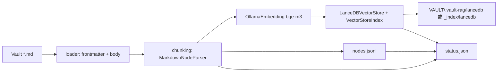
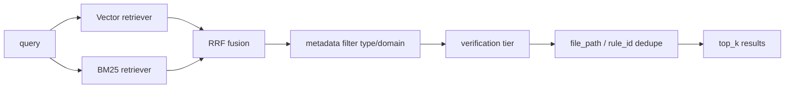

# vault-rag 架構說明

本文描述 **索引如何構建**、**查詢如何執行**、**MCP 與 Cursor 如何銜接**，以及目錄與產物意義。

---

## 1. 目標與邊界

| 項目 | 說明 |
|------|------|
| 輸入 | Obsidian Vault 下所有 `.md`，經 **路徑排除 + YAML 排除** 後才進索引。 |
| 輸出 | 可供 **語義 + 關鍵字** 混合檢索的索引；透過 **MCP** 暴露給 Cursor。 |
| 嵌入 | 本機 **Ollama**，預設模型 **`bge-m3`**。 |
| 向量庫 | **LanceDB**（本機目錄，嵌入式）。 |
| 稀疏檢索 | **BM25**（LlamaIndex `BM25Retriever`，資料來自與向量相同的 chunk）。 |
| 不做的事 | 不在本服務內用 LLM **生成長篇答案**；生成與寫碼由 Cursor Agent 負責，本專案負責 **召回**。 |

---

## 2. 目錄結構

### 2.1 工具專案（本倉 `vault-rag/`）

```text
vault-rag/
  pyproject.toml
  mcp_server.py
  .env.example
  templates/dot-ragignore.example   # 複製到 Vault 根為 .ragignore
  vault_rag/
    settings.py           # VAULT_ROOT、INDEX_IN_VAULT、排除規則等
    path_exclusions.py    # pathspec + 目錄名 + 子字串 + YAML 排除
    metadata_sanitize.py
    metadata_unify.py
    loader.py / chunking.py / index_build.py / nodes_store.py / fusion.py / service.py
    vault_audit.py        # audit 預檢
    mcp_app.py / cli.py
  docs/ …
  scripts/setup.ps1
  _generated/             # MCP 片段（gitignore）
```

### 2.2 索引產物（預設在知識庫內）

預設 **`VAULT_ROOT/.vault-rag/`**（與筆記同備份），包含：

```text
<VAULT_ROOT>/.vault-rag/
  lancedb/          # LanceDB 表檔
  nodes.jsonl
  status.json
  AUDIT-last.md     # 僅在執行 audit --write-report 時生成
```

若設定 **`INDEX_IN_VAULT=false`**，則改為 **`vault-rag/_index/`**（專案內，行為與舊版一致）。

---

## 3. 索引構建管線（`vault-rag reindex`）



### 3.1 載入與排除（`path_exclusions.py` + `loader.py`）

- 以 `VAULT_ROOT` 為根 **`rglob("*.md")`**。
- **內建 pathspec**（`builtin_exclude_pathspec`）：預設 `.obsidian/**`、`.git/**`、`.vault-rag/**`、`node_modules/**`。
- **`VAULT_ROOT/.ragignore`**（可選，`LOAD_RAGIGNORE_FILE=true`）：與 `.gitignore` 語法相同，合併進 pathspec。
- **`EXCLUDE_PATHSPEC_EXTRA`**：環境變數額外規則（`|` 或逗號分隔）。
- **目錄名** `merged_exclude_dir_names()`：內建 **`.obsidian`、`.git`、`.vault-rag`、`node_modules`、`_index`**，並與 **`EXCLUDE_DIR_NAMES_EXTRA`**（`|` 或逗號分隔的**單段路徑名**）合併；任一路徑段不分大小寫命中即跳過。
- **子字串** `EXCLUDE_GLOBS`：對相對路徑不分大小寫子字串匹配（舊版簡單排除，仍保留）。
- **YAML 單檔排除**：frontmatter 含 **`rag_index: false`** 或 **`vault_rag_exclude: true`** 則整檔不進索引。
- 使用 **python-frontmatter**：YAML 進 `metadata`，正文進 `Document.text`；並寫入 `file_path`、`file_name`。
- **`metadata_sanitize.py`**：將 frontmatter 值 **一律轉為字串**（list/dict 則 `json.dumps`），避免 Lance/Arrow 欄位型別衝突。

### 3.1b 欄位聯集（`metadata_unify.py`）

- 不同筆記的 YAML 欄位不完全相同；LanceDB 首寫入會鎖定 schema。
- **`unify_node_metadata_keys`**：先收集所有出現過的 metadata 鍵，再為每個 chunk **補齊缺鍵**（空字串），最後再經 sanitize，確保每列欄位一致。

### 3.2 分塊（`chunking.py`）

- **LlamaIndex `MarkdownNodeParser`**：依 Markdown 標題結構切分為多個 **`TextNode`**。
- **`chunk_id`**：`sha256(file_path + "\n" + chunk_text)` 十六進位全長，作為穩定主鍵（同內容重建索引 id 不變）。
- 每個 node 帶上一步的 **metadata**（含 frontmatter 欄位），供過濾與展示。

### 3.3 向量索引（`index_build.py`）

- **`OllamaEmbedding`**：`base_url` + `model_name`（預設 `bge-m3`）。
- **`LanceDBVectorStore`**：`uri = INDEX_DIR/lancedb`，`table_name` 預設 `vault_chunks`。
- **`VectorStoreIndex(nodes, ...)`**：批次嵌入並寫入 Lance；`insert_batch_size=64` 降低單次請求壓力。
- 建索引前會 **刪除** 既有 `lancedb` 目錄，確保全量重建乾淨。

### 3.4 稀疏檢索與全文取回（`nodes_store.py`）

- 建完向量後，將所有 **`TextNode`** 序列化為 **`nodes.jsonl`**（每行 JSON：`id`、`text`、`metadata`）。
- **BM25** 在查詢階段由 `BM25Retriever.from_defaults(nodes=...)` 使用同一批 node；**`vault_get_chunk`** 亦由記憶體中的 `chunk_id → node` 映射取全文。

### 3.5 狀態檔（`status.json`）

記錄：`indexed_at`、`vault_root`、`num_files`、`num_chunks`、`embedding_model`、`ollama_base_url`、`lance_uri`、`nodes_jsonl` 路徑等，供 **`vault_index_status`** 與排錯。

---

## 4. 查詢管線（MCP / `vault-rag search`）



### 4.1 載入（`service.py`）

- 讀 **`nodes.jsonl`** → 重建 **`TextNode`** 列表與 **`chunk_id` 映射**。
- 開啟 **LanceDB** → **`VectorStoreIndex.from_vector_store`** + 與建索引時相同的 **`OllamaEmbedding`**（查詢句也需嵌入）。
- 建立 **`BM25Retriever`** 與 **`index.as_retriever(similarity_top_k=...)`**。

### 4.2 混合與融合（`fusion.py` + `service.py`）

- 對同一 `query` 分別 **`retrieve`** 向量與 BM25（**BM25 結果列在融合時先於向量**，以符合常見 LlamaIndex 社群建議）。
- **`reciprocal_rank_fusion`**：對多份排序列表做 RRF 打分，合併為單一排序。
- `note_type` 優先使用 `metadata["type"]`，缺失時由 `type/*` tag 或一級目錄推導。
- `domain` 支援 CSV、`|`、JSON/YAML 陣列的成員匹配；未分類筆記保持候選資格，已聲明且不匹配的 domain 才排除。
- 驗證狀態只決定 preferred / backfill，不再讓低相關的 `verified_true` 硬排在高相關的 `limited` 前面。
- `vault_search` 按 `file_path` 去重；`rule_search` 按 `rule_id` 去重。去重發生在 `top_k` 截斷之前。
- `rule_search` 根據 domain + query intent 注入穩定必選規則，並以 `match_reason=required_rule` 標識；其餘結果仍由混合檢索補充。

### 4.3 MCP 工具（`mcp_app.py`）

| 工具 | 作用 |
|------|------|
| `vault_search` | 混合檢索 + 過濾 + 可信度分層 + 筆記去重 + 摘要片段 `excerpt`。 |
| `rule_search` | `Rules/` 範圍混合檢索 + 必選規則注入 + `rule_id` 去重。 |
| `vault_get_chunk` | 依 `chunk_id` 返回完整 `text` 與 `metadata`。 |
| `vault_index_status` | 讀取 `status.json` 與基本就緒狀態。 |

---

## 5. 配置來源優先序

1. **環境變數**（含 Cursor `mcp.json` 的 `env` 區塊）。
2. **`vault-rag/.env`**（在 **`cwd` 為 `vault-rag`** 時由 pydantic-settings 載入）。
3. **`settings.py` 內建預設值**（例如預設 `VAULT_ROOT` 路徑）。

**建議**：Cursor MCP 的 `cwd` 固定為 `vault-rag`，並在 `env` 中寫明 `VAULT_ROOT`，避免工作目錄不同導致讀不到 `.env`。

---

## 6. 維運注意

- **更換嵌入模型**或 **Ollama 模型維度變更**：必須 **`reindex` 全量重建**。
- **筆記大量變更**：目前僅支援 **手動全量 `reindex`**；增量索引可作為後續迭代。
- **Ollama 必須在跑**：`reindex` 與每次 **`vault_search` 的向量支路**都會呼叫嵌入 API。
- **Windows 路徑含空格**：`mcp.json` 中 `command` 建議使用 **帶引號或可執行檔完整路徑**（見 `SETUP.md`）。

---

## 7. 依賴關係（高層）

| 依賴 | 用途 |
|------|------|
| llama-index-core | Document、Node、Index、Retriever 抽象 |
| llama-index-embeddings-ollama | Ollama 嵌入 |
| llama-index-vector-stores-lancedb | LanceDB 向量存儲 |
| llama-index-retrievers-bm25 | BM25 |
| lancedb / pandas | Lance 表與 DataFrame 互操作 |
| pydantic-settings | 設定載入 |
| python-frontmatter | YAML 分割 |
| typer / rich | CLI |
| mcp | FastMCP 服務 |

---

## 8. 與 Smart Connections MCP 的關係

本專案在 **Cursor 側**提供自建 **vault-rag** MCP，索引與檢索邏輯可控（混合檢索、metadata、本地 Ollama）。**不再需要** Node 版 **smart-connections-mcp** 即可在 Cursor 內搜庫；Obsidian 內是否仍安裝 Smart Connections **插件**與本 MCP 無強依賴。
