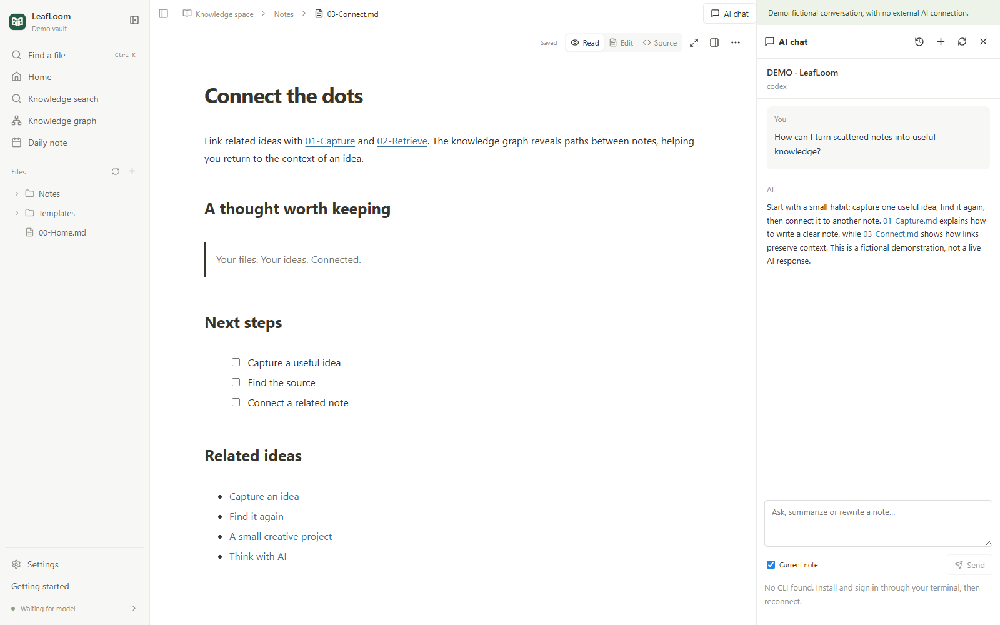

# Optional AI connections

[English](AI.md) · [中文](../zh-CN/AI.md) · [日本語](../ja/AI.md)

LeafLoom's browser, editor, graph and local retrieval do not require external AI. The optional assistant uses an already installed and signed-in Codex or Codely CLI. It does not ask you to enter API keys into LeafLoom.

## Browser assistant

Install your chosen CLI following its official instructions and sign in from a normal terminal. Open **AI chat**, choose the provider, and reconnect if necessary. Select text in a note, then choose **Add to AI chat**. Review the reference cards and the **Current note** checkbox before sending. The configured model service may receive your question, selected text, current note and retrieved evidence.

Chats are organized by topic and stored in the app's private configuration directory. **Stop** keeps received text. Refresh/restart reconnects to existing history without automatically resending a question. Keep the CLI's own native conversation records for restoration.

## Review edits before saving

Inspect the proposed difference. **Accept into draft** changes the editor, not the saved file. AI drafts and subsequent manual edits pause autosave until you choose **Save draft** or `Ctrl/⌘+S`. **Discard draft** restores the disk version after confirmation. Creating a proposed note requires confirmation and does not overwrite an existing file.

If the note, draft or saved version changed, regenerate or merge manually. LeafLoom preserves conflicting drafts rather than silently replacing the file.

## Connect another AI client through MCP

Open **Settings → AI connections → MCP access permissions**. Enable local AI reading and copy the generated connection configuration. Its dedicated credential is shown once. Use `http_headers.Authorization` in Codex, `headers.Authorization` in Cursor, and `type: http` plus `headers.Authorization` in Claude Code. Regenerating the credential or disabling all its resource scopes revokes it; keep configurations private.

Enable **Allow local AI to modify notes** separately for direct saves. For ChatGPT, use the existing Tunnel connection and its separate **read all notes** and **modify notes** switches. Permission changes automatically reconnect the Tunnel; refresh the tool list in your client. Writing is off by default for both connections.

Full access covers all connected Markdown, TXT and HTML/HTM notes, including archives and notes outside RAG. It supports finding, reading, creating, precise edits, properties, moves, recoverable deletion, history, links, templates and daily notes. RAG still uses only selected eligible Markdown/TXT. HTML is read and edited as source. Existing unauthenticated loopback and legacy bearer connections retain the original five read-only capabilities; the old `auth-token` does not unlock full access.

Every mutation checks the workspace revision; existing notes also require their read-time version. Moves and deletes first return an impact preview; history and Trash can be previewed and restored. MCP reads saved files, preserves conflicting editor drafts and reports pending indexing separately from successful saves. The browser assistant above keeps its proposal workflow.

**Settings → Skill → Install skill** installs `wiki-search` instructions and does not configure MCP. See the [complete tool contract](../MCP.md).

## Troubleshooting

If a CLI is missing, verify it works in your terminal and restart the service so it sees the current PATH. Renew expired login through the CLI. If conversation restoration fails, keep the local history and resolve the underlying CLI/session problem; do not delete your notes to repair a chat.

