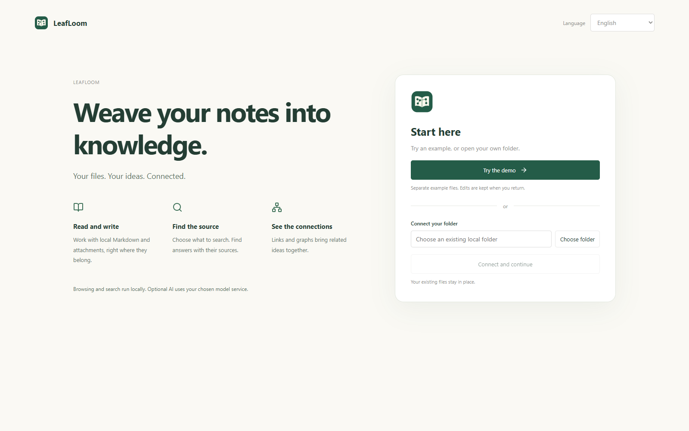
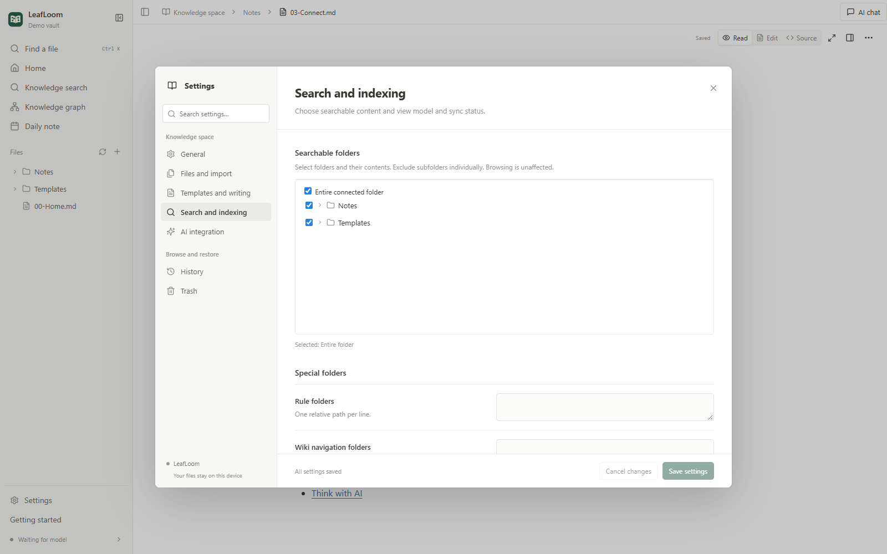
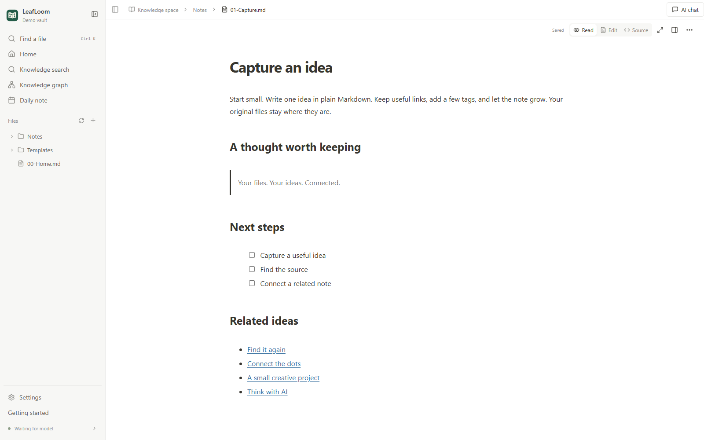
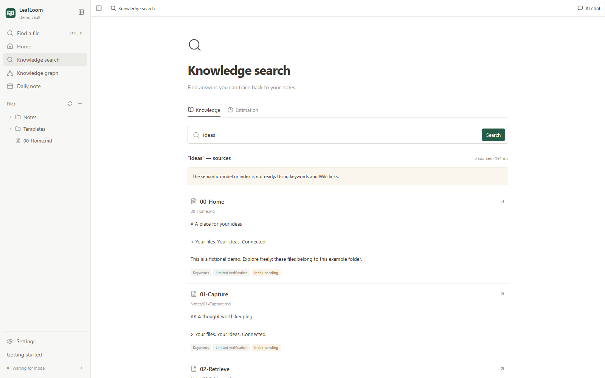
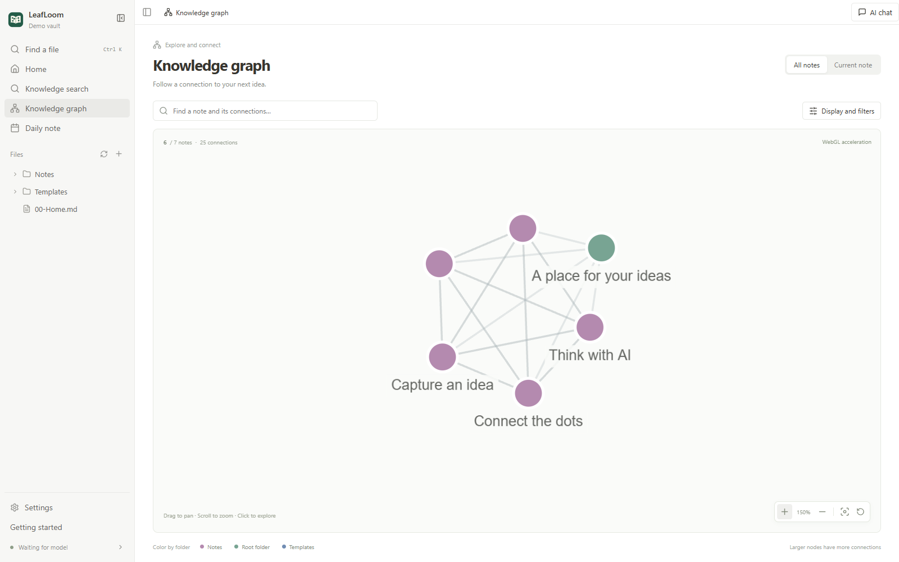

# Your first steps with LeafLoom

Use **Settings → Skill** to install or update the bundled `wiki-search` skill.

[English](GUIDE.md) · [中文](../zh-CN/GUIDE.md) · [日本語](../ja/GUIDE.md)

[All documentation](../README.md)

## Help center

Open **Help center** in the app sidebar or [visit the online help center](https://dj-huang.github.io/LeafLoom/docs/en/). Browse task topics or search full article text with `Ctrl/⌘+K`. Articles include steps, expected results, troubleshooting, contents and previous/next links. Language switching retains the task and its standard section. Examples can be copied and screenshots enlarged; topic browsing and articles also work without JavaScript. Help search covers public documentation only and never reads your vault.

## Install and open

**Developers:** In a source checkout, double-click `Dev.cmd` on Windows or `Dev.command` on macOS 14+ Apple Silicon; on Mac, `sh Dev.sh` also works in Terminal. Run `chmod +x Dev.command Dev.sh` once if a copied/downloaded checkout loses execute permissions. You can also run `node scripts/dev-desktop.cjs` on either platform. Requires Node 22+ and uv; the first launch installs dependencies. The desktop runs directly from source and frontend edits update automatically. Dev shares the installed app's settings, models, credentials and desktop data, including its configured backend port (18080 by default). Only development dependencies stay in `.cache/desktop-dev/.venv`; Vite uses port 5173. Quit the running app before switching modes. For isolated testing, explicitly set a disposable `VAULT_RAG_HOME`. After Python/Electron edits, use **LeafLoom → Restart LeafLoom** or the tray menu’s **Restart LeafLoom**. See [source development](../DESKTOP.md#source-development).

On macOS, launching through **Dev.command** or **Dev.sh** also shows the LeafLoom logo and name in the Dock. Use **Restart LeafLoom** to reload desktop source and branding changes.

**Optional browser development:** Follow [the two-terminal setup](../DESKTOP.md#optional-browser-development) to start Vite at `http://127.0.0.1:5173`, then run `uv run --locked python scripts/dev-browser.py --home /tmp/leafloom-browser-dev --port 36229 --loopback-ui`. Open the printed `http://localhost:36229/` in a dedicated browser profile. The required home must be new/empty or previously marked by this launcher; it pins the port and UI mode, so changes require a fresh home and profile. Omitting `--loopback-ui` keeps the normal `app.<installation-id>.localhost` UI. The real runtime and background workers remain active, without automatic model downloads or external AI calls. Separate HTML-project origins may still fail in affected managed browsers; do not bypass security warnings. This is browser development, not Linux desktop installer support.

Previous Dev settings remain in `.cache/desktop-dev/` for recovery and do not override installed settings. If the shared data directory has no `models/` directory, Dev copies the previous model files while keeping the originals; existing model directories are preserved.

The old repository launchers have been removed. Manage installed apps through their own shortcuts and menus. During development, use Dev and quit through its own tray/menu-bar menu or Ctrl+C.
The [LeafLoom website](https://dj-huang.github.io/LeafLoom/) offers English, Chinese and Japanese pages with screenshots and direct downloads of the latest available stable installer for each platform. Choose Windows or Mac explicitly; release notes and SHA-256 files are linked beside the installers. When a new Release has no installer for a platform, its download keeps the latest available stable version, with that version’s release notes and checksum. A platform is unavailable only if no stable Release provides its installer.

The website’s About page links to the creator’s GitHub and X profiles; open it from the top navigation or footer. Language switching keeps you on About.

Supported: Windows 10/11 x64 and macOS 14+ on Apple Silicon. Linux, Intel Mac and Windows ARM are not supported by the desktop installer.

**Recommended: download the desktop installer from the [latest Release](https://github.com/DJ-Huang/LeafLoom/releases/latest).** You do not need to clone the repository or install Python, Node or Ollama.

1. **Windows:** Download the Windows x64 `.exe`, run the installer, then open LeafLoom from Start or the desktop shortcut.
2. **Mac:** Download the macOS Apple Silicon `.dmg`, open it, drag LeafLoom to Applications, then launch it.
3. Choose a language and try the included demo or connect your own folder. Reading, editing, graphs and keyword search work without downloading the semantic-search model. Prepare BGE-M3 in search settings when needed.

Closing the window keeps LeafLoom in the tray/menu bar; use **Quit** to stop the application and its local service. **LeafLoom → Restart LeafLoom** and the tray’s **Restart LeafLoom** close and reopen the app with the same settings and data directory. Restart prepares note drafts and waits for the local service to stop; an unsaved-content prompt lets you return and cancel. Dev keeps Vite running and synchronizes locked Python dependencies before opening the current source again. When first updating from a version without this menu, quit and launch Dev manually once. Login startup is off for new installations and can be changed in desktop settings or the tray. To update, open **Settings → General → App updates → Check for updates**. The current and latest versions are shown. Choose **Download and install** to see the percentage and downloaded/total size. After SHA-256 verification, LeafLoom quits normally (including unsaved-draft prompts) and opens the Windows installer or Mac DMG. Complete the installer; on Mac, drag the new app to Applications. Reopen LeafLoom afterward. A canceled quit leaves **Continue installation** available. Failed requests/downloads can be retried. Dev only checks versions; update the source and restart Dev.

The service binds to `127.0.0.1`, normally on port `18080`. See [desktop installation details](../DESKTOP.md) for requirements and validation limits. Developers can use the [source installation instructions](../../README.md#get-started).

For maintainers, pushing a matching `vX.Y.Z` version tag automatically builds both
installers on GitHub and prepares a Release draft with `SHA256SUMS.txt`. Review the
Actions results and draft, then publish manually. Failed builds can be rerun;
published Releases are protected from replacement. Manual **Run workflow** builds
only provide Actions downloads. Current tag builds have no trusted publisher
signature (Mac uses ad-hoc signing without notarization), so system warnings or
blocks remain possible. See [build, retry and release instructions](../DESKTOP.md#automatic-release-drafts).

## Choose a language and folder

The welcome page follows your system language, with English as fallback. Select 中文, English or 日本語 to save a preference. Change it later in **Settings → General → Language**. Changing language keeps your open document, draft and position; it does not rebuild search indexes.

Choose **Try the demo** to explore fictional notes in a separate folder. You may edit them; returning preserves edits. Each language has its own demo. Choose **Connect your folder** to use an existing Markdown/Obsidian folder instead. LeafLoom keeps original files in place; it is a file editor, so edits you save change those files.



## Select what to search

You can browse the entire connected folder. Knowledge search only uses the folders you explicitly select. Choose the whole folder or specific subfolders; exclude a child folder independently. Nothing is selected automatically. **Browse for now** leaves the knowledge corpus empty.

Only `.md` and `.txt` are indexed. Images, videos and other attachments remain browsable but are not transcribed. Hidden/application folders, `.ragignore` exclusions and opted-out notes remain excluded. Special rule, topic-navigation and estimation folders are advanced settings; ordinary notes do not need them.



## Read, write, find and connect

1. Open a Markdown note from the sidebar and edit directly on the formatted page. **View source** opens its Markdown text. Ordinary edits autosave; save conflicts keep your draft so you can review and merge.
2. Use **New note** to write an idea. Add `[[other note]]` to connect it to another note.
3. Use `Ctrl/⌘+K` to find a file by name. Use **Knowledge search** for questions and keywords in your notes.
4. Open a search result to read the original evidence. Check its context and verification status before relying on it.
5. Explore **Knowledge graph**. Search a note, filter folders, and follow nearby connections. A backlink needs another note that links to this one.
6. The home checklist is optional. Mark steps complete, hide it, or reopen it with **Getting started** in the sidebar.





## Write with commands

Type `/` at the start of a line or after a space to insert headings, lists, tasks, quotes, tables, code, images, links, equations or Mermaid diagrams. The menu includes icons, descriptions, categories and recently used items. Search by name or aliases such as `/h2` and `/todo`; use the arrow keys and Enter, or Esc to keep the literal text. Code, formulas, properties and URLs do not open the menu.

Select text for the formatting toolbar. `Ctrl/⌘+B`, `Ctrl/⌘+I` and `Ctrl/⌘+E` toggle bold, italic and inline code. Paste a URL over selected text to make a link, or use `Ctrl/⌘+Shift+K` to enter one. Type `[[` and a note name to choose a note by its full path.

Hover beside a block to insert with **+**, or use its handle to convert, duplicate, move or delete it. Drag the handle to reorder paragraphs, list items or whole blocks. Select text across paragraphs and type directly in table cells. Tab moves between cells and adds a row from the last cell; the table toolbar manages rows, columns, the header and alignment. Paste screenshots or drop files into the editor: attachments go in the vault's central `_attachments` folder (or configured `attachment_folder`) with unique names. Uploading does not replace existing files; undoing the inserted link keeps the uploaded file. Failed or cancelled uploads may leave completed files in that folder.

Files remain ordinary Markdown; unchanged blocks and document properties retain their original source. The page and source views share undo history. Equations and Mermaid stay rendered and have dedicated editing panels. Complex or unsupported content is preserved for display and can be located in source. Changing the interface language keeps the editor and its history. Tables use simple Markdown structures, without merged cells or nested blocks inside cells.

## Text highlights and comments

In a Markdown document, select text to reveal five **highlight** colors and **Add comment** in the floating formatting bar. Choose a color to mark a passage. To restore plain text, select highlighted text and choose **Clear highlight** (the slashed circle before the colors), also available in the context menu. Only the selected highlight is removed; outside portions and comments remain. One clear action is one undo/redo step. Click comment (or press `Ctrl/⌘+Shift+M`) to begin a thread. Use the toolbar's **Comments** button to see the right panel, add a **Page comment** without selecting text, reply to threads, edit your messages, resolve/reopen, filter or delete.

Click a quoted snippet to jump to the original passage. Comments try to follow moved text using the quote and its context; deleted or ambiguous quotes are flagged **Text no longer found**, so you can select a new range and **Relink to selected text**. The same decorations appear in Markdown source mode without modifying Markdown syntax. Highlights and comments share the page/source undo history: use the toolbar buttons or `Ctrl/⌘+Z` to undo and `Ctrl/⌘+Shift+Z` (or `Ctrl+Y`) to redo. Creation, deletion (including replies), message edits, resolve/reopen and relinking can be reversed in order with text edits during the current session. Comment input fields keep their own text undo. If another window or MCP changed a thread, undo/redo stops without overwriting it. Normal unsaved edits must save first; AI manual drafts must be saved explicitly.

Highlights and comments are **user data**, not a disposable index: back up `.vault-rag/annotations.sqlite` alongside your notes. When moved or restored through LeafLoom, note comments retain their identity. The first iteration supports annotated Markdown (the API also supports plain TXT); HTML projects and Design Studio are not yet covered. See [annotation architecture](../ANNOTATIONS.md).

## Open HTML projects, websites and Design Studio

1. Open a local `.html` or `.htm` file from the directory. Confirm its **Project folder** and choose **Save and open**. Select a folder containing the entry and all companion resources; the website's `/` maps to this folder. An empty folder value uses the connected knowledge folder's root.
2. Use **Project settings** to change the folder or enable **SPA routing** for a client-side application. This opens the project entry for missing page routes; missing scripts, images and JSON still return errors.
3. Use back, forward, refresh, full screen or **Open in new tab** in the website toolbar. In the desktop app, the same website runs inside its window. Browser and desktop website storage are independent.
4. To open an existing website or development server, choose **Preview → Open website** and enter its HTTP/HTTPS URL. LeafLoom does not install dependencies or start a backend. A site may refuse embedding or require sign-in.
5. Open **Design Studio** from the sidebar or a folder's **New design project here** menu. New projects use a managed visual document; existing `1.1.0` projects keep their layer-review tools and can be converted into a separate editable copy. Choose mobile portrait `720×1560`, mobile landscape `1560×720`, desktop `1440×900` or custom page dimensions.

**Source** opens the HTML text. Ordinary edits autosave; if an unsaved draft remains, the website view previews it in a temporary origin without saving it. Companion resources still come from disk. HTML remains browsable independently of the selected search folders and is not indexed for knowledge search.

On macOS 14/15 Safari, use **Settings → General → Safari local website compatibility** if local websites do not open. macOS requests administrator authorization for this installation's resolver configuration. See [HTML project details](../HTML_PROJECTS.md) for removal and platform limits.

When an older loopback address opens the new workspace address, local drafts and view state migrate automatically. Existing destination values win; a conflict banner offers a backup download. Original browser storage is retained. This migration does not synchronize browsers or the desktop app.

## Build game screens in Design Studio

- The project home offers search, recent/favorite projects, rename, copy, move, archive and a recoverable recycle bin. Workspace undo/redo covers project management; project history covers design edits across pages and restarts.
- Use **Pages** to add, group, reorder or duplicate screens. Insert text, images, containers, buttons, shapes, SVG, custom HTML, embedded pages, or game starters such as a HUD, character card, gallery and dialog. Select layers, Shift-select several, then use the canvas and inspector for position, size, rotation, text, appearance and row/column/grid layout. Child pages and component instances retain separate identities.
- Upload or paste artwork in **Assets**. Inspect dimensions/transparency, set names/categories/tags, locate uses and replace one image or all references. Publish components and assets to the personal shared library; import a newer version explicitly. Dependencies are copied into the project for offline use. A referenced asset cannot be removed until its uses are replaced or deleted.
- The **Animation** inspector offers fade, slide, scale, bounce, breathe and spin. In **Scripts and source**, attach `mount(ctx)` JavaScript to an element or page and expose parameters as inspector controls. Scripts pause during editing. Preview a component or the whole screen, then stop to restore the design state; logs identify the affected element. Source changes and parameters share the same undo history.
- **Send to AI** includes stable element IDs and the current revision. Managed design edits apply directly and one AI batch is one undo step. `Ctrl/⌘+Z` undoes and `Ctrl/⌘+Shift+Z` redoes, including after closing and reopening. Save conflicts retain pending changes; inspect them before choosing reload/reapply. Export after pending saves finish, unzip the result and open `index.html` with its companion files.

- HTML conversion retains document-root context, native mixed text and responsive image candidates. Unreadable external stylesheets are omitted with a warning; original source remains intact. Viewport/rem units and media queries still use the renderer environment. Native text runs expose content editing; select their parent for layout and typography. Compare the converted page with its original before relying on it.

- Navigate the canvas with **Select** (`V`) and **Hand** (`H`), or hold Space while dragging. Use the zoom percentage, +/−, fit page (`Shift+1`) and fit selection (`Shift+2`); Ctrl/⌘+wheel zooms around the pointer. Camera position stays steady while editing. Expand/collapse containers in **Layers**, use the selected-layer breadcrumb to reach ancestors, and edit grouped **Layout**, **Appearance** and **Typography** properties. If the isolated canvas cannot connect, use its retry action; the management shell can still show saved layers and properties.
- **Convert a copy** preserves the original project and imports authored DOM/CSS, text and assets, adapting recognized navigation, settings switches and context-dependent page states. Original scripts remain in the copied source; other legacy event handlers and runtime state need new scripts. Review conversion notices and compare the copy with the original before replacing a workflow. See the [workflow and script API](../DESIGN_STUDIO.md) for commands, import limits and performance acceptance targets.

To sync a design between computers, close LeafLoom on the sending computer, sync the entire project folder (including assets) and its `.vault-rag/design-studio` history, and wait for sync to finish before opening it on the receiving computer. Keep the same project path within the vault; the vault root may differ between Windows and Mac. Use the fixed version on both computers and edit on only one at a time. Opening does not rewrite history ownership, while duplicate project IDs in different folders and external content conflicts remain blocked. Use the project home’s **Copy** action for an independent copy.

The design project **Recycle bin** supports restore, **Delete project permanently** and **Empty project recycle bin**. Permanent actions list affected projects and require confirmation; their files, design histories and related management undo records are removed. Other projects and shared libraries are retained.

If project home reports that the service has not loaded project management, quit the app from the tray/menu bar and reopen it. Refreshing the page does not reload backend interfaces. Delete, move and related actions remain disabled until management loads; use **Retry** to reconnect.

## Recovery and everyday use

External file changes are watched. **Refresh data** refreshes views; browser reload does not upgrade the background service. Switch folders in Settings. Delete sends content to Trash; use **Settings → Trash** to restore it. **History** keeps saved versions and file operations. Emptying Trash permanently cannot be undone.

Files and local history are not a cloud backup. Back up your folder using your preferred tool. LeafLoom does not supply cloud sync or universal Obsidian plugin compatibility.

## Optional AI

See [AI connections](AI.md). Browsing and local retrieval work without an AI subscription or CLI. A configured external AI service may receive selected content. AI note suggestions enter a reviewable draft and require manual saving; managed design edits apply directly and can be undone in project history.

## Optional Feishu / Lark connection

1. Install, configure and log in to [official lark-cli](https://github.com/larksuite/cli) separately. Its credentials stay with the CLI.
2. Open **Settings → AI connections → Feishu / Lark**, enable integration, optionally enter a native executable path and CLI profile, then save and select **Verify connection**. A blank path uses automatic detection.
3. In **MCP access permissions**, enable Feishu reading and, if wanted, writing separately for local AI clients and Tunnel. Copy the dedicated local connection configuration when first enabled; refresh the client's tools after a backend update.

4. Ask your AI client to inspect the installed CLI help and embedded Skill, then use the generic read/write tools for documents, Base and other business commands. Block edits support XML headings and rich structure. Document updates need the revision returned by reading. A verified account does not guarantee access to every resource.
5. High-risk commands and raw API calls require the separate local/Tunnel **high-risk** switch (off by default), plus explicit confirmation of each operation. Turning off read or write also turns off high-risk access.
6. Transfer attachments with temporary file IDs and chunked upload/download. Importing an existing connected file additionally needs note-read permission. After upgrading, refresh the client tool list: the four previous document/Base tools are replaced by CLI discovery, read/write execution and file transfer.

Tunnel conversations share the permissions configured for that Tunnel connection. LeafLoom authenticates its runtime separately from a conversation's connector bearer; changing chats does not require a permission refresh or reconnect. Disabling a resource still revokes access immediately.

Dev and the installed app use the same saved Tunnel configuration and application lifecycle: connect on startup when enabled, stop on Quit. Dev reuses the registered installation's runtime when available. One shared-directory owner is allowed; do not also run a standalone tunnel-client for the same connection. MCP authorization errors identify `leafloom_mcp`; they do not require Feishu reauthorization. For Base tables, use an ID returned by the table list, rather than an unverified URL query value.

Connection status distinguishes missing/incompatible CLI, missing configuration/login, expired login and network problems. Complete setup or reauthorization externally, then verify again. Cloud operations need network access and return requested content to the calling AI. They do not automatically import or index it in your local knowledge base. See [capabilities and limits](../FEISHU.md).

## Frequently asked questions

**Why are there no search results?** Check the selected folders, file extensions and exclusions. Check indexing in Settings. If the semantic model/index is not ready, the app reports a keyword/Wiki fallback. Do not treat that as completed semantic indexing.

**Do I need to download a model before starting?** No. The desktop package includes its private runtime; reading, editing, graphs and keyword search work without BGE-M3. Download the model from search settings only when you want semantic retrieval. Source installations prepare their dependencies separately.

Model preparation shows the current connection, download and verification stages in Settings → Search & index and in setup. Downloaded file counts, received bytes, speed and elapsed time update in place. After 30 seconds without progress, a waiting hint appears; failures retain details and a retry button. Close Settings to keep reading while preparation continues; quitting the app interrupts it. Retrying reuses available downloads. Once the files are ready, indexing has its own progress.

The model section also shows the actual storage path. Select **Open folder** to view it in your system file manager; if it does not exist yet, an empty folder is created without downloading the model.

**Where is my data?** Notes remain in the connected folder. Indexes, history and Trash are in its `.vault-rag/`. Private configuration, models, tokens and AI history are in `%LOCALAPPDATA%\VaultRag` on Windows or `~/Library/Application Support/VaultRag` on macOS. `VAULT_RAG_HOME` can override the private location.

**Does it work offline?** The installed desktop app supports local reading, editing, graphs and keyword search offline. Semantic retrieval also needs the local model prepared first. External AI depends on the chosen provider's network requirements.

**The page is blank or changes do not appear.** Complete the frontend build/install, restart the service, then reload the page. Check the service logs and port conflicts. Restarting a browser alone does not load new server code.

**Can I use a network folder?** The desktop app expects a local folder. UNC shares and symbolic-link/junction access are rejected to keep file operations inside the connected folder.

**How do I uninstall?** Quit LeafLoom, then uninstall it through Windows Settings or remove it from Applications on Mac. Notes, configuration, indexes and models are retained. For a legacy source-installed service, use `vault-rag service uninstall` from that environment. Remove retained data separately only when you no longer need it.

## Full note and design access from AI clients

The same workspace read/write grants now include attachments. After restarting the updated backend, refresh the tool list in the AI client you use; refresh the LeafLoom ChatGPT plugin only if you use that connection. `vault_files` searches metadata, returns file versions and Markdown links, reads original bytes, prepares ZIP downloads and checks tasks. `vault_files_update` uploads chat files or local byte chunks and prepares move/rename, trash or organization plans. Read the plan, then explicitly execute, resume or undo it with its current revision; later edits are never overwritten. Uploads go to the configured attachment folder, preserve duplicate names and do not edit a note automatically. Chat file uploads run in the background; inspect task results before retrying failed files. See the [file tool contract](../MCP.md#general-file-tools).

In **Settings → AI connections**, enable full MCP reading for your local AI client or ChatGPT. Enable each connection's write switch separately to allow direct saves with history and recoverable deletion. Clients can edit connected Markdown/TXT/HTML and designs. Managed projects use `design_document`, `design_operations`, `design_history`, asset import, shared-library and export tools; the six legacy design tools remain available. RAG still uses only selected folders. Older connections retain their original five read-only capabilities. See [AI setup](AI.md), the [tool contract](../MCP.md) and [Design Studio](../DESIGN_STUDIO.md).

Dev and the installed app use the same MCP address and access settings (normally `http://127.0.0.1:18080/mcp`). After upgrading the server or changing its dedicated credential, reload the connection in the client you use. If you use ChatGPT, refresh its plugin tools too. A cached session can still report legacy access even when a fresh connection has full access; check `vault_index_status.capabilities` as well as the tool list.

## Attachment manager

### Server originals and device catalogs

Select the server under **Settings → Files & imports → Attachment storage → Save new attachments to** to use server mode. The attachment workspace opens the saved server catalog directly, without local initialization or an organization plan. Scan the server when its catalog is new or needs updating; existing server originals are not re-uploaded. Local-only installations can choose **Prepare local catalog**; organizing files remains a separate, explicit task.

Attachment SQLite databases, server settings, cached bytes, unsent uploads, group state and product metadata projections now live in the application's private data directory, under `attachment-workspaces/<workspace-key>/`. Asset paths are relative; the workspace key binds device state to this machine's linked folder. Do not synchronize application data or live SQLite files with Resilio or another folder-sync tool. A one-time upgrade takes consistent snapshots from the old `.vault-rag` state and preserves the old files; pause the old application and folder sync during upgrade. Historical local organization backups stay in `.vault-rag/attachment-migrations/`; temporary migration release claims stay beside the vault for same-filesystem recovery. Neither is automatically deleted.

New uploads and server migrations save immutable relative-path references under the server metadata directory's `attachments/v1/`, verify the records by reading them back, and only then complete or release originals. For attachments migrated by an older build, choose **Sync legacy references** once on the computer holding the old mappings. On another computer, configure the same server root and metadata directory, enter its credentials locally, then scan: old paths, original canonical paths and public asset IDs are restored even with a different local folder or storage profile ID. Conflicting aliases are reported rather than guessed. Scanning fetches directory/reference metadata, not attachment bodies. Do not delete the metadata directory or a device's unsent upload queue.

The local catalog is an offline query cache, not a second set of originals. Preview/download fetches bytes on demand; clearing the cache does not delete server files. Offline access is limited to already cached bytes, and pending uploads remain local until verified on the server. HTML/source projects and their protected dependencies remain in place. Old links are resolved inside LeafLoom; other editors need their own server URL/authentication support. Local historical backups and originals not yet migrated are retained; selecting server mode does not silently delete them.

### Server attachments, local cache and migration

This feature requires a build containing server attachment support; the original v0.1.4 installers do not include it.

Open **Settings → Files & import → Attachment storage** to add a generic WebDAV server. Each profile has a name, service URL, server root, upload subdirectory and separate username. Do not include a password in the URL. **Save attachment settings**, then **Test connection** and **Scan server attachments**; opening Settings does not scan the NAS automatically. Background scanning saves directory metadata in batches without reading attachment contents; discovered records remain after interruptions or failures. The new-attachment destination affects future uploads only, and the local workspace remains available. Server permissions control writable directories; read-only assets cannot be renamed, moved or recycled in LeafLoom.

After deleting, moving or adding originals on the NAS, choose **Refresh server directory** in Attachments. A specific-server source refreshes only that server. For all/server sources, choose one server when several are configured; a single enabled server can refresh directly. It does not refresh every server automatically. This synchronizes directory metadata without reading attachment contents, and reports progress and results. Only a complete successful scan hides missing files from the list and size totals. Asset IDs, tags and old-reference records remain; opening an old reference reports a missing original. Interrupted or failed scans retain existing records. **Refresh indexed list** only reloads the local index and does not discover NAS deletions.

The server root and each subdirectory may contain a visible `leafloom.ignore`. It supports Gitignore-style paths, globs, `#` comments and `!` reinclusion; child-directory rules can override ancestor rules. Scanning always visits subdirectories to read their rules rather than applying Git's excluded-parent directory pruning, so child rules can reinclude files excluded by an ancestor. The defaults exclude `.md`, `.markdown`, `.base`, `.html`, `.htm` and script/source-code files; `!` can also override these defaults. `.txt`, `.json`, binary and design resources remain included. Edit rules through the NAS file manager: LeafLoom reads them without requiring Dufs write permission. Refresh the server directory after changes. Only a complete successful scan hides excluded entries from attachment lists, metadata searches and size totals. Exclusion does not delete NAS originals or mark them missing: existing asset IDs, tags, old references and cache remain, and old IDs/references can still read the original. Rule read/parse failures do not partially hide existing records under the new rules; correct them and refresh again.

Save the file as UTF-8 (an optional BOM and CRLF are accepted). Its first line must be exactly `# leafloom-ignore v1`, with no blank line before it; an absent or invalid header stops the refresh instead of treating an authentication/error page as rules. Each file is limited to 64 KiB, 2,048 lines and 2,048 characters per line. Copy this template to the root or a subdirectory and adapt its rules:

```text
# leafloom-ignore v1
# Exclude temporary files under this directory
*.tmp
# Reinclude this Markdown file as an attachment
!reference.md
```

The desktop app stores passwords with system encryption and restores them to backend memory in the background; workspace configuration contains no passwords. Where supported, system encryption uses asynchronous APIs so the workspace opens without waiting for key-store recovery. If the system key store is temporarily locked or the local service has not received credentials, recovery retries are limited to delays of 1, 3, 10 and 30 seconds. Unlocking, waking the computer or choosing **Settings → Files & import → Attachment storage → Attachment credential recovery → Retry credential recovery** starts a fresh retry cycle. This section reports key-store, credential-file and local-sync status. **Synced to the local service** means credentials reached backend memory; check the server connection separately. A damaged credential file is retained rather than replaced with empty credentials. In the browser version, passwords live only in the current backend process's memory and must be entered again after its restart.

NAS network failures and 502/503/504 responses use retry backoff of about 2, 4, 8, 16, 32 and 60 seconds, capped at 60 seconds, while retaining directory records and pending uploads. Healthy connections probe only their configured URL about every 60 seconds, without recursively scanning the NAS or reading attachment contents. A 401/403 response pauses automatic attempts with that credential version until an explicit **Test connection**, task resume or credential update. Changing a password does not reauthorize old tasks: if the owner or credential revision changed, explicitly resume the task so its owner/revision checks can run again.

An official-client bridge uses the verified local forwarded URL you provide. Keep the official client and its attachment window open. After closing that window or restarting the client, reopen the attachment window manually; LeafLoom cannot rebuild the official session or discover a new port. Recovery at the same URL can be detected automatically; update the URL manually if the port changes. Complete any verification in the official client, then resume according to the task state.

For reliable use on the same LAN, connect directly to the attachment service on the NAS (including its service port) and select **Direct WebDAV**. This removes the dependency on the official-client window. Reserve the NAS IP in the router or use a stable HTTPS hostname; a LAN address is only reachable on that network or through an appropriately configured VPN. Keep the existing source profile, server root and credentials when changing only the connection route; test the connection and open an attachment before refreshing the catalog.

For access from outside the LAN, join the NAS and the computer running LeafLoom to the same private VPN. Numeric shared-network IPv4 addresses in `100.64.0.0/10` (including Tailscale) are supported for HTTP alongside local/private addresses; public HTTP addresses still require HTTPS. Keep the VPN connected and retain the existing attachment profile and credentials when changing its URL. If Clash is also active, exclude the VPN address ranges from both its TUN routing and system proxy bypass list while retaining other entries. Verify an uncached attachment over a phone hotspot before relying on outside access.

The server holds originals; local files are fetched into an on-demand cache. Details show the original location and whether caching is absent, partial or complete. Edit tags, categories and descriptions for browsing and AI/MCP queries. The downloaded cache defaults to 2 GiB and can be resized or cleared in Settings. Complete cached files can be reused; uncached or partial files still require a server connection. Pending uploads have a separate space limit, defaulting to 10 GiB, and survive cache cleanup. Connection or authentication failures retain waiting tasks and pending files. Received and waiting for sync does not mean saved on the server; completion requires server storage and verification. Authentication pages or error HTML must not become attachment cache entries. AI/MCP shares these storage profiles, metadata and backend tasks under the existing separate workspace read/write grants, without receiving server passwords.

To move existing files, choose a server and **Preview local attachment migration**. By default this analyzes only the current local attachment directory, excluding project dependencies. Review counts, sizes, files and exclusions, then **Confirm and execute migration**. Each original is released locally only after upload, streaming readback SHA-256 verification, a durable old-path mapping and a fresh source-version check. This creates no permanent local originals archive. Existing note references keep resolving inside LeafLoom; compatibility with other Markdown editors is not promised. Interruptions retain pending files and progress. Configuring a server does not move existing originals without an explicit migration.

Server migration differs from the recoverable local organization workflow below. Existing history, recycle records and older organization archives are not deleted automatically and may still use disk space. Back up server originals independently; cache is not a backup. Remote attachments do not offer **Show in file manager**.

Open **Attachments** in the sidebar for a dedicated workspace (`?view=attachments`). Use **Attachment source** to select all sources, local attachments, server attachments or a specific server; pagination, totals, size and type counts follow that selection. All sources shows local and server original sizes separately; a single source shows only its originals, excluding local cache. The header shows the total file count, storage used and index status. Search file names and relative paths across the vault; filter by type, sort by name, modification time or size, and switch between thumbnails and a list. The default is thumbnails, most recently modified first. Each page contains up to 100 items. Selection applies only to the current page and clears when paging, searching, filtering or sorting.

Opening the local-only workspace checks status first. **Prepare local catalog** builds or upgrades filename metadata without preparing an organization plan, moving files or rewriting links. Use **Organize attachments** separately when you want a reviewed file operation. Supported older indexes are backed up; unsupported versions are preserved. **Tasks** reconnects to saved tasks.

Select a file to preview it beside the results. Images support zoom, dragging, fit and full-size viewing; PDF opens inline, and audio/video uses the built-in player. Switching files or leaving the page stops playback. On narrow screens, return from the preview to the list without losing filters or scroll position. Other formats show metadata and an original-file download; desktop also offers **Show in file manager** for local attachments. HTML never executes in this page, and SVG is displayed as an image. Thumbnails are generated on demand with bounded decoding and cached locally; failed or unsupported thumbnails show format icons.

Use **Upload** or drop multiple files onto the page. Uploads use the configured local central folder (default `_attachments`) or the selected server upload directory; duplicate names keep both files, without overwriting. Upload progress and retry are in **Tasks**. Notes (`.md`, `.txt`, `.base`) belong in the editor or file browser. Select files for a ZIP download, a batch move or recycling; rename is available for one file. ZIP download preparation is asynchronous and the download expires after one hour.

Rename and move first prepare a plan, including supported static Markdown inline/reference links and wiki links/embeds. Review the discovered referring notes, paths and blockers, then confirm once to apply. Recycling a referenced attachment also shows the discovered notes and requires confirmation; it does not delete or rewrite note links. Restore the attachment when those links are needed again. “Discovered references” describes the analysis results, not proof that all references have been found. Office conversion, content/OCR search, deduplication and bulk naming templates are outside this version.

### Attachment groups, source metadata and downloads

Attachments opens **All attachments**, with no store-specific or format-specific tabs. Use **New group** to create your own tabs, rename them, move them left or right, or delete them. Groups are separate from attachment categories. A file may belong to several groups; deleting a group never deletes files or metadata.

Groups support manual membership and rules for source, directory, format, category and tags. Conditions are combined with AND; values within a condition use OR. Directories include descendants and format matching ignores case. Select files and choose **Groups** to include, exclude or reset overrides. Results are rule matches plus manual inclusions minus manual exclusions. Source, search, format and sort controls remain available.

Definitions and persistent member identities are saved in the vault. Configure **Settings → Files & import → Attachment storage → Attachment metadata storage** to replicate them to a separate `attachment-groups/events/` directory under the metadata directory (default `Incoming/LeafLoomCatalog/v1`), excluded from attachment scans. Offline changes survive restart. Server synchronization is acknowledged only after verified readback. Concurrent edits preserve both versions for explicit resolution in the group editor. Unavailable local files from another device retain their membership records without binding to same-named files.

Existing source descriptions and official covers appear on their linked attachments. Files remain individual entries, with no product grouping or automatically created category tabs. Personal fields remain separate: nonempty personal description/category take precedence, while personal tags and source keywords are searchable together. Source refresh never overwrites personal fields. Missing covers receive no generated substitutes. Existing catalog associations and legacy MCP interfaces remain compatible; source-specific collectors are optional adapters.

The sidebar **Downloads** page lists remote attachment downloads and local ZIP tasks. **Download attachment** streams a remote original into verified staging. **Ready to save** means staging is complete; select **Save to device** to save a copy. Tasks continue while navigating and records recover after restart. A single local file downloads directly without extra staging. Legacy ZIP jobs retain their one-hour expiry and must be restarted after interruption.

**Download settings** controls the separate **20 GiB** remote staging budget, independent of the **2 GiB** preview cache and upload queue, with at least **5 GiB** disk reserve. Controlled handles last 24 hours; prepare expired files again. Staging follows capacity and seven-day retention rules while protecting active transfers. **Clear staged file** removes only the local temporary copy. Strong validators enable the existing resume behavior; other transfers restart completely.

For AI/MCP, `vault_files` supports `groups`, `list` with `group_id`, source-enriched `stat`, `prepare_download` and `download_status`. `vault_files_update` uses `group_update` for group and membership edits with revision checks and write authorization. Read-only connections cannot edit groups. Legacy `products`, `product` and `product_update` remain compatible. Full attachments are delivered through Downloads rather than MCP Base64 chunks.

#### Batch collection script

Some official pages omit JSON-LD. Collection can still read the official structured product and publisher entities when their IDs agree; a title or preview image alone is insufficient.

With LeafLoom running and the catalog configured, run the repository's [collection script](../../scripts/collect_unity_catalog.py) against the same vault:

```sh
python3 scripts/collect_unity_catalog.py --root /path/to/vault --start --wait --interval 10 --report /path/to/collection-report.json
python3 scripts/collect_unity_catalog.py --root /path/to/vault --status --report /path/to/status-report.json
python3 scripts/collect_unity_catalog.py --root /path/to/vault --apply-chinese /path/to/chinese.json --report /path/to/chinese-report.json
```

The script controls the local backend; it does not automate a browser, use store-account cookies or download package originals. Collection resumes the backend's saved progress, preserving completed review-needed judgments after interruption while retrying blocked access and network failures. Background synchronization coalesces repeated scans and resumes pending uploads before checking the remote catalog when a verified checkpoint is available; first-time or explicit synchronization still checks the remote catalog first. Stopping the monitor with Ctrl-C does not cancel the backend task. `succeeded` counts obtained official facts, not completed Chinese summaries; check Chinese summaries and translation status separately. A reported `legacy_unresolved` count is unverified work from an older checkpoint without sufficient identity data, not a success count; reconcile complete progress with the package inventory. Chinese input updates only supplied official translation fields and preserves personal tags and notes. See the [input format and connection options](../MCP.md#batch-script).

### Organization and recovery

**Organize attachments** opens the task workspace. Review the destination (vault-relative, default `_attachments`), movable file count, size, affected notes and retained resources; create a new plan when needed. Preparing a plan writes only index and recovery metadata. Actual changes require one explicit confirmation, without a separate acknowledgement checkbox. A blocked plan leaves the ready index usable for browsing and downloading. Expand the reasons, resolve them and prepare a fresh plan. Large path, reference, result and blocker lists show at most 200 entries, with totals where applicable.

HTML/source projects, loose script folders, native authoring projects and their related shared resources stay in place. Literal file references, directory prefixes and configuration references expand protection transitively. These files remain browsable and downloadable, but cannot be renamed, moved or recycled here. Dynamic code within retained projects does not by itself block independent attachments. Unreadable dependency sources, ambiguous links, unsupported references and destination conflicts can still block a plan. Binary engineering resources are not parsed as text.

Before execution, the service checks file versions, access boundaries, destination collisions and free space again. Changes after analysis require rechecking. Pause external editors and sync before applying; conflicting writes through LeafLoom are blocked during execution, while reading and downloading remain available. Move/rename rewrites only supported note links. Organization copies files, updates links, retires originals into recovery storage and rebuilds the index. A final-index failure triggers restoration. Results report each file as pending, completed, failed or restored so partial failures can be reviewed.

**Request stop** stops at a safe boundary and is not undo. Leaving the page or switching vaults stops client waiting, not the server task; return to **Tasks** to reconnect. After a service restart, inspect saved work before confirming resume. **Restore / undo task** requires confirmation and refuses to overwrite subsequent edits or new files. Recycled attachments can also be restored from the recycle area in Settings; their note links are left untouched.

Recovery material stays in `.vault-rag/attachment-migrations/<job-id>/`: `manifest.json` records the task, `originals/` holds original assets and `notes/` holds note backups. Recycling uses recoverable records under `.vault-rag/trash/`. Do not edit or remove recovery folders while they may be needed. This workspace has no permanent-delete action. Preserve recovery data and resolve reported conflicts before retrying. Only a completed organization task changes the default upload folder; rename and move do not.

## Start from the FORMA template

Folder clicks only select and expand a parent folder; they never create a project. Review the selected parent path and the complete new-project path, enter a single new folder name, and choose a template before clicking **Create and open Design Studio**. Enter in a name field, Cancel, and closing the dialog do not create files. While creation is pending, fields and repeated creation are disabled. Existing project folders are opened from the project list, not recreated.

Open **Design projects → New design project**, choose **FORMA · Editorial Studio**, then enter a project name and a new folder. The preview shows its editorial layout. Creating it opens an independent, editable project with four desktop/mobile artboards and 328 native layers. Text, layout, colors, interactions and original CSS artwork can be edited and saved normally. All artwork is bundled; no external asset download is needed. Existing folders are rejected rather than overwritten: choose a different folder name. Each creation has its own project ID and history, so edits never change the built-in starter or other copies.

### Everyday visual editing

Drag on empty canvas space to select a region; Shift adds to the selection. Arrow keys nudge selected free-positioned layers by 1 px, or 10 px with Shift. Dragging shows nearby alignment guides; use the alignment and equal-gap controls for a precise arrangement across nested containers. Multi-selection resize acts on the selected group. Layout children are reordered within their parent instead of receiving free-position offsets.

The inspector groups relevant properties by object. Mixed values are shown as mixed, and editing a shared field applies to the selection. Choose Fixed, Hug content or Fill parent separately for width and height. Row/column layouts expose wrap, alignment, gap, per-side padding and minimum/maximum sizes. Fill requires a layout parent with available space; use a fixed outer width and hugging height for a text-heavy card. Test long copy and narrow widths before exporting.

Typography includes weight, line height and letter spacing. Appearance exposes stroke, shadow and gradients; image controls offer cover/contain plus crop-position sliders. Save named color, typography and spacing styles, apply them to several layers and update the linked definition. Local overrides stay explicit; detach a style when a layer should keep its own appearance. FORMA includes named brand styles and recognizable content layers for rebranding.

Component instances expose editable content, color, image and state properties for their source layers. Overrides remain local while unchanged properties inherit the master; Reset removes an override so inheritance resumes. Review the separate retained, converted and unsupported import notes. Arbitrary JavaScript listeners and live runtime state are not reconstructed. Save errors retain pending operations; retry the original operation for connection failures, or deliberately reapply against the newest revision after inspecting a conflict. Export only once the saved indicator is confirmed.


## Play with Motion Playground

Choose **Motion Playground** in **New design project**. The self-contained starter demonstrates two editable approaches: native **Animation** settings for staggered entrances, hover/focus feedback and click bounce; and **Script** modules for pointer tilt and click-driven state. Select the named example layer, adjust its Animation settings or open its readable `mount(ctx)` source and parameters, then use **Preview**. Editing mode pauses motion. The guide explains each example; a narrow artboard makes the touch layout easy to inspect.

There are no external dependencies or automatic endless effects. Preset motion honors the operating system’s reduced-motion preference, including changes during preview; hover examples also respond to keyboard focus and touch. Scripts provide click/touch alternatives and clean up through the runtime context and their returned cleanup function. Changes save with the project and run in the exported HTML ZIP. The picker illustration is static, not an animation recording.

## Switch between editing and preview

Choose **Preview** at the top of the workbench to play the current page’s animation, scripts and navigation without exporting a ZIP. The workbench commits active text input and waits for pending saves first. If saving fails, your changes remain queued and editing stays open with retry guidance, rather than showing stale content. Preview hides layers, properties, selection outlines and handles. Use **Preview page** to switch existing artboards, including desktop/mobile layouts included in a template, and **Replay** to restart the current page. **Edit** or **Back to editing** restores the page, selected layers and canvas position from before preview.

## Reuse content and publish page variants

In Design Studio, open the inspector's **Data** tab. Bind a text, button or image
to a stable key, create a language or general variant, and edit its values. Images
share existing asset IDs. Source changes mark older translations for review;
variant layout overrides adjust text boxes and page dimensions without replacing
the source. These edits use normal save, undo and conflict recovery.

Open **Batch publish**, select pages and variants, check the explicit dimensions,
and run the output check. Export PNG images in a ZIP or one multi-page PDF. The
current-canvas check locates overflow and font/resource risks. Prefer editing the
content or box; bounded text fitting only runs when explicitly clicked and obeys
a minimum font size and reduction limit. Glyph/fallback detection is not a full
font audit. Failed export items can be retried from the same saved snapshot.
Desktop uses its built-in renderer; web/headless hosting needs the optional
publishing dependencies. Interactive preview and the original HTML ZIP export
remain available. See [publishing details](../DESIGN_STUDIO.md#bound-content-variants-and-static-publishing).

Bindings and variants belong to their project. Shared-library component publication freezes source content and removes its project binding links; imported components can be bound to keys in the destination project.

### An editorial starter and a focused publishing workspace

Choose **ATELIER** when creating a project for a three-artboard lighting campaign with editable type, original sculptural artwork and complete English, Chinese and Japanese variants. Use **Data** to edit bound source copy or switch variants; retain the general-purpose blank, FORMA and Motion starters for other work.

The workbench separates editing tools from Export and Publish. Page reorder, duplicate and delete controls are grouped under **Page actions** in the page inspector. Batch publishing keeps its action bar visible while you choose pages, variants and format. Review the output summary, run the selected-output check, then publish. Completed items use compact expandable rows; failed items expand their diagnostics. Text fitting limits and shared check limitations remain available in disclosure sections. Static export checks do not replace visual review of fonts and layout. Use the canvas toolbar’s **Hide panels** control for more canvas space on a narrow window; **Show panels** restores the previous inspector and layer selection.

## Upload images and ordinary attachments over MCP

Use `vault_files_update` with `request.action="upload"` for knowledge-base attachments. ChatGPT should prefer `source="files"` with the host-provided top-level `files` array. Local clients can send one file up to 2 MiB with `source="base64"`, `name`, `data_base64`, and the original bytes' `sha256`; use begin/chunk/commit for larger files. Omit `folder` for the configured attachment directory, or specify a vault-relative directory such as `Comics/Project/assets`.

Read `workspace_revision` from `vault_index_status` and use a unique `operation_id`; keep the ID unchanged when retrying identical arguments. Upload results include the saved path, size, SHA-256, revision and `markdown_link`; images also return `markdown_embed`. Use `vault_files` stat with `source_note` to obtain a note-relative reference, then edit the note with its current revision. Existing files remain intact.

If only Design Studio import or Feishu temporary transfers appear, check the server's `tools/list`: it must include `vault_files` and `vault_files_update`. Restart an updated backend and refresh/rescan the client's plugin tool directory. Restarting LeafLoom alone does not refresh a cached client directory. Check workspace-write permission separately; these uploads do not require Feishu authorization. See [MCP file tools](../MCP.md#general-file-tools).

The single-request Base64 path requires a build containing this change.


### AI asset search and delivery

Before searching, enable **Use for AI asset search** in each desired attachment group. All groups start off; only the selected groups’ union enters keyword/semantic retrieval, and no selection returns `scope_not_configured` without a full-library fallback. This choice syncs to NAS with group metadata. Conflicted groups are excluded until explicitly resolved. Normal attachment browsing and note references remain available.

In **Downloads → Download settings**, set the **Asset delivery directory** and optionally enable semantic asset indexing with your prepared local model. AI can search existing local/NAS assets through `vault_files` actions `search_assets`, `asset_details` and `asset_preview`, then use `vault_files_update.deliver_asset` and poll `delivery_status`. Only completed deliveries return an absolute path on the identified service computer. Delivered files remain independently of cache cleanup; the calling AI handles project integration. Keyword search works without a model; package contents and visual similarity are not indexed.
