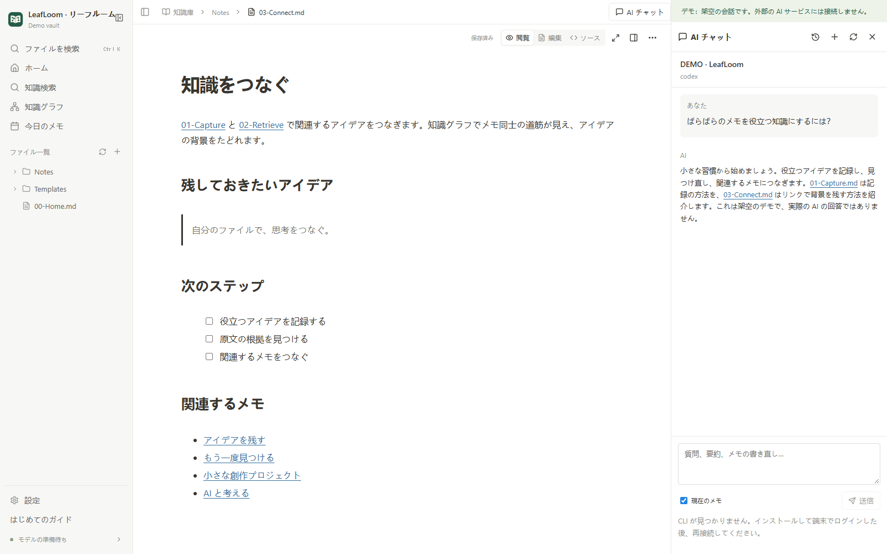

# 任意の AI 連携

[English](../en/AI.md) · [中文](../zh-CN/AI.md) · [日本語](AI.md)

閲覧、編集、グラフ、ローカル検索には外部 AI は不要です。アシスタントはインストール・ログイン済みの Codex または Codely CLI を利用します。LeafLoom に API キーを入力する必要はありません。

## ウェブのアシスタント

CLI の公式手順でインストールし、通常の端末でログインします。**AI チャット** を開いてサービスを選び、必要なら再接続してください。メモの文字を選び、**AI チャットに追加** を使えます。送信前に引用と **現在のメモ** を確認しましょう。設定したモデルサービスには、質問、選択した文章、現在のメモ、検索した根拠が送られることがあります。

会話はトピックごとに、アプリの非公開の設定フォルダーに保存します。**停止** は受信済みの回答を残します。再読み込み・再起動後も履歴を復元し、質問を自動では再送しません。CLI 自体の会話記録も保持してください。

## 変更を確認して保存

差分を確認し、**下書きに反映** を選びます。この時点ではファイルに保存しません。AI の下書きとその後の手動編集は自動保存を停止します。**下書きを保存** または `Ctrl/⌘+S` で書き込みます。**下書きを破棄** は確認後に保存済みの内容へ戻します。新しいメモの作成も確認が必要で、同名のファイルは上書きしません。

原文、下書き、保存済みの内容が変わった場合は再生成または手動で統合してください。競合した下書きは保持します。

## AI でデザインを調整

Design Studio で要素を選択し、**AI チャットに追加** でプロジェクト、ページ、安定した ID、現在のリビジョンを添付します。レイアウト、素材、コンポーネント、アニメーション、スクリプトの変更を依頼できます。内蔵アシスタントが変更できるのは、現在の会話に明示的に添付したプロジェクトだけです。一括変更は直接適用され、一度で元に戻せる永続履歴になります。バージョン競合では新しいデザインを保持し、スクリプトの再生状態は保存しません。スクリプト API と書き出しは [Design Studio](../DESIGN_STUDIO.md) を参照してください。

## MCP で他のクライアントを接続

**設定 → AI 連携 → MCP アクセス権限** でローカル AI の閲覧を有効にし、生成された接続設定をコピーします。専用の認証情報は一度だけ表示されます。Codex は `http_headers.Authorization`、Cursor は `headers.Authorization`、Claude Code は `type: http` と `headers.Authorization` を使います。認証情報の再生成または全リソース権限の無効化で古い認証情報は直ちに失効します。設定を共有しないでください。

直接保存するには、ローカル AI による変更を別途許可します。ChatGPT は既存の Tunnel と、全メモの閲覧・変更それぞれのスイッチを使います。権限の変更で自動再接続するため、クライアントのツール一覧を更新してください。どちらも書き込みは初期状態で無効です。

完全アクセスは、アーカイブや RAG 対象外を含む接続フォルダー内の Markdown、TXT、HTML/HTM に対応します。検索、分割閲覧、作成、正確な置換、プロパティ、移動、ゴミ箱、履歴復元、リンク、テンプレート、日記を利用できます。RAG は引き続き選択した対象の Markdown/TXT のみを使い、HTML はソースとして読み書きします。従来のローカル接続と bearer 認証は従来の 5 つの読み取り専用機能を保持し、以前の `auth-token` では完全アクセスできません。

すべての変更でワークスペースのバージョンを確認し、既存メモでは読み取り時のファイルバージョンも必要です。移動・削除は影響のプレビューから開始し、履歴・ゴミ箱も確認して復元できます。MCP は保存済みの内容を読み、競合した下書きを保持し、保存と索引更新の状態を区別します。ウェブアシスタントのメモ編集は従来の提案フローを維持します。管理されたデザインは `design_document`、`design_operations` とデザイン履歴、素材、共有ライブラリ、書き出しの各ツールを使い、接続ごとの読み書き権限に従います。

**設定 → AI 連携 → スキルをインストール** は `wiki-search` の指示を追加します。MCP の設定は別途必要です。[ツールの仕様](../MCP.md)をご覧ください。

CLI が見つからない場合は端末で動作を確認し、サービスを再起動して最新の PATH を読み込ませます。ログインの期限が切れたら CLI で更新します。会話の復元に失敗しても履歴を保持し、CLI の状態を確認してください。メモを削除して修復する必要はありません。

