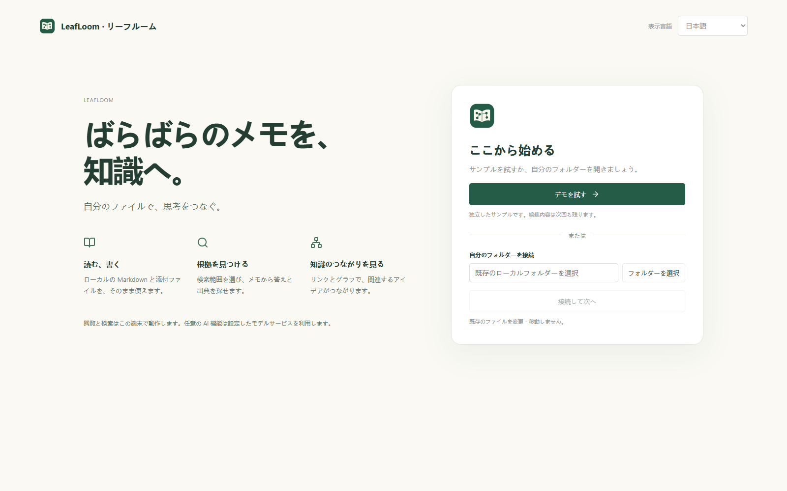
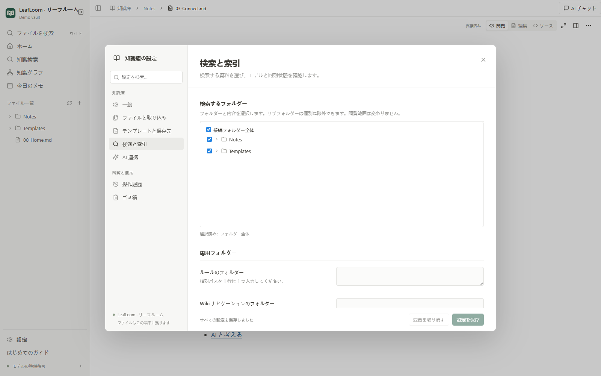
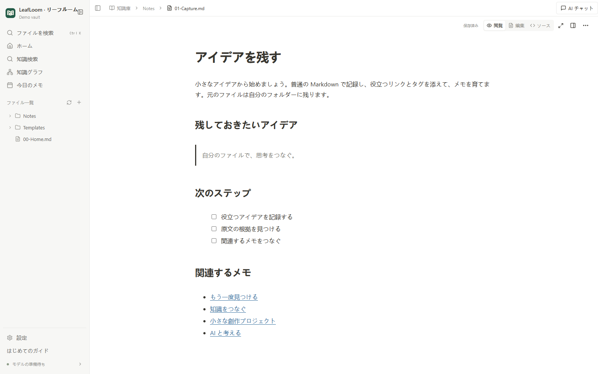
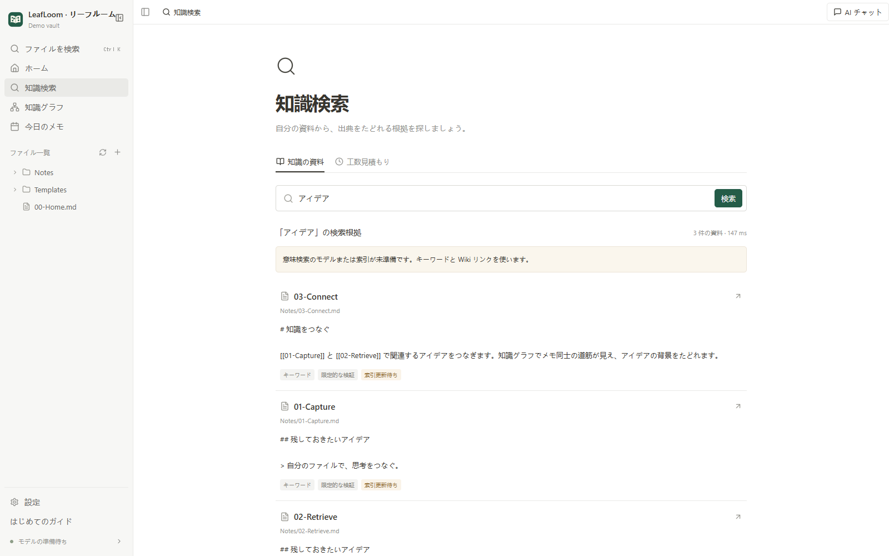
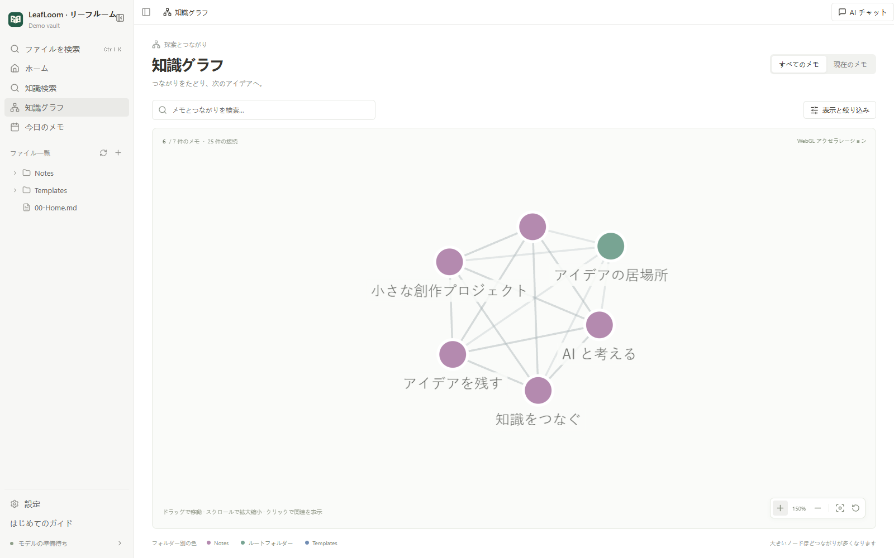

# LeafLoom を使い始める

[English](../en/GUIDE.md) · [中文](../zh-CN/GUIDE.md) · [日本語](GUIDE.md)

## インストールと起動

Windows 10/11 x64 と、macOS 14 以降の Apple Silicon に対応しています。デスクトップインストーラーは Linux、Intel Mac、Windows ARM に未対応です。

**[最新の Release](https://github.com/DJ-Huang/LeafLoom/releases/latest) のデスクトップインストーラーがおすすめです。** リポジトリのクローンや、Python・Node・Ollama の事前インストールは不要です。

1. **Windows：** Windows x64 用の `.exe` をダウンロードしてインストールし、スタートメニューやデスクトップから LeafLoom を開きます。
2. **Mac：** macOS Apple Silicon 用の `.dmg` を開き、LeafLoom を「アプリケーション」にドラッグして起動します。
3. 言語を選び、同梱のデモを試すか自分のフォルダーを接続します。閲覧、編集、グラフ、キーワード検索に意味検索モデルは不要です。必要になったら検索設定で BGE-M3 を準備してください。

ウィンドウを閉じるとトレイ／メニューバーに残ります。**終了** でアプリとローカルサービスを停止します。新規インストールではログイン時起動は無効で、デスクトップ設定やトレイから変更できます。更新時はアプリを終了し、対応する最新版の Release パッケージをインストールして再び開きます。

サービスは `127.0.0.1`、通常ポート `18080` で動作します。要件と検証状況は[デスクトップの詳細](../DESKTOP.md)を、開発者は[ソースからのインストール](../../README.md#get-started)をご覧ください。

## 言語とフォルダーを選ぶ

最初はシステムの言語を使用し、未対応の言語は英語になります。中文、English、日本語を選択できます。後から **設定 → 一般 → 表示言語** で変更してください。メモ、下書き、表示位置を保持し、索引を再構築しません。

**デモを試す** では独立した架空のメモを使えます。編集内容は次回も残り、言語ごとに別のデモを用意します。既存の Markdown/Obsidian の資料は **自分のフォルダーを接続** で開いてください。元のファイルはその場所に残ります。編集を保存すると、その元のファイルに書き込みます。

## 検索する範囲を決める

接続したフォルダー全体を閲覧できますが、知識検索には明示的に選んだフォルダーだけを使います。全体または一部を選択し、サブフォルダーは個別に除外できます。初期状態では何も選択しません。**まずは閲覧する** を選ぶと検索対象は空のままです。

索引の対象は `.md` と `.txt` です。画像、動画、添付は閲覧できますが、文字起こしはしません。隠し・アプリ用フォルダー、`.ragignore` の除外、検索を無効にしたメモは対象外です。ルール、トピック、工数資料の専用フォルダーは高度な設定で、普通のメモでは不要です。

## 読む、書く、探す、つなぐ

1. サイドバーから Markdown メモを開くと、整形されたページを直接編集できます。**ソースを表示** で Markdown テキストに切り替えます。通常の編集は自動保存し、競合が起きたら下書きを保持します。
2. **新しいメモ** でアイデアを書きます。`[[別のメモ]]` で関連するメモをつなぎます。
3. `Ctrl/⌘+K` は名前によるファイル検索です。本文の質問やキーワードは **知識検索** を使います。
4. 検索結果から原文を開き、前後の文脈と検証状態を確認してください。
5. **知識グラフ** でメモを検索し、フォルダーを絞り込み、つながりをたどれます。バックリンクは他のメモからのリンクです。
6. ホームのチェックリストは任意です。完了をマークし、閉じたり、**はじめてのガイド** から開き直したりできます。

## コマンドで編集

本文の行頭または空白の後に `/` を入力すると、見出し、リスト、ToDo、引用、表、コード、画像、リンク、数式、Mermaid 図を挿入できます。メニューにはアイコン、説明、分類、最近使った項目が表示されます。名前や `/h2`、`/todo` などで絞り込み、矢印キーと Enter で選択します。Esc は入力を残して閉じます。コード、数式、プロパティ、URL 内では開きません。

文字を選択すると書式ツールバーが表示されます。`Ctrl/⌘+B`、`Ctrl/⌘+I`、`Ctrl/⌘+E` で太字、斜体、インラインコードを切り替えます。選択文字に URL を貼り付けるか、`Ctrl/⌘+Shift+K` でリンクを入力できます。`[[` とノート名を入力すると、パスでノートを選べます。

ブロックにカーソルを重ねると **＋** とハンドルが表示されます。ハンドルのメニューで変換、複製、上下移動、削除ができ、ドラッグで段落、リスト項目、ブロック全体を並べ替えられます。段落をまたいで文字を選択でき、表のセルも直接編集できます。Tab でセルを移動し、最後のセルでは行を追加します。表のツールバーで行列、見出し、配置を変更できます。添付はノートの隣の `attachments` フォルダーに一意の名前で保存し、既存ファイルは上書きしません。リンクを元に戻しても添付は残り、失敗やキャンセル後も完了済みのファイルは残ります。

保存形式は通常の Markdown のままです。変更していないブロックやプロパティは元のテキストを保持し、本文とソースで元に戻す履歴を共有します。数式と Mermaid は整形して表示し、専用パネルで変更します。直接編集できない複雑な内容は表示を保ち、該当するソースへ移動して編集できます。言語の変更でも編集状態と履歴を保持します。表は Markdown の単純な構造に対応し、セルの結合やセル内の入れ子ブロックは含みません。

## 日常の使い方と復元

外部のファイル変更を監視します。**データを更新** は表示を更新します。ブラウザーの再読み込みだけではサービスのコードは更新されません。フォルダーは設定で切り替えられます。削除した内容は **設定 → ゴミ箱** で復元でき、**操作履歴** には保存したバージョンとファイル操作を表示します。完全削除は取り消せません。

ローカルファイルと履歴はクラウドバックアップではありません。好みのツールでバックアップしてください。クラウド同期やすべての Obsidian プラグインへの対応は提供しません。

## 任意の AI 機能

[AI 連携](AI.md) を参照してください。閲覧とローカル検索は AI の契約や CLI がなくても使えます。外部のモデルサービスに選択した内容が送られることがあります。AI の変更は確認できる下書きになり、手動で保存します。

## よくある質問

**検索結果が出ません。** 選択したフォルダー、拡張子、除外を確認し、索引の進捗を見てください。意味検索の準備ができていない場合はキーワード/Wiki に切り替えたことを表示します。これは意味検索の索引が完成したという意味ではありません。

**使い始める前にモデルのダウンロードが必要ですか？** 不要です。デスクトップ版は専用の実行環境を含み、閲覧、編集、グラフ、キーワード検索は BGE-M3 なしで使えます。意味検索が必要になったら設定でモデルをダウンロードしてください。ソース版では依存関係を別途準備します。

**データはどこにありますか？** メモは接続フォルダーに、索引・履歴・ゴミ箱はその中の `.vault-rag/` にあります。設定、モデル、トークン、AI 履歴は Windows の `%LOCALAPPDATA%\VaultRag` または macOS の `~/Library/Application Support/VaultRag` にあります。`VAULT_RAG_HOME` で変更できます。

**オフラインで使えますか？** デスクトップ版のインストール後は、ローカルの閲覧、編集、グラフ、キーワード検索をオフラインで使えます。意味検索にはローカルモデルの事前準備も必要です。外部 AI の接続要件はサービスによって異なります。

**画面が空白、更新が反映されません。** ウェブ画面のビルドとインストールを完了し、サービスを再起動してから画面を再読み込みしてください。ログとポートの競合も確認してください。

**ネットワークフォルダーは使えますか？** ローカルフォルダーを使用してください。UNC 共有とシンボリックリンク/junction 経由のアクセスは拒否します。

**アンインストール方法は？** LeafLoom を終了し、Windows の設定からアンインストールするか、Mac の「アプリケーション」から削除します。メモ、設定、索引、モデルは残ります。従来のソース版サービスは、その環境で `vault-rag service uninstall` を実行してください。不要なデータは確認したうえで別途削除してください。
