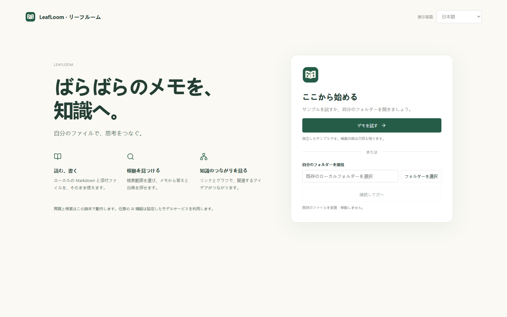
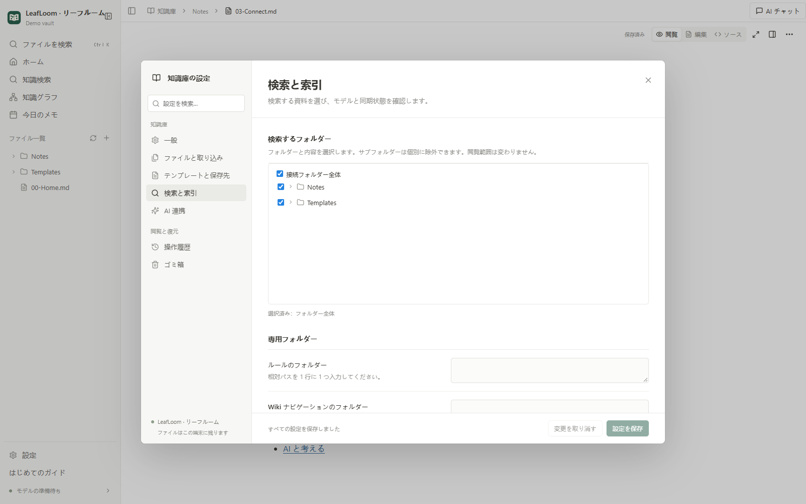
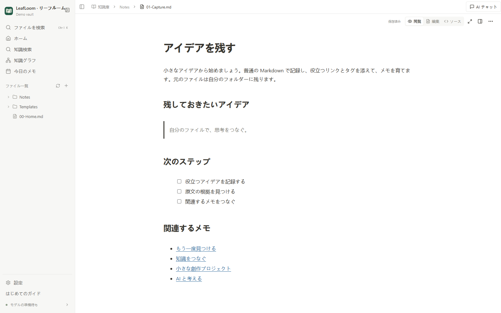
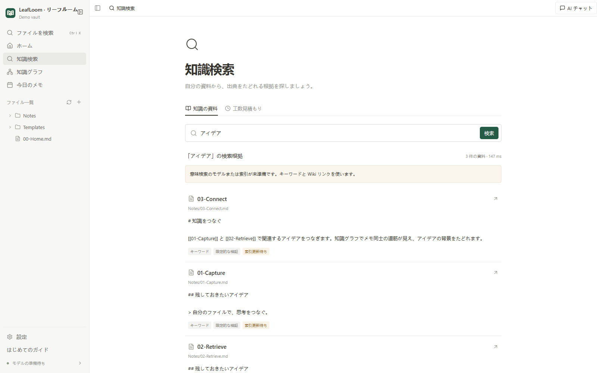
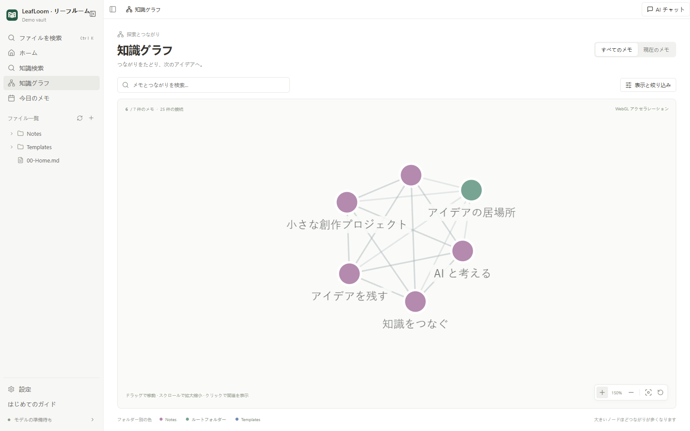

# LeafLoom を使い始める

[0.1.8 の変更点と更新手順](RELEASE_NOTES_0.1.8.md)

**設定 → Skill** から同梱の **LeafLoom スキル**をインストール・更新します。新しいローカルの Codex チャットで `$leafloom` を使うと、知識庫の検索、プロジェクトのタスク管理、作業記録ができます。デザインの依頼には **Design Studio** の開き方を案内します。スキルは起動中のアプリに直接接続します。**設定 → AI 連携** でローカル AI の読み取りを許可し、保存が必要な場合は書き込みも許可してください。

作業記録とレポートは既定で接続中の知識庫の `工作中枢/` を使います。飛書と GitLab の手順は依頼に応じて読み込みます。[ワークハブ](../WORK_HUB.md)を参照してください。

**オフィス製品の選択：** **設定 → Skill → ワークハブ設定** で、飛書/Lark と Notion など利用する製品を複数チェックできます。変更は即時保存されます。出典に応じた自動選択・ローカルのみは独立した排他モードで、すべて解除すると自動選択に戻ります。DingTalk・WeCom・Notion は現在は設定の保存のみで未連携と表示します。認証と権限は別途設定します。チャットでも「飛書と Notion を使う」「Notion も追加して」と依頼でき、同じ `工作中枢/配置.md` を更新します。旧単一選択も読み取れます。複数選択で取得範囲を広げたりタスクを全製品へ送ったりはしません。チャットで変更した後は再読み込みしてください。保存先は **テンプレートと書き込み → 既定の書き込み先** で変更できますが、既存ノートは移動しません。

週報・隔週報は `工作中枢/模板/周报模板.md` があれば参照します。

原文を読むには、飛書ページと子ページを `工作中枢/工作目录/` に同期するよう `$leafloom` に依頼します。依頼時だけの一方向同期で、画像・動画は添付サーバーの保存を検証してから参照を置換し、500 MB を超える動画も扱えます。ローカル編集と削除された元ページのコピーを保護し、失敗後は再開できます。本機の LeafLoom、Python 3.11+、認証済み `lark-cli` が必要です。[ワークハブ](../WORK_HUB.md)を参照してください。

[English](../en/GUIDE.md) · [中文](../zh-CN/GUIDE.md) · [日本語](GUIDE.md)

[ドキュメント一覧](../README.md)

**開発者向け：** ソースのルートで、Windows は `Dev.cmd`、macOS 14+ Apple Silicon は `Dev.command` をダブルクリックします。Mac の Terminal では `sh Dev.sh` も使えます。コピーやダウンロードで実行権限が失われた場合は、最初に `chmod +x Dev.command Dev.sh` を実行してください。両環境で `node scripts/dev-desktop.cjs` も利用できます。Node 22+ と uv が必要で、初回は依存関係を自動インストールします。デスクトップをソースから起動し、フロントエンドの変更を自動反映します。Dev はインストール版とユーザー設定・モデル・認証情報・デスクトップデータを共有し、バックエンドも同じ設定のポート（既定は 18080）を使います。開発依存関係のみ `.cache/desktop-dev/.venv` に保存し、Vite は 5173 を使用します。切り替え前に現在のアプリを終了してください。分離した検証には一時的な `VAULT_RAG_HOME` を明示します。Python/Electron の変更後は **LeafLoom → LeafLoom を再起動** またはトレイの **LeafLoom を再起動** を選びます。[ソース開発](../DESKTOP.md#source-development)を参照してください。

**任意のブラウザー開発：** [2 つの Terminal での起動手順](../DESKTOP.md#optional-browser-development)に従い、Vite を `http://127.0.0.1:5173` で起動してから `uv run --locked python scripts/dev-browser.py --home /tmp/leafloom-browser-dev --port 36229 --loopback-ui` を実行します。表示された `http://localhost:36229/` を専用ブラウザープロファイルで開いてください。必須の home は新規／空のディレクトリ、またはこの起動スクリプトが印を付けたものに限ります。ポートと UI モードは固定され、変更には新しい home とプロファイルが必要です。`--loopback-ui` を省くと通常の `app.<installation-id>.localhost` 管理画面を使います。実際のランタイムとバックグラウンド処理を動かし、モデルの自動取得や外部 AI 呼び出しは行いません。影響のある管理対象ブラウザーでは別オリジンの HTML プレビューに制限が残る場合があります。安全性の警告は回避しないでください。Linux デスクトップのインストール対応ではありません。

旧 Dev 設定は復旧用に `.cache/desktop-dev/` に保持し、インストール版の設定を上書きしません。共有データ保存先に `models/` がない場合のみ旧モデルをコピーし、元ファイルと既存のモデルフォルダーは保持します。

従来のリポジトリ起動スクリプトは削除しました。インストール済みアプリは自身のショートカットとメニューで管理します。開発中は Dev を使い、そのトレイ／メニューバーから終了するか、起動した Terminal で Ctrl+C を押してください。

## ヘルプセンター

サイドバーの **ヘルプセンター**、または[オンラインヘルプ](https://dj-huang.github.io/LeafLoom/docs/ja/)を開きます。トピックから選ぶか、`Ctrl/⌘+K` で記事全文を検索できます。操作手順・完了後の状態・問題解決・目次・前後の記事を用意し、言語変更でも同じタスクと標準セクションを保持します。例のコピーと画像拡大ができ、JavaScript なしでも記事を閲覧できます。ヘルプ検索は公開文書だけを対象にし、保管庫を読みません。

## インストールと起動

[LeafLoom 公式サイト](https://dj-huang.github.io/LeafLoom/ja/) は日英中の紹介、製品画面、各プラットフォームで利用できる最新正式版の直接ダウンロードに対応しています。Windows または Mac を選択し、リリースノートと SHA-256 ファイルも確認できます。新しい Release に対象のインストーラーがない場合は、利用できる最新正式版と、その版のリリースノート・チェックサムを引き続き掲載します。正式版に対象のインストーラーが一つもない場合のみ利用不可になります。

公式サイトの「このサイトについて」ページで作者の GitHub と X のプロフィールを確認できます。上部ナビゲーションまたはフッターから開き、言語を切り替えても紹介ページに留まります。

Windows 10/11 x64 と、macOS 14 以降の Apple Silicon に対応しています。デスクトップインストーラーは Linux、Intel Mac、Windows ARM に未対応です。

**[最新の Release](https://github.com/DJ-Huang/LeafLoom/releases/latest) のデスクトップインストーラーがおすすめです。** リポジトリのクローンや、Python・Node・Ollama の事前インストールは不要です。

1. **Windows：** Windows x64 用の `.exe` をダウンロードしてインストールし、スタートメニューやデスクトップから LeafLoom を開きます。
2. **Mac：** macOS Apple Silicon 用の `.dmg` を開き、LeafLoom を「アプリケーション」にドラッグして起動します。
3. 言語を選び、同梱のデモを試すか自分のフォルダーを接続します。閲覧、編集、グラフ、キーワード検索に意味検索モデルは不要です。必要になったら検索設定で BGE-M3 を準備してください。

ウィンドウを閉じるとトレイ／メニューバーに残ります。**終了** でアプリとローカルサービスを停止します。アプリメニューの **LeafLoom → LeafLoom を再起動** またはトレイの **LeafLoom を再起動** で、同じ設定とデータ保存先を使って開き直せます。再起動前にメモの下書きを準備し、ローカルサービスの停止を待ちます。未保存の確認で戻ると再起動をキャンセルできます。Dev は Vite を維持し、ロック済み Python 依存関係を同期して現在のソースを開き直します。このメニューのない版から更新した最初の一回は、Dev を手動で終了・起動してください。新規インストールではログイン時起動は無効で、デスクトップ設定やトレイから変更できます。更新は **設定 → 一般 → アプリの更新 → 更新を確認** から行い、現在と最新のバージョンを確認します。**ダウンロードしてインストール** を選ぶと、進捗率と受信量／総容量を表示します。SHA-256 検証後、未保存の下書きの確認を含む通常の終了処理を行い、Windows のインストーラーまたは Mac の DMG を開きます。インストールを完了し、Mac では新版を「アプリケーション」にドラッグしてから LeafLoom を起動してください。終了をキャンセルした場合は **インストールを続行** を選べます。確認やダウンロードの失敗時は再試行できます。Dev はバージョン確認のみで、ソースを更新して再起動します。

サービスは `127.0.0.1`、通常ポート `18080` で動作します。要件と検証状況は[デスクトップの詳細](../DESKTOP.md)を、開発者は[ソースからのインストール](../../README.md#get-started)をご覧ください。

macOS で **Dev.command** または **Dev.sh** から開発モードを起動すると、Dock にも LeafLoom のロゴと名前が表示されます。ソースやブランド素材の更新後は **LeafLoom を再起動** で読み込み直します。

メンテナーがプロジェクトと一致する `vX.Y.Z` タグを push すると、GitHub が両環境のインストーラーと `SHA256SUMS.txt` を Release 下書きに用意します。Actions の結果と下書きを確認し、手動で公開してください。失敗したビルドは再実行でき、公開済み Release は上書きしません。手動の **Run workflow** は Actions の添付ファイルのみを作成します。現在のタグビルドには信頼された発行者署名がなく、Mac は公証なしの ad-hoc 署名のため、OS が警告または起動を拒否する場合があります。[ビルド・再試行・公開手順](../DESKTOP.md#automatic-release-drafts)を参照してください。

## 言語とフォルダーを選ぶ

最初はシステムの言語を使用し、未対応の言語は英語になります。中文、English、日本語を選択できます。後から **設定 → 一般 → 表示言語** で変更してください。メモ、下書き、表示位置を保持し、索引を再構築しません。

**デモを試す** では独立した架空のメモを使えます。編集内容は次回も残り、言語ごとに別のデモを用意します。既存の Markdown/Obsidian の資料は **自分のフォルダーを接続** で開いてください。元のファイルはその場所に残ります。編集を保存すると、その元のファイルに書き込みます。



## 検索する範囲を決める

接続したフォルダー全体を閲覧できますが、知識検索には明示的に選んだフォルダーだけを使います。全体または一部を選択し、サブフォルダーは個別に除外できます。初期状態では何も選択しません。**まずは閲覧する** を選ぶと検索対象は空のままです。

索引の対象は `.md` と `.txt` です。画像、動画、添付は閲覧できますが、文字起こしはしません。隠し・アプリ用フォルダー、`.ragignore` の除外、検索を無効にしたメモは対象外です。ルール、トピック、工数資料の専用フォルダーは高度な設定で、普通のメモでは不要です。



## 読む、書く、探す、つなぐ

1. サイドバーから Markdown メモを開くと、整形されたページを直接編集できます。**ソースを表示** で Markdown テキストに切り替えます。通常の編集は自動保存し、競合が起きたら下書きを保持します。
2. **新しいメモ** でアイデアを書きます。`[[別のメモ]]` で関連するメモをつなぎます。
3. `Ctrl/⌘+K` は名前によるファイル検索です。本文の質問やキーワードは **知識検索** を使います。
4. 検索結果から原文を開き、前後の文脈と検証状態を確認してください。
5. **知識グラフ** でメモを検索し、フォルダーを絞り込み、つながりをたどれます。バックリンクは他のメモからのリンクです。
6. ホームのチェックリストは任意です。完了をマークし、閉じたり、**はじめてのガイド** から開き直したりできます。

上部のパスバーでフォルダー名やファイル名（**保管庫** を含む）を右クリックし、**相対パスをコピー** または **絶対パスをコピー** を選びます。相対パスは接続した保管庫のルートから始まり、ルート自体は `.` です。絶対パスはサービスを実行しているコンピューターの形式を使います。パスにフォーカスして **Shift+F10**、または現在のファイル名・フォルダー名のクリックでも開けます。上位フォルダーでは、その階層までのパスをコピーします。





## コマンドで編集

本文の行頭または空白の後に `/` を入力すると、見出し、リスト、ToDo、引用、表、コード、画像、リンク、数式、Mermaid 図を挿入できます。メニューにはアイコン、説明、分類、最近使った項目が表示されます。名前や `/h2`、`/todo` などで絞り込み、矢印キーと Enter で選択します。Esc は入力を残して閉じます。コード、数式、プロパティ、URL 内では開きません。

文字を選択すると書式ツールバーが表示されます。`Ctrl/⌘+B`、`Ctrl/⌘+I`、`Ctrl/⌘+E` で太字、斜体、インラインコードを切り替えます。選択文字に URL を貼り付けるか、`Ctrl/⌘+Shift+K` でリンクを入力できます。`[[` とノート名を入力すると、パスでノートを選べます。

ブロックにカーソルを重ねると **＋** とハンドルが表示されます。ハンドルのメニューで変換、複製、上下移動、削除ができ、ドラッグで段落、リスト項目、ブロック全体を並べ替えられます。段落をまたいで文字を選択でき、表のセルも直接編集できます。Tab でセルを移動し、最後のセルでは行を追加します。表のツールバーで行列、見出し、配置を変更できます。添付は保管庫共通の `_attachments` フォルダー（または設定済みの `attachment_folder`）に一意の名前で保存し、既存ファイルは上書きしません。リンクを元に戻しても添付は残り、失敗やキャンセル後も完了済みのファイルは残ります。

保存形式は通常の Markdown のままです。変更していないブロックやプロパティは元のテキストを保持し、本文とソースで元に戻す履歴を共有します。数式と Mermaid は整形して表示し、専用パネルで変更します。直接編集できない複雑な内容は表示を保ち、該当するソースへ移動して編集できます。言語の変更でも編集状態と履歴を保持します。表は Markdown の単純な構造に対応し、セルの結合やセル内の入れ子ブロックは含みません。

**このページの目次** は現在の Markdown メモの見出しを、本文左側の罫線のない一覧に階層表示します。左上の二重矢印で閉じ、同じ位置に残るリストアイコンで開きます。下位見出しのある項目は、見出しの文字をクリックして子階層全体を開閉し、同時に該当箇所へ移動できます。左側の矢印は開閉のみを行い、下位見出しのない項目は移動のみを行います。編集や目次全体の開閉でも各階層の状態を保持し、閉じた階層内を読んでいる間は上位見出しを強調して自動では開きません。読んでいる節を青色で示し、本文のスクロールに追従します。見出しをクリックすると本文・ソースの該当箇所を画面上部へ移動します。編集時にも更新し、下線形式の見出しや同名の見出しを区別します。コードブロックとプロパティは含めません。現在のセッションでメモごとに開閉を記憶します。文書領域が狭い場合は既定で閉じ、開くと重ねて表示します。上位見出しの開閉では表示を保ち、下位見出しのない項目の選択か Esc で閉じます。

## ハイライトとコメント

Markdown 本文で文字を選択すると、書式ツールバーに 5 色の **ハイライト** と **コメント** が表示されます。色を選択して重要箇所をマークできます。ハイライト済みの文字を選び、色の前にある斜線の丸 **ハイライトを解除** を押すと通常の文字に戻ります。右クリックメニューからも解除でき、選択範囲外の色とコメントは保持されます。一度の解除をまとめて元に戻す／やり直すことができます。コメント（または `Ctrl/⌘+Shift+M`）で議論を開始します。上部の **コメント** ボタンから右パネルを開き、文字を選択しない **ページコメント**、返信、編集、解決と再オープン、絞り込み、削除を利用できます。

引用をクリックすると本文へ移動します。文字の移動には引用と前後の文脈で追従し、削除や曖昧な重複で位置が特定できない場合は新しい範囲を選んで再関連付けできます。Markdown のソース画面にも注釈を表示し、元の Markdown は変更しません。注釈・本文・ソースは現在のセッションの履歴を共有します。上部のボタンか `Ctrl/⌘+Z` で元に戻し、`Ctrl/⌘+Shift+Z`（`Ctrl+Y` も可）でやり直せます。追加、返信を含む削除、コメント編集、解決／再オープン、再関連付けを本文編集と順番に戻せます。コメント入力欄は独自の文字履歴を保持します。別のウィンドウや MCP がスレッドを変更した場合は上書きせず操作を停止します。未保存の通常編集は先に保存し、AI の手動下書きは明示的に保存する必要があります。

コメントは再生成可能な索引ではなく **ユーザーデータ** です。メモと一緒に `.vault-rag/annotations.sqlite` をバックアップしてください。LeafLoom での移動やゴミ箱からの復元でもメモの注釈を維持します。初期バージョンは Markdown を対象とし、HTML プロジェクトと Design Studio のコメントは未対応です。詳しくは[注釈の技術資料](../ANNOTATIONS.md)をご覧ください。

## HTML プロジェクト、ウェブサイト、デザインスタジオを開く

1. ファイル一覧からローカルの `.html` または `.htm` を開き、**プロジェクトフォルダー** を確認して **保存して開く** を選びます。入口と関連リソースを含むフォルダーを指定してください。ウェブの `/` はこのフォルダーに対応し、空欄は接続フォルダーのルートを意味します。
2. **プロジェクト設定** でフォルダーを変更し、必要に応じて **SPA ルーティング** を有効にします。存在しないページのパスでは入口を開きますが、欠けたスクリプト、画像、JSON はエラーになります。
3. ツールバーで戻る、進む、更新、全画面、**別のタブで開く** を利用できます。デスクトップ版は同じサイトをアプリ内で開きます。ブラウザーとアプリのサイト保存領域は別々です。
4. サイドバーの **プレビュー → ウェブサイトを開く** から、既存の HTTP/HTTPS サイトや開発サーバーを開けます。依存関係のインストールやバックエンドの起動は行いません。外部サイトは埋め込みを制限したりログインを要求したりする場合があります。
5. サイドバーの **デザインスタジオ**、またはフォルダーの **ここにデザインプロジェクトを作成** を開きます。新規プロジェクトは管理されたビジュアル文書を使用します。既存の `1.1.0` プロジェクトは従来のレイヤー表示を維持し、独立した編集用コピーにも変換できます。モバイル縦 `720×1560`、横 `1560×720`、デスクトップ `1440×900`、カスタムサイズに対応します。

**ソース** で HTML を編集できます。通常の編集は自動保存します。未保存の下書きがある場合、ウェブ表示では一時的なオリジンでプレビューし、表示だけでは保存しません。関連リソースはディスクから読み込みます。HTML の閲覧は検索対象フォルダーの選択と独立しており、知識検索の索引には入りません。

HTML プロジェクトと Design Studio の資源はプロジェクトフォルダー内（`assets/`、`Design/Assets/` など）に留め、中央の `_attachments` や添付サーバー移行の対象にしません。登録済み HTML プロジェクトがまだ `_attachments` にある場合は、LeafLoom を終了してから一度きりのスクリプト `scripts/localize_html_attachments.py` を実行します（既定はプレビュー、`--apply` で書き込み）。プロジェクト一式は `Web/<名前>/` へ、外部の中央依存は各プロジェクトの `assets/` へ移し、静的な HTML/CSS 参照を書き換えます。スクリプト由来の参照はブロッカーとして報告されます。

macOS 14/15 の Safari でローカルサイトが開かない場合は、**設定 → 一般 → Safari のローカルサイト互換性** を有効にします。このアプリ専用の名前解決設定に管理者の許可が必要です。削除方法と対応範囲は [HTML プロジェクトの詳細](../HTML_PROJECTS.md) を参照してください。

以前のループバックアドレスから新しいワークスペースに移ると、下書きと表示状態を自動で移行します。移行先の既存の値を優先し、競合時はバナーからバックアップをダウンロードできます。元の保存領域も残ります。ブラウザー間やアプリとの同期は行いません。

## デザインスタジオでゲーム画面を作る

最初に設定で飛書接続を有効にし、必要な妙搭アプリの権限を承認してください。Design Studio の **公開先** で **妙搭** を選んでからページを選び、新規アプリを作成するか、既存の Design Studio 教材アプリを ID で関連付けます。関連付け時に教材の識別情報とリモートファイルを確認し、未確認の変更があれば停止します。再関連付けで検査を回避することはできません。選択ページで現在の教材を置き換え、既存アプリのアクセス範囲は変更しません。新規アプリは教材を含まない空の画面を先に公開し、組織内アクセスの確認後に教材をアップロードします。そのため承認が 2 回必要になる場合があります。保存済みの版から素材をバックグラウンドでアップロードして公開し、未選択の関連ページ、動的参照、認証や承認を表示します。不確かな操作の中断後はリモートを確認し、素材段階は照合して再開できます。

妙搭の公開状況はバックグラウンドの現在の処理に追従します。初回公開から素材アップロード、完了、中断へ進んだ場合も、更新すると現在の状態を表示します。一時的な取得失敗は間隔を置いて再試行します。アップロード中断後の「素材を確認して続行」は正確なファイル名でリモートを照合し、一意の結果は再利用、完全な検索で存在しない場合は再アップロード、不完全・曖昧な結果では停止を維持します。

妙搭の編集プレビューと公開アプリは別の作業環境です。公開済みでも編集画面が初期ページのままなら、クラウド側の差分を確認し、既存の変更を保ったまま `origin/sprint/default` をマージします。プレビューの更新だけではコードを取得しません。公開状態だけでなく、表示・ページ移動・操作を確認してください。公開教材は拡張子なしの本文 URL からアプリと一緒に梱包した本文のひな型で、同一オリジンの分離されたフレームを作成します。これにより埋め込みナビゲーションの停止を避け、実行環境の準備完了までページ移動を無効にします。読み込みが長引く場合は再試行と単独表示を案内します。

- プロジェクトホームで検索、最近の項目、お気に入り、名前変更、コピー、移動、アーカイブ、復元可能なゴミ箱を利用できます。管理操作はワークスペース履歴、画面の編集はプロジェクト履歴を使用し、ページ切り替えや再起動後も元に戻す/やり直しができます。
- **ページ** で画面を追加、グループ化、並べ替え、複製します。リストのページを右クリックすると複製または削除でき、削除は元に戻せます。最後のページは削除できません。文字、画像、コンテナー、ボタン、図形、SVG、カスタム HTML、埋め込みページに加え、HUD、キャラクターカード、図鑑、ダイアログなどを挿入できます。Shift で複数選択し、キャンバスとプロパティで位置、寸法、回転、外観、文字、横/縦/グリッド配置を調整します。
- キャンバスの要素またはレイヤー一覧を右クリックし、**要素の位置情報をコピー** を選んで外部 AI に貼り付けます。プロパティパネルでも現在の選択をコピーできます。Shift キーで複数選択し、選択済みの要素を右クリックすると選択を保持します。簡潔な JSON には `Design/studio/project.json` の絶対パス `file`、`page_id`（マスターコンポーネントは `component_id`）、単一選択の `node_id` または複数選択の `node_ids` 配列のみを含みます。該当する場合のみ `variant_id` や `has_pending_changes:true` を追加します。保存完了を待ち、AI は最新版を読み、バージョン検査付きの操作で履歴を保持して変更してください。デスクトップ版はシステムのクリップボードを使用し、ネイティブコピー機能の更新後は LeafLoom を再起動してください。 キャンバスまたはレイヤーにフォーカスがあるとき、Mac は **⌘+C**、Windows は **Ctrl+C** で画像以外の単一要素や複数要素の位置情報をコピーできます。単一画像は元画像をコピーし、その位置情報には **要素の位置情報をコピー** を明示的に選択してください。テキスト編集中、入力欄、ソースエディター、通常の文字選択では標準のコピー動作を保ち、プレビューには影響しません。
- **素材** でアップロードや画像の貼り付け、寸法/透明情報の確認、名前/分類/タグの編集、使用箇所の検索、画像一つまたは全参照の置換ができます。コンポーネントと素材を個人の共有ライブラリに公開し、他のプロジェクトへ取り込みます。更新は明示的に選び、依存ファイルはオフライン用にコピーされます。使用中の素材は先に参照を置換または削除します。
- **アニメーション** にフェード、移動、拡大縮小、バウンス、呼吸、回転があります。**スクリプトとソース** で要素やページに `mount(ctx)` JavaScript を付け、パラメーターをプロパティとして公開できます。編集中は停止し、コンポーネントまたは画面全体をプレビューできます。停止時に設計状態へ戻り、ログから要素を確認できます。コードとパラメーターも履歴に残ります。
- **書き出し** でページを選び、保存済みの対話型 HTML ZIP を作成できます。1 ページ以上を選択すると、元の順序で最初の選択ページから表示し、関連する素材と依存ファイルだけを含めます。未選択の既知の移動先や埋め込み先は追加できます。省略した移動先は使用できず、埋め込みは空白です。スクリプトの動的参照は検出できない場合があり、外部 URL は同梱されません。展開後に `index.html` を開いて操作を確認してください。

最初に設定で飛書接続を有効にし、必要な妙搭アプリの権限を承認してください。Design Studio の **公開先** で **妙搭** を選んでからページを選び、新規アプリを作成するか、既存の Design Studio 教材アプリを ID で関連付けます。関連付け時に教材の識別情報とリモートファイルを確認し、未確認の変更があれば停止します。再関連付けで検査を回避することはできません。選択ページで現在の教材を置き換え、既存アプリのアクセス範囲は変更しません。新規アプリは教材を含まない空の画面を先に公開し、組織内アクセスの確認後に教材をアップロードします。そのため承認が 2 回必要になる場合があります。保存済みの版から素材をバックグラウンドでアップロードして公開し、未選択の関連ページ、動的参照、認証や承認を表示します。不確かな操作の中断後はリモートを確認し、素材段階は照合して再開できます。

- **AI チャットへ追加** は要素 ID と現在のリビジョンを渡します。管理されたデザインの変更は直接適用され、AI の一括指示一回を一度で元に戻せます。`Ctrl/⌘+Z`、`Ctrl/⌘+Shift+Z` は再起動後も使用できます。競合時は保留中の変更を確認してから再読み込み/再適用します。保存完了後に書き出し、ZIP を展開して配布ファイルと一緒に `index.html` を開きます。

- HTML 変換では文書ルートのコンテキスト、混在テキスト、レスポンシブ画像候補を保持します。読み込めない外部スタイルシートは警告とともに省略され、元のソースは保持されます。ビューポート・rem 単位やメディアクエリはレンダラー環境を使用します。ネイティブテキストは内容のみ編集でき、レイアウトや文字組みは親を選択して変更します。利用前に元のページと比較してください。

- **選択**（`V`）と**手のひら**（`H`）、またはスペースキーを押しながらドラッグしてキャンバスを移動します。ズーム倍率、＋/−、ページにフィット（`Shift+1`）、選択範囲にフィット（`Shift+2`）を利用でき、Ctrl/⌘＋ホイールでポインター位置を中心にズームできます。編集中も表示位置を保持します。**レイヤー**のコンテナーを折りたたみ、選択パスから親へ移動し、**レイアウト**・**外観**・**文字組み**ごとにプロパティを編集できます。分離されたキャンバスの接続に失敗した場合は再試行してください。管理画面では保存済みのレイヤーとプロパティを確認できます。
- **コピーを変換** は元プロジェクトを残して DOM/CSS、文字と素材を取り込み、認識できるナビゲーション、設定スイッチ、入口に応じたページ状態を引き継ぎます。元スクリプトはコピーしたソースに保持されますが、その他のイベント処理や実行時状態は新しいスクリプトで再実装してください。変換の注意事項を確認し、原画面と比較してください。[ワークフローとスクリプト API](../DESIGN_STUDIO.md) にコマンド、制限、性能目標をまとめています。

AI から動画などの大きな素材を取り込む場合は、`design_import_asset` に保管庫内の相対パス `source_path`、または飛書 CLI が返す `source_file_id` を渡します。素材はサービス側でコピーされ、AI 接続経由の Base64 往復を省けます。`include_document:false` で短い結果を取得できます。サイズ、内容、現在の権限と取り消し履歴の検証は維持され、保管庫外のパスは受け付けません。[MCP の例](../MCP.md) を参照してください。

MCP のノート保存は、ファイルと履歴の確定後に `saved:true` と保存済みリビジョンを返します。カタログ、添付メタデータ、検索索引はバックグラウンドで更新します。`index_pending` は索引の処理待ちを示し、未保存を意味しません。準備中も正確なパスでの読み取りとバージョン確認付きの編集を続けられます。全体検索が一時的に `metadata_pending` を返した場合は検索だけを再試行し、成功した保存は繰り返さないでください。バックエンド修正は LeafLoom の再起動後に有効になります。内蔵の再起動手順でローカルの下書きを扱います。

別のパソコンへデザインを同期する場合は、送信側の LeafLoom を終了し、素材を含むプロジェクト全体と対応する `.vault-rag/design-studio` の履歴を同期してください。同期完了後に受信側で開きます。保管庫内の相対パスは同じにし、Windows と Mac の保管庫ルートは異なっていても構いません。両方で修正版を使用し、同時に編集しないでください。開くだけでは履歴の所有情報を書き換えません。別フォルダーで同じプロジェクト ID を使う場合や中断した保存が外部内容と競合する場合は引き続き停止します。独立した複製にはプロジェクトホームの **コピー** を使います。

**外部でのソース編集。** テキストエディターや AI ツールで `Design/studio/project.json` を編集できます。次回の表示・再読み込み時に、完全で有効な文書を「外部ファイルの変更」という1件の履歴に取り込み、元に戻す・やり直しに対応します。外部ファイルは書き換えません。書式だけの変更は履歴を増やしません。古い画面からの保存は引き続き版の競合で停止し、未保存の変更を保持します。再読み込み後に変更を確認・統合してください。JSON が未完成または不正な場合は、外部編集を完了・修正して再試行します。中断した保存と外部内容の競合、履歴の欠損は引き続き保護します。この機能の更新後は LeafLoom を再起動してください。

デザインプロジェクトの **ゴミ箱** から、復元、**プロジェクトを完全に削除**、**プロジェクトのゴミ箱を空にする** を選べます。完全削除は対象を表示して確認し、ファイル、デザイン履歴、関連する管理操作の取り消し記録を削除します。他のプロジェクトや共有ライブラリは保持します。

プロジェクト管理機能が読み込まれていないと表示された場合は、トレイ／メニューバーからアプリを終了して再起動してください。ページの再読み込みだけではバックエンドは更新されません。管理状態を取得するまで削除・移動などの操作は無効になり、**再試行** で再接続できます。

## 日常の使い方と復元

外部のファイル変更を監視します。**データを更新** は表示を更新します。ブラウザーの再読み込みだけではサービスのコードは更新されません。フォルダーは設定で切り替えられます。削除した内容は **設定 → ゴミ箱** で復元でき、**操作履歴** には保存したバージョンとファイル操作を表示します。完全削除は取り消せません。

ローカルファイルと履歴はクラウドバックアップではありません。好みのツールでバックアップしてください。クラウド同期やすべての Obsidian プラグインへの対応は提供しません。

## 任意の AI 機能

[AI 連携](AI.md) を参照してください。閲覧とローカル検索は AI の契約や CLI がなくても使えます。外部のモデルサービスに選択した内容が送られることがあります。AI によるメモの変更は確認できる下書きになり、手動で保存します。管理されたデザインの変更は直接適用され、プロジェクト履歴から元に戻せます。

## 任意の Feishu / Lark 連携

1. [公式 lark-cli](https://github.com/larksuite/cli) を別途インストール・設定・ログインしてください。認証情報は CLI が管理します。
2. **設定 → AI 連携 → Feishu / Lark** を開き、連携を有効にします。必要ならネイティブ実行ファイルのパスと CLI プロファイルを入力し、保存して **接続を検証** を選びます。パスは空欄で自動検出します。
3. **MCP アクセス権限** でローカル AI と Tunnel の Feishu 読み取り・書き込みを個別に許可します。初回のローカル有効化時に専用接続設定をコピーし、バックエンド更新後はクライアントのツール一覧を更新してください。

4. AI にインストール済み CLI のヘルプと内蔵 Skill を確認させ、汎用の読み書きツールから文書・Base・その他の業務コマンドを利用します。ブロック編集は XML の見出しとリッチ構造に対応し、文書更新には読み取り時のリビジョンが必要です。アカウント検証は個別リソースへの権限を保証しません。
5. 高リスクコマンドと raw API は、ローカル／Tunnel 別の高リスク許可（初期値オフ）と操作ごとの明示的な確認が必要です。読み取り・書き込みを無効にすると高リスク許可も解除されます。
6. 添付は一時ファイル ID を使って分割アップロード／ダウンロードします。接続フォルダーの既存ファイルを取り込む場合はノート読み取り権限も必要です。更新後はツール一覧を再取得してください。従来の文書／Base 用の四つのツールは CLI 検索・汎用読み書き・ファイル転送に置き換わりました。

同じ Tunnel の会話は、その接続に設定された権限を共有します。ランタイムの内部認証は会話の接続トークンと分離され、会話を切り替えても権限の更新や再接続は不要です。リソース権限を無効にすると、アクセスは直ちに失効します。

Dev とインストール版は Tunnel 設定とライフサイクルを共有し、有効時はアプリ起動で接続し、終了で停止します。Dev は既存インストールのランタイムを再利用します。同じ接続の standalone tunnel-client を別に起動しないでください。MCP 認証エラーの `leafloom_mcp` は Feishu の再認証を必要としません。Base はテーブル一覧の実際の ID を使い、URL の未確認の table パラメーターをそのまま使わないでください。

CLI 未検出・非対応、未設定、未ログイン、期限切れ、ネットワーク障害を区別します。外部で設定や再認可を行って再検証してください。クラウド操作には接続が必要で、要求された内容は呼び出し元 AI に返されます。ローカル知識ベースへの自動取り込み・索引化は行いません。[機能と制限](../FEISHU.md)をご覧ください。

## よくある質問

**検索結果が出ません。** 選択したフォルダー、拡張子、除外を確認し、索引の進捗を見てください。意味検索の準備ができていない場合はキーワード/Wiki に切り替えたことを表示します。これは意味検索の索引が完成したという意味ではありません。

**使い始める前にモデルのダウンロードが必要ですか？** 不要です。デスクトップ版は専用の実行環境を含み、閲覧、編集、グラフ、キーワード検索は BGE-M3 なしで使えます。意味検索が必要になったら設定でモデルをダウンロードしてください。ソース版では依存関係を別途準備します。

設定 → 検索と索引および初回ガイドで、モデル準備の接続・ダウンロード・検証段階、ファイル数、受信量、速度、経過時間を確認できます。30 秒間進捗がない場合は待機の案内を表示し、失敗時は詳細を保持して再試行できます。設定を閉じても準備は続き、閲覧できますが、アプリの終了で中断されます。再試行では既存のダウンロードを可能な限り再利用します。ファイルの準備後は索引作成の進捗を別に確認できます。

モデル欄には実際の保存先も表示されます。「フォルダーを開く」でシステムのファイルマネージャーに表示できます。未作成の場合は空のフォルダーのみを作成し、モデルのダウンロードは開始しません。

**データはどこにありますか？** メモは接続フォルダーに、索引・履歴・ゴミ箱はその中の `.vault-rag/` にあります。設定、モデル、トークン、AI 履歴は Windows の `%LOCALAPPDATA%\VaultRag` または macOS の `~/Library/Application Support/VaultRag` にあります。`VAULT_RAG_HOME` で変更できます。

**オフラインで使えますか？** デスクトップ版のインストール後は、ローカルの閲覧、編集、グラフ、キーワード検索をオフラインで使えます。意味検索にはローカルモデルの事前準備も必要です。外部 AI の接続要件はサービスによって異なります。

**画面が空白、更新が反映されません。** ウェブ画面のビルドとインストールを完了し、サービスを再起動してから画面を再読み込みしてください。ログとポートの競合も確認してください。

**ネットワークフォルダーは使えますか？** ローカルフォルダーを使用してください。UNC 共有とシンボリックリンク/junction 経由のアクセスは拒否します。

**アンインストール方法は？** LeafLoom を終了し、Windows の設定からアンインストールするか、Mac の「アプリケーション」から削除します。メモ、設定、索引、モデルは残ります。従来のソース版サービスは、その環境で `vault-rag service uninstall` を実行してください。不要なデータは確認したうえで別途削除してください。

## AI からメモ全体とデザインプロジェクトにアクセス

デザイン MCP は小さなページ分割済み要約を既定で返します（既定 20 件）。`page_id` で要素、`section` で素材／コンポーネント／スタイル／スクリプトを一覧表示し、必要なページ／要素またはリソース ID に `full=true` を付けて正確なソースを取得します。`next_offset` と返された `revision` を `expected_revision` として渡すと版の混在を防げます。編集、取り消し／やり直し、取り込みは短い結果を返し、`include_document=true` で従来の完全な結果を取得できます。`design_get_project` も管理文書を既定で展開しません。選択条件なしの `design_document(full=true)` は文書全体を返します。更新後はバックエンドを再起動してクライアントのツールを更新してください。内蔵 AI も同じ既定動作です。[MCP の読み取り設定](../MCP.md)を参照してください。

同じ保管庫の読み書き権限で添付も管理できます。更新したバックエンドを再起動し、使用する AI クライアントのツール一覧を更新してください。LeafLoom ChatGPT プラグインを使う場合は、そのツールも更新してください。`vault_files` はメタデータ検索、ファイルの版と Markdown リンク、元のバイト列、ZIP 作成、タスク確認に対応します。`vault_files_update` はチャットファイルやローカル分割アップロード、移動・名前変更・回収・整理計画に対応します。計画を読み、現在のタスク版を渡して実行・再開・取り消しを明示します。その後の編集は上書きしません。添付保存先と同名保持を共用し、ノートを自動変更しません。チャットのアップロードはバックグラウンドで進むため、失敗時は完了済み結果を確認して残りを再試行してください。[ファイル仕様](../MCP.md#general-file-tools)を参照してください。

**設定 → AI 連携** でローカル AI または ChatGPT の完全 MCP 閲覧を有効にし、書き込みを接続ごとに別途許可します。接続フォルダー内の Markdown/TXT/HTML とデザインを編集できます。管理されたプロジェクトには `design_document`、`design_operations`、`design_history`、素材取り込み、共有ライブラリ、書き出しの各ツールを使用し、従来の六つのデザインツールも保持します。RAG は選択範囲のみを使い、旧接続の五つの読み取り専用機能も維持します。[AI 連携](AI.md)、[ツール仕様](../MCP.md)、[Design Studio](../DESIGN_STUDIO.md) をご覧ください。

Dev とインストール版は MCP アドレスと権限設定を共有します（通常は `http://127.0.0.1:18080/mcp`）。サーバー更新や専用認証情報の変更後は、使用するクライアントの接続を再読み込みしてください。ChatGPT を使う場合は、プラグインのツールも更新してください。既存セッションには従来の認証情報が残る場合があるため、ツール一覧に加えて `vault_index_status.capabilities` も確認します。

## 添付ファイルの管理

### 添付サーバーと自動同期

走査中はツールバーに確認済みと待機中のディレクトリ数を表示し、同期状況を閉じていても二秒ごとに更新します。失敗後も件数を保持し、接続確立のタイムアウト、応答のタイムアウト、読み取り中断を分かりやすく表示します。失敗時刻と次の接続再試行時刻も確認できます。

資料同期の一時的な切断は自動再試行として表示し、前回の接続問題は折りたたみます。再試行中は **再接続中…**、資料サービスの応答を確認した後は **接続が復旧し、資料を同期しています** と表示し、送信待ちがなくても現在の処理を示します。再試行中と成功後に過去の赤いエラーは残しません。認証・権限・無効な応答などは引き続き表示します。再接続時は添付一覧の全走査を待たずに資料同期を起こし、前回の成功時刻も保持します。

一覧の読み込み中はバックグラウンド走査の通知をまとめ、大きな一覧が完了する前に中断しないようにします。20 秒を超えると既存表示を保持して再試行可能なエラーを表示し、初回の失敗でも読み込み中のままにはしません。

増分走査のバッチ確定ごとに添付一覧を全面更新しません。進捗はステータスポーリングで追い、走査の完了／失敗時にグリッドを更新します。ソースで **ローカル** を選ぶと端末目録のみを使い、リモート走査ロックを待ちません。**ローカルにキャッシュ** は選択したリモートファイルを保管庫の添付キャッシュへ実体化します。

添付サーバーは任意です。未設定時はノートと添付のアップロードをローカルの `_attachments` に保存します。**添付ファイル** で端末の目録を準備すれば閲覧・プレビュー・アップロードができます。NAS の閲覧や移行が必要なときだけサーバーを追加します。接続後、**同期状況 → 既存ファイルをディレクトリ庫へ取り込み** でメンバー登録のみ行い（原本はダウンロードしない）、日常の全ツリー走査を止めます。貼り付け／アップロードはサーバーへ上げたあと、ノート向けサイズの画像は端末キャッシュとして残し、大きい／非画像の仮置きは削除して一覧はプレビューのみ、他の原本は **ローカルにキャッシュ** で取得します。

**設定 → 添付サーバー** で接続を追加し、アドレス、アカウント、パスワードを入力して **保存して接続** を選びます。WebDAV は HTTP(S) サービスのアドレス、SMB は `smb://host/share/subfolder` または Windows 共有パスを使用します。サーバーのブランド選択は不要です。SMB2/3 は明示的な認証情報を使い、OS のマウントやログインに依存しません。DFS 転送や再解析ポイントは追跡しません。公開 WebDAV は HTTPS が必要で、数値のローカル／プライベート HTTP アドレスは引き続き利用できます。既存の接続、ルート、保存先と資料庫の関連付けを維持します。一覧は ZSpace Sync フォルダーに依存しません。接続テストは往復遅延を表示します。Tailscale は direct（DERP 中継以外）を優先し、PC と NAS が同一網なら LAN の WebDAV URL を使います。

同じ DUFS サーバーを複数人で使う場合、各自のアカウント URL に接続します。管理者向けの[単一コンテナー設定と DJ 移行ガイド](DUFS_MULTIUSER.md)に、リンク対策、パスワード保持と復元手順を記載しています。

各カードから接続の編集、有効／無効の切り替え、**新しい添付の既定先にする** を選べます。新規設定では最初のサーバーを既定先にします。既定先の変更は今後のアップロードだけに適用され、既存の原本や資料庫の関連付けを変更しません。ノートはローカルに残ります。新しい接続はアップロードに `Incoming`、資料に `Incoming/LeafLoomCatalog/v1` を使います。キャッシュと送信待ち容量は維持し、ダウンロード容量はダウンロード設定で管理します。

同じページの **サーバーへのアップロードと移行タスク** でローカル添付をサーバーへ移せます。移行先を選び、任意で保管庫相対パスを1行ずつ貼り付け（空なら添付フォルダー全体をプレビュー）、確認後に実行します。登録済み HTML プロジェクトの木とその保護依存は除外され、HTML プロジェクト資源はサーバー移行の対象外です。失敗・中断・接続待ちは**同一ジョブ**の **この移行を続行** を使い、並行して別の全庫移行を始めないでください。検証後の原本はサーバー、ローカル `_attachments` 同パスは版一致キャッシュとして残ります（読み取りはキャッシュ優先。キャッシュ削除は端末側のみで NAS 原本は消しません）。プレビューが 0 件で除外のみの場合は端末側ルール（HTML／プロジェクト依存・未許可種類・既にサーバー）です。除外を開いて理由を確認してください。「サーバーにあるから見つからない」ではありません。遠隔の低速経路（Tailscale DERP のみなど）では URL に Tailscale `100.x` を使い、1 回あたり約 50～200 パス、PC のスリープを防ぎ LeafLoom を開いたままにし、切断後は再開します。自宅では LAN（`192.168.x.x`）を優先し、大きめのバッチやフォルダー全体も可。転送中のジョブカードには完了数／総数、バイト進捗、転送速度、現在のファイルが表示されます。低速経路の大きなファイルでは速度が低くなることがあるので、このページを開いたままにしてください。移行中にサーバー URL 変更・outbox 消去・複数移行の並行は避けてください。

起動時は保存した確認日時と短い猶予に従い、再接続時は必要に応じて早めに確認します。完了から2時間後に再確認します。サーバーを順番に走査し、グループ、表紙、資料、添付参照をバックグラウンドで同期します。原本は必要時に取得します。失敗や中断でも既存の記録を保持し、認証エラー時は情報の更新まで停止します。完全終了時は停止し、次回起動時に再開します。デスクトップのパスワードはシステム暗号化、ブラウザー版はバックエンドのメモリのみを使用します。既存の公式クライアント経由接続は、そのクライアントを利用可能な状態に保つ必要があります。

WebDAV で資料を送信する際は送信先ディレクトリ自体だけを確認するため、表紙ディレクトリ全体を毎回取得しません。送信内容を読み戻して一致を確認してから同期済みにします。

完了したディレクトリごとに、この端末へ再開位置を保存します。通信中断やアプリ再起動後は、未完了の走査で確認済みのディレクトリを再利用して残りを続行します。次回以降は 2 時間以内の一覧を再利用し、期限切れの子ディレクトリを親のキャッシュとは独立して確認します。一台につき同時に読むディレクトリは二つまでです。同期状態には初回・差分確認・再開の区別と再利用数を表示します。**今すぐ同期**は同じキャッシュを使い、**全ディレクトリを確認**はキャッシュを使わず追加・変更・削除をすぐに確認します。原本は取得しません。失敗した走査で欠落扱いにはせず、削除判定には完了した走査と存在しないことの確認が必要です。保管庫、アドレス、アカウント、認証情報の版、資料ディレクトリが変わると旧再開位置は無効になります。この機能のない旧版から更新した直後は、最初の走査が必要です。

WebDAV の変更履歴を提供しないサーバーでは、問い合わせなしですべての下位変更を検出できません。親ディレクトリの時刻や ETag で下位の変更を推測せず、定期的に照合します。変更のない添付記録は書き直さず、開く・アップロードする操作で取得した新しいファイル情報を古い一覧で戻しません。

ツールバーの **添付ファイルの概要**、**同期状況**、**添付ファイル情報** から詳細を開きます。詳しい統計と同期明細を必要時に表示します。情報欄は初期状態で折りたたみ、設定を記憶し、閉じても選択を保持します。直接プレビューできない形式は既存の表紙を拡大表示でき、原本を取得しません。表紙がない場合はアイコンとダウンロード操作を表示します。自動更新で選択、絞り込み、スクロール、編集中の資料を保持し、ページのスナップショットが古い場合は **一覧が更新されました。最新を表示** から先頭ページを読み込みます。

グループの切り替えでは見出しもグループ名に変わり、そのグループの添付だけを読みます。グループ・保存元・検索を明示的に変えた場合は、前の一覧と件数を消して読み込み状態を表示します。失敗時は再試行を案内し、新しいタブの下に前のグループの内容を残しません。バックグラウンド同期では一覧と下書きを保持し、索引の進捗更新でグループの読み込みを中断しません。

ファイルディレクトリの操作メニューとサイドバーの **新規作成と取り込み** では、選択中のディレクトリにファイル／フォルダーの作成、取り込み、テンプレート作成を行います。添付のアップロードは添付画面に残ります。ローカル整理の入口は非表示のまま、サーバー移行は **設定 → 添付サーバー** にあります。アップロード、ダウンロード、名前変更と回収は参照確認と必要な確認操作を維持します。

スキャン中のディレクトリ読み取りがタイムアウトした場合、最大 2 回自動的に再試行します。タイムアウトが続くとスキャンを中止して既存の記録を保持します。接続またはサーバーの負荷を確認してから再度更新してください。

サーバーのルートと各サブディレクトリに、非表示ではない `leafloom.ignore` を置けます。Gitignore 形式のパス・glob・`#` コメント・`!` による再包含に対応し、子ディレクトリのルールは祖先のルールを上書きできます。除外された親ディレクトリで探索を止める Git の動作とは異なり、常に子ディレクトリを訪れてルールを読むため、子のルールで親が除外したファイルを再包含できます。既定では `.md`・`.markdown`・`.base`・`.html`・`.htm` とスクリプト／ソースコードを除外し、これらも `!` で再包含できます。`.txt`・`.json`・バイナリ・デザイン素材は保持します。ルールは NAS のファイル管理機能で編集し、LeafLoom は読み取りのみで取得するため Dufs の書き込み権限は不要です。変更後はサーバーのディレクトリを再更新してください。全体の確認成功後のみ、除外項目を添付一覧・メタデータ検索・容量の集計から非表示にします。除外は NAS 原本の削除や欠落扱いではなく、既存のアセット ID・タグ・旧参照・キャッシュを保持し、旧 ID／参照から原本を読み取れます。ルールの読み取り・解析に失敗しても、新しいルールで既存記録を部分的に非表示にはしません。修正後に再更新してください。

UTF-8 で保存してください（BOM と CRLF も使用できます）。先頭行は正確に `# leafloom-ignore v1` とし、その前に空行を置かないでください。ヘッダーの欠落・不一致時は更新を中止し、認証／エラーページをルールとして扱いません。各ファイルは 64 KiB・2,048 行まで、各行は 2,048 文字までです。次のテンプレートをルートまたはサブディレクトリへコピーし、ルールを編集できます。

```text
# leafloom-ignore v1
# このディレクトリ内の一時ファイルを除外
*.tmp
# この Markdown ファイルを添付として再包含
!reference.md
```

### 添付グループ・出典情報・ダウンロード

添付管理は **すべての添付** から開き、ストアや形式に固定したタブは設けません。**グループを追加** でタブを作成し、名前の変更、左右の並べ替え、削除ができます。グループと添付の分類は別です。一つの添付は複数のグループに所属でき、グループを削除しても添付や情報は削除しません。

手動指定と、保存元・ディレクトリ・形式・分類・タグのルールを併用できます。条件間は AND、同じ条件内の複数の値は OR です。ディレクトリには配下を含み、形式は大文字小文字を区別しません。添付を選択して **グループ** から追加・除外・ルールに戻す操作ができます。結果は「ルール一致＋手動追加－手動除外」で、手動指定を優先します。保存元、検索、形式、並び順も引き続き使えます。

定義と永続的なメンバー情報は保管庫に保存し、関連付け済み資料サーバーの `attachment-groups/events/` へ自動同期します。新しい接続の既定資料ディレクトリは `Incoming/LeafLoomCatalog/v1` で、既存の関連付けを保持し、添付走査から除外します。オフラインの変更は再起動後も同期を継続し、同時編集は両方を保持してグループ編集画面で解決します。別端末のローカル添付を同名ファイルへ自動関連付けしません。

既存の説明・公式カバーは関連する各添付に表示します。ファイルを製品単位にまとめたり、公式分類から自動でタブを作ったりしません。個人情報は別に保存し、空でない個人の説明・分類を優先します。タグと出典キーワードは一緒に検索できます。出典更新で個人の編集を上書きせず、未取得カバーの代替画像も生成しません。既存カタログの関連付けと旧 MCP 接口は互換性を維持し、出典別の取得スクリプトは任意のアダプターとして利用できます。

左側の **ダウンロード** はサーバー添付とローカル ZIP タスクをまとめて表示します。**添付をダウンロード** で一時保存へストリーム取得・検証し、**端末に保存可能** になったら **端末に保存** を選びます。画面を切り替えても進行し、再起動後に記録を復元します。単一のローカル添付は余分な一時コピーなしで保存します。従来の ZIP は一時間の有効期限を維持し、中断後は再度開始します。

**ダウンロード設定** のサーバー一時保存は既定 **20 GiB** で、**2 GiB** のプレビューキャッシュやアップロードキューと分離し、最低 **5 GiB** の空き容量を確保します。制御された取得ハンドルは 24 時間有効です。容量と最長七日の保持規則に従い、転送中のファイルは保持します。**一時ファイルを削除** はローカルコピーのみを消し、NAS の原本は削除しません。強いバージョン検証が可能な場合は従来の再開処理を使い、その他は全体を再試行します。

AI/MCP の `vault_files` は `groups`、`group_id` 付き `list`、出典情報付き `stat`、`prepare_download`、`download_status` に対応します。`vault_files_update` の `group_update` はリビジョン確認と書き込み権限を要求し、読み取り専用接続では変更できません。旧 `products`、`product`、`product_update` も互換性を維持します。添付全体はダウンロード画面から取得し、MCP の Base64 分割転送は使いません。

#### スクリプトでの一括取得

新しい一括オプションを使う前に LeafLoom を更新して再起動してください。`--dry-run` はストアへ接続せず、資料の変更も送信せずにローカル在庫をプレビューします。`--group` はグループ ID または一意な名前を指定し、省略時は設定済み製品カタログを使用します。空グループは対象ゼロです。未関連付けパッケージに加え、画像・タグ・説明が不足する既存製品も公式 ID で補完します。新規の自動関連付けにはタイトル・発行者の完全一致と一意の結果が必要で、タイトルのみの候補は要確認として保存します。`--limit 100` は試行件数を制限し、`--refresh` は完全な製品も更新、`--delay 2` はパッケージ間で 2 秒待ちます。同じ製品の資料は選択グループ外も含む全コピーで共有されます。不足は `needs_review` と `missing_fields` に記録して次回再試行し、レート制限や認証要求では一時停止します。個人の説明や中国語要約がない場合は取得した出典の抜粋を添付カードに表示し、個人の整理は保持します。

一部の公式製品ページは JSON-LD を省略します。製品 ID と発行者の識別情報を確認できる場合は公式の構造化データから取得できますが、タイトルや画像だけでは関連付けません。

LeafLoom を起動し、製品カタログを設定してから、リポジトリの[取得スクリプト](../../scripts/collect_unity_catalog.py)に同じ保管庫を指定します。

```sh
python3 scripts/collect_unity_catalog.py --root /path/to/vault --group "Unity Asset" --dry-run --report /path/to/preview.json
python3 scripts/collect_unity_catalog.py --root /path/to/vault --group "Unity Asset" --start --wait --report /path/to/collection-report.json
python3 scripts/collect_unity_catalog.py --root /path/to/vault --start --wait --interval 10 --report /path/to/collection-report.json
python3 scripts/collect_unity_catalog.py --root /path/to/vault --status --report /path/to/status-report.json
python3 scripts/collect_unity_catalog.py --root /path/to/vault --apply-chinese /path/to/chinese.json --report /path/to/chinese-report.json
```

スクリプトはローカルのバックエンドを操作し、ブラウザー操作・ストアアカウントの Cookie・パッケージ原本の取得は使いません。取得は保存済みの進捗から再開し、中断前に完了した要確認の判断を保持しつつ、アクセス遮断・通信失敗は再試行します。検証済みチェックポイントがあるバックグラウンド同期は待機中の送信を先に再開してから遠隔を確認し、重複スキャンをまとめます。初回・明示的な同期では先に遠隔を読みます。Ctrl-C は監視だけを停止し、バックエンドのタスクを取り消しません。`succeeded` は公式情報の取得数で、中国語の整理完了数ではありません。要約と翻訳状態を別途確認してください。`legacy_unresolved` は旧チェックポイントで識別情報が不足する未検証件数で、成功数ではありません。全体の進捗はパッケージ在庫と照合します。中国語入力は指定した公式翻訳フィールドだけを更新し、個人タグとノートを保持します。[入力形式と接続オプション](../MCP.md#batch-script)も参照してください。

一時的な通信エラーやサーバー障害は短い待機後に 2 回再試行します。レート制限やアクセス確認では直ちに一時停止します。

中断後の再開では、対象項目・グループ・更新設定が同じなら、`--delay` を 0.5～60 秒に変更しても完了済みの結果を保持します。ローカル変更は対象項目の投影だけを更新し、遠隔の照合と競合確認は維持します。

公式ページや表紙の取得は最大 3 件を並行し、結果は完了順に一件ずつ保存します。レート制限やアクセス確認では新規リクエストを停止し、送信済みのリクエストは完了する場合があります。未処理の項目は次回再開用に保持します。

### ファイル操作の復元

ローカル整理は今後の対応とし、既存のタスク記録は復元用に保持します。サーバー添付の移行は上記 **設定 → 添付サーバー** を参照。名前変更、移動と回収は、確認前にバージョン、アクセス範囲と検出した参照を検証します。復元データは `.vault-rag/attachment-migrations/<job-id>/` に残り、`manifest.json` が記録、`originals/` が元の添付、`notes/` がノートのバックアップです。回収データは `.vault-rag/trash/` にあります。復元が必要な間はこれらを保持してください。


### 添付ファイルの種類

**設定 → 添付サーバー → 添付ファイルの種類** で許可する拡張子を編集し、**保存** します。ローカルファイル、設定済みの全サーバー、添付管理からのアップロード、エディターへの添付挿入、MCP 添付アップロードで共通です。既定では一般的な画像（SVG を含む）、PDF／Office、音声・動画、圧縮ファイル、フォント、電子書籍、`.unitypackage` を含みます。Web ページやスクリプトなどのソースは既定で対象外ですが、通常のファイルインポートは利用できます。

カンマ、空白、改行で区切ります。`PNG` は `.png` に統一し、重複を除去します。大文字と小文字を区別せず、`.tar.gz` などの複合拡張子にも対応します。パスとワイルドカードは使用できません。空欄の場合は添付を認識しません。**既定の種類に戻す** で既定一覧を入力し、確認後に保存できます。この端末にワークスペースごとに保存し、端末間では自動同期しません。

拡張子を削除すると、既存索引を含む添付一覧、グループ、AI 素材検索、件数・容量にすぐ反映します。追加時は索引済みローカルファイルに即時反映し、サーバーでは次回のスキャン後に表示します。ディレクトリキャッシュは再利用できます。サーバーの `leafloom.ignore` は引き続き有効で、`!` でも許可一覧外の種類は含められません。元ファイル、メタデータ、ID、既存リンクは保持します。未完了の添付アップロードは公開前に種類を再確認し、無効化された場合は復旧用データを保持します。移行の依存関係保護と対応形式の制限も維持します。


### バックグラウンド確認と走査範囲

起動時は保存済みの添付一覧をすぐ表示し、再開位置も再起動後に保持します。期限が来た処理は短い起動猶予の後に開始します。設定済みアップロード先、その子と上位ディレクトリは約2時間ごとに確認します。それ以外は変更がなければ2時間から間隔を倍増し、最長1週間に延ばします。子は親の更新日時に依存せず個別に確認します。LeafLoomでアップロードした項目は一覧にすぐ反映し、関係するディレクトリと上位だけを再確認対象にします。商品資料とグループの取得も変更がなければ2時間から最長6時間に延ばしますが、この端末の編集は速やかに送信します。走査や同期の失敗時は1分から最長1時間まで再試行間隔を延ばします。進捗、確認間隔、再試行時刻は再起動後も保持します。

他のツールによる変更は次回確認まで反映されません。安定したアーカイブでは最長1週間、資料やグループでは最長6時間かかる場合があります。すぐに確認するには **全ディレクトリを確認**、資料には手動同期を使用してください。NASへの追加サービスは不要です。サーバーの変更通知ではなく定期確認を利用します。

**設定 → 添付サーバー** でサーバーを編集し、**サーバーの走査対象ディレクトリ** に設定済みサーバールートからの相対パスを1行ずつ指定します。空欄は全体です。一覧に表示したいアップロード先も含めてください。この範囲は検出と一覧のみを制限し、既存の参照は無効にしません。範囲を狭めても元ファイル、別名、個人資料は削除しません。上位ディレクトリの `leafloom.ignore` も適用します。

同期状態はキャッシュ読込、実際のサーバー取得、欠落確認、参照と資料の同期を区別し、現在のディレクトリと資料の処理件数を表示します。**ディレクトリ確認を一時停止** は再起動後も有効で、完了したディレクトリの記録を保持します。**ディレクトリ確認を再開** で検出を続行します。既存の添付、ダウンロード、未送信資料には影響しません。**全ディレクトリを確認** は選択範囲のみでキャッシュを使わずに確認します。他のツールでサーバーを変更した場合、一覧への反映は次回の確認まで待つことがあります。

## FORMA テンプレートから始める

フォルダーのクリックは親フォルダーの選択・展開のみで、プロジェクトは作成しません。選択した親フォルダーと作成先の完全なパスを確認し、新しいフォルダー名とテンプレートを指定してから作成ボタンを押してください。名前欄の Enter、キャンセル、ダイアログを閉じる操作ではファイルを作成しません。作成中は入力と重複作成を無効にします。既存プロジェクトは一覧から開いてください。

**デザインプロジェクト → 新規デザインプロジェクト** を開き、**FORMA · エディトリアルスタジオ** を選択して、プロジェクト名と新しいフォルダー名を入力します。プレビューでレイアウトを確認できます。作成後は、デスクトップ／モバイル向けの 4 アートボードと 328 個のネイティブレイヤーを持つ独立した編集可能プロジェクトが開きます。テキスト、レイアウト、色、操作、オリジナル CSS アートを編集・保存できます。素材は同梱され、外部ダウンロードは不要です。既存フォルダーは上書きせず拒否するため、別の名前を指定してください。作成ごとに独立した ID と履歴があり、編集は内蔵テンプレートや他のコピーに影響しません。

### 日常のビジュアル編集

キャンバスの空白部分をドラッグして範囲選択し、Shift で選択を追加します。自由配置のレイヤーは矢印キーで 1 px、Shift と矢印キーで 10 px 移動します。ドラッグ時のガイドと整列・等間隔配置で、入れ子の要素も正確に配置できます。複数選択の拡縮は選択全体に適用され、自動レイアウトの子要素は同じ親の中で並べ替えられます。

インスペクターは対象に応じて属性を整理し、複数選択の異なる値を混在として表示します。幅と高さをそれぞれ固定、内容に合わせる、親を埋めるから選びます。行・列には折り返し、整列、間隔、各辺の余白、最小・最大サイズがあります。親を埋めるには親レイアウトの空き領域が必要です。文章中心のカードでは外側の幅を固定し、高さを内容に合わせ、長文と狭い幅で確認してください。

文字の太さ・行間・字間、枠線・影・グラデーション、画像の表示方式と切り抜き位置を視覚的に調整できます。色・文字・間隔に名前を付けて共通スタイルとして適用し、定義を更新できます。ローカル上書きを保持し、独立した外観が必要なら関連を解除します。FORMA にはブランド用の名前付きスタイルと識別しやすいレイヤーがあります。

コンポーネントのインスタンスでは元レイヤーの文章・色・画像・状態を編集できます。上書きはそのインスタンスだけに適用され、他の項目はマスターを継承します。リセットすると継承が再開します。インポートの保持・変換・未対応の説明を確認してください。任意の JavaScript リスナーや実行状態は再構築されません。保存失敗時は変更を保持し、接続失敗なら元の操作を再試行します。競合時は内容を確認して最新リビジョンへの再適用を選び、保存済みを確認してからエクスポートしてください。


## Motion Playground を試す

**新規デザインプロジェクト** で **Motion Playground** を選びます。**アニメーション** パネルで登場の時間差、ホバー／フォーカスの反応、クリックのバウンスを編集し、**スクリプト** パネルではポインターによる傾きとクリック状態切替の `mount(ctx)` ソースとパラメーターを編集できます。名前付きレイヤーを選択して変更し、**プレビュー** で試します。編集モードでは動きが停止します。ガイド用と狭幅のアートボードも付属します。

外部依存や自動の無限アニメーションはありません。プリセットはプレビュー中の変更を含む OS の視差効果低減設定に従い、ホバー例はキーボードフォーカスとタッチにも対応します。スクリプトにはクリック代替操作があり、コンテキストと終了処理でリソースを解放します。変更は保存され、書き出した HTML ZIP でも動作します。選択カードの図は静止画であり、動きの録画ではありません。

## ページのフォルダー分け

同じ **ページグループ** のページは、文書内で離れていてもページ数付きのフォルダーにまとめて表示します。フォルダー行をクリックすると展開・折りたたみできます。「ページ」の横の **ページのフォルダー分け** でページを選び、既存の名前を選択するか新しい名前を入力します。空欄にすると分類を解除します。フォルダー横の整理ボタンは配下の全ページを選ぶため、名前を変えるとフォルダーの改名・統合ができます。ページの右クリックメニューからも **フォルダーへ移動** を選べます。フォルダーは1ページ以上ある間だけ表示されます。通常の保存・元に戻す履歴を利用し、プレゼンテーション順序は変えません。ページを開くと、そのフォルダーを自動展開します。

**元画像をコピーする。** Design Studio で画像を1つ選び、右側の **デザイン** タブで **画像の元ファイル → 画像をコピー** を選択します。縮小画像、ファイル名、保管庫内の相対パスを表示し、バインディング、バリアント、画像をルートとするコンポーネントの上書きを反映します。元画像のサイズと透明背景を保持し、キャンバスの切り抜き・角丸・回転は含めません。ロック中の画像や読み取り専用のバリアントでもコピーでき、保存や履歴の追加は行いません。キャンバスかレイヤー一覧にフォーカスがある場合、**⌘C / Ctrl+C** で単一画像をコピーします。他の要素や複数選択では位置情報をコピーし、画像メニューの **要素の位置情報をコピー** も利用できます。入力欄の文字コピーは通常どおりです。PNG を他のアプリやメモへ貼り付けでき、メモでは既存の添付アップロードを利用します。SVG は画像化し、アニメーションは最初のフレームのみを使用します。プロジェクト内の元画像のみ対応し、外部画像は先に取り込んでください。欠落・読込・デコード失敗時は理由と再試行を表示し、リンクや文字には置き換えません。元ファイルと PNG は32 MiB以下、画像は6400万画素以下です。ネイティブコピー機能の更新後はデスクトップ版を再起動してください。

## 編集とプレビューを切り替える

編集とプレビューの横にある **比較** を選ぶと、左側で編集しながら右側で操作を試せます。変更の保存、編集ページやバリアントの切り替えでプレビューが更新され、操作は最初から再開します。右側のページ移動は編集ページから独立しています。右側の **再生し直す** で編集ページへ戻ります。狭いワークベンチでは **キャンバス／レイヤー／プロパティ** でパネルを切り替え、両キャンバスは左右に並びます。

ワークベンチ上部の **プレビュー** から、ZIP を書き出さずに現在のページのアニメーション、スクリプト、ナビゲーションを試せます。編集中のテキストを確定し、保留中の保存が完了してから開始します。保存に失敗した場合は変更を保持し、編集画面で再試行を案内します。プレビューではレイヤー・プロパティパネル、選択枠とハンドルを隠します。**プレビューページ** で既存のアートボード（テンプレートのデスクトップ／モバイル画面を含む）を切り替え、**再生し直す** で現在のページを最初から試せます。**編集** または **編集に戻る** で、元のページ、選択レイヤー、キャンバス位置に戻ります。

**プレビュー** で **全画面でプレゼンテーション** を選ぶと、アプリのサイドバーとツールバーを隠し、アートボード全体を縦横比を保って画面に合わせます。現在の操作状態は再生し直さずに継続します。下部にポインターを移動するとページ切替と **全画面を終了** が表示されます。**Esc** で通常のプレビューに戻り、その後は通常どおり編集へ戻れます。ネイティブ全画面が使えない場合もアプリのウィンドウ全体に表示します。

## データの再利用とページバリアントの書き出し

デザインスタジオのインスペクターで「データ」を開き、テキスト、ボタン、画像を安定したキーに関連付けます。言語や用途ごとのバリアントを作成し、値を編集してください。画像は既存の素材 ID を共有します。元の値が変わると翻訳の再確認を表示します。バリアントのレイアウト上書きで、元の配置を置き換えずにテキスト枠やページサイズを調整できます。保存、元に戻す、競合回復は通常の編集と共通です。

「一括書き出し」でページとバリアントを選び、サイズを確認して出力チェックを実行します。PNG の ZIP または 1 つの複数ページ PDF を生成します。現在のキャンバスのチェックから、はみ出しやフォント・素材の問題箇所へ移動できます。まず内容や枠を調整してください。文字のフィットは明示的に実行した場合のみ、最小文字サイズと縮小率の上限内で行います。欠落グリフや代替フォントの検出は完全なフォント監査ではありません。失敗項目は同じ保存済みスナップショットから再試行できます。デスクトップ版は内蔵レンダラーを使用し、Web・ヘッドレス環境には任意の書き出し依存関係が必要です。既存のインタラクティブなプレビューと HTML ZIP も利用できます。[詳細](../DESIGN_STUDIO.md#bound-content-variants-and-static-publishing)を参照してください。

関連付けとバリアントはプロジェクト内の情報です。共有ライブラリへの公開では元の内容を固定し、プロジェクトの関連付けを解除します。読み込んだコンポーネントは、移行先のデータキーに関連付けできます。

### エディトリアルテンプレートと整理された公開ワークスペース

新規プロジェクトで **ATELIER** を選ぶと、編集可能な文字、オリジナルの造形的なアートワーク、英語・中国語・日本語のバリアントを備えた、照明キャンペーンの 3 アートボードを作成できます。「データ」でバインドされた元の文章を編集したり、バリアントを切り替えたりできます。空白、FORMA、Motion の汎用テンプレートも引き続き利用できます。

編集ツールとエクスポート・公開操作を分け、ページの並べ替え・複製・削除をページ属性の「ページ操作」にまとめました。一括公開では操作バーを固定し、ページ・バリアント・形式を選んで概要を確認し、出力をチェックして公開できます。完了項目は展開可能な簡潔な行で表示され、失敗項目は診断を展開します。文字調整の制限とチェックの説明も必要に応じて開けます。静的チェックに加え、フォントとレイアウトを目視で確認してください。 左のレイヤーパネルと右のプロパティパネルは、上部のタブバーのボタンで個別に折りたためます。キャンバスツールバーにも左右それぞれの展開・折りたたみボタンがあり、編集・比較モードで使えます。展開するとタブ、選択、下書きを保持します。狭いワークベンチでは **レイヤー** または **プロパティ** で開き直し、パネルの折りたたみボタンでキャンバスに戻ります。

## MCP で画像と通常の添付ファイルをアップロード

ナレッジベースの添付は `vault_files_update` の `request.action="upload"` を使います。ChatGPT では `source="files"` とホストが提供するトップレベルの `files` 配列を優先します。ローカルクライアントは `source="base64"`、`name`、`data_base64`、元バイト列の `sha256` により 2 MiB 以下を一括送信できます。それ以上は begin/chunk/commit を使います。`folder` を省略すると設定済み添付フォルダーを使い、`Comics/Project/assets` などの保管庫内相対パスも指定できます。

`vault_index_status` の `workspace_revision` と一意の `operation_id` が必要です。同一引数の再試行では同じ ID を使います。結果は保存先、サイズ、SHA-256、リビジョン、`markdown_link` を返し、画像には `markdown_embed` も返します。`vault_files` の stat に `source_note` を指定するとノート相対リンクを取得できます。ノートの現在のリビジョンを使って Markdown を更新してください。同名の元ファイルは保持されます。

Design Studio のインポートや Feishu の一時転送しか表示されない場合、サーバーの `tools/list` に `vault_files` と `vault_files_update` があるか確認します。更新済みバックエンドの再起動に加え、クライアントのプラグインツール一覧を更新／再スキャンしてください。LeafLoom の再起動だけではクライアントのキャッシュは更新されません。保管庫の書き込み権限も確認してください。通常の添付に Feishu 権限は不要です。[MCP ファイルツール](../MCP.md#general-file-tools)を参照してください。

Base64 一括送信には、この変更を含むビルドが必要です。


### AI 素材検索と受け渡し

検索前に対象の添付グループを編集し、**AI 素材検索の対象にする** を有効にします。既定はすべて無効で、選択したグループの和集合のみを検索します。未選択時は `scope_not_configured` を返し、全添付には切り替えません。選択はグループ情報とともに NAS に同期され、競合するグループは解決するまで対象外です。通常の添付閲覧やノート参照には影響しません。

**ダウンロード → ダウンロード設定** で素材の保存先を設定し、必要に応じて準備済みローカルモデルによる意味検索を有効にします。AI は `vault_files` の `search_assets`、`asset_details`、`asset_preview` で既存のローカル／NAS 素材と実際のバージョンを確認し、`vault_files_update` の `deliver_asset` と `delivery_status` で保存します。完了時のみサービス端末の絶対パスを返します。保存済みファイルはキャッシュ削除の対象外で、プロジェクトへの組み込みは AI が行います。モデルがなくてもキーワード検索でき、パッケージ内部や画像の外観類似度は検索しません。

## 2 画面の発表者モード

デスクトップ版の **プレビュー → 発表者モード** から観客用画面を選び、必要に応じて **画面を識別** して開始します。画面が 1 台なら別ウィンドウでリハーサルできます。ページにグループがある場合は現在のグループを再生し、**すべてのページを再生** で対象を広げます。再生中の **画面を入れ替え** で操作画面と観客画面を交換できます。

操作コンソールには幅を調整できるライブプレビューと非公開の発表者ノートを表示します。プレビューでのクリック、A/B スライダー、スクロール、事例や詳細の選択、動画操作は観客ウィンドウに反映され、動画と音声は観客側でのみ再生します。**次のステップ**、スペース、右矢印はページ内の説明を進め、最後に次のページへ移動します。左矢印は逆方向、展開中のデモは先に閉じます。ページ一覧から直接移動でき、ステップ未対応の教材はページ単位で進みます。

ノートはページ全体と安定したステップ／事例 ID ごとの段落を持ち、閲覧、編集、文字サイズ変更ができます。手動スクロールや編集で追従を停止し、**追従を再開** で戻します。パラメーターの変更は状態のみ更新します。ノートはバージョン検証と取り消し履歴付きで自動保存し、失敗時はローカル下書きを保持します。観客側は開始時の教材スナップショットを使い、ノート保存で動画やスライダーを初期化しません。

**ブラックアウト** は動画と音声を一時停止します。画面を戻した後は明示的に再開してください。画面や操作接続が失われた場合は観客出力を停止して非表示にし、画面を選び直せます。終了時は観客ウィンドウを閉じ、元の編集ページ、選択範囲とカメラに戻ります。プロジェクトのコピーと履歴はノートを保持し、観客用文書、HTML ZIP と静的公開には含めません。初版の実機受け入れは macOS を優先し、Windows の実機検証は別途記録します。

## ノートデータベース

項目名のメニューから **フィールドを編集** を選ぶと、詳細を離れずに編集できます。単一・複数選択では名前を直接編集し、下部で追加、パレットで色変更、確認付きで選択肢を削除します。**保存** で全ビューに反映し、キャンセルは設定を変えず、失敗時は入力を保持します。名前変更は表示名のみで保存値を保持。削除済みの選択肢は既存記録に履歴値として残り、複数選択では保持・解除できます。新しい記録には削除済み値を割り当てられません。タスク状態の初期・完了設定も同じ画面で引き継ぎ、一度に保存します。ボード・日程・タスクで使用する項目の種類は固定です。

詳細の項目名をクリック・右クリック、または **⋯** から **名前変更、上下移動、フィールドを削除** を選べます。表示名を直接編集し、Enter で保存、Escape でキャンセルします。左のハンドルで主要項目と展開した **その他のプロパティ** を別々に並べ替えます。**Alt＋上下キー** と **Shift+F10** にも対応。順序は現在の詳細レイアウトと埋め込みで共有し、名前変更・削除はデータベース全体に反映します。削除前に元の属性値・本文の保持と、関連するグループ・フィルター・日程設定への影響を確認します。組み込み・読み取り専用項目は削除や名前変更から保護され、順序のみ変更できます。保存失敗時は順序または入力名を保持します。

記録の詳細は指定レイアウトを先に表示し、**その他のプロパティ** で残りの設定済み項目を開きます。総合ビューでは、等値条件が記録に一致する設定済みレイアウトを再利用できます。専用設定がない場合は、ビューの表示項目、グループ、カバー、日付を使います。項目一覧の下の **＋ フィールドを追加** から名前・種類・選択肢を入力すると、定義と詳細への表示を一度に保存します。キャンセルや失敗時は元の設定と入力を保持し、定義を削除しても Markdown の属性値と本文を保持します。

上部のビュータブを左右へドラッグ、または **⋯ → 左へ移動／右へ移動** で並べ替えます。右クリックと **Shift+F10** でもメニューを開けます。タブにフォーカスして **Alt＋左右キー** で直接移動できます。小画面ではメニューを常に表示し、タブ内を横スクロールできます。順序は `.base` に保存して埋め込みと共有し、選択ビュー、フィルター、記録、固定ビューのリンクを保持します。保存失敗時は元の順序に戻り、版の競合時は再読み込みしてください。

ディレクトリー見出しの横、またはディレクトリーメニューから **データベースを作成** を選択します。名前を入力し、記録フォルダーを空欄にすると専用フォルダーが作成されます。既存の保管庫内フォルダーも指定できます。設定は `.base`、各記録は対象フォルダーとその下の Markdown ノートに保存されます。データベースの閲覧は RAG の検索範囲を変更しません。

タブで **テーブル、リスト、ボード、ギャラリー、タイムライン** を切り替えます。**記録を追加** でノートを作成し、タイトルから編集可能な詳細を開き、**ページ全体** に移動できます。**フィールド** はテキスト、数値、選択、複数選択、日付、チェックボックス、リンク、添付ファイルに対応します。キーは固定で表示名を変更でき、設定を削除しても元の値は保持されます。**レイアウト** で表示項目と順序、カバー、カードサイズ、画像表示、開始日と終了日を設定します。列の境界をドラッグして幅を変更できます。境界にフォーカスして左右キーでも調整できます。検索アイコンをクリックして検索します。フィールドは一覧から編集し、「フィールドを追加」で作成します。**フィルター、並べ替え、グループ** と検索は現在のビューに適用され、フィルターはすべての条件に一致する必要があります。読み込み済み/総数を確認し、**さらに読み込む** で続けます。

各ビューの記録を右クリック、または **⋯** から、**サイドプレビューで開く、ページ全体で開く、名前を変更、複製、ノートリンクをコピー、ゴミ箱に移動** を選べます。タイトルにフォーカスして **Shift+F10**、矢印キー、Escape でも操作できます。名前変更はタイトルのみでパスを保持します。複製は本文・項目・添付参照を保持し、既存のノート ID は新しくします。リンクは `[[ノートのパス]]` 形式です。ゴミ箱への移動には確認が必要で復元できます。未保存の本文は先に保存してください。ボードでは列移動と上下の並べ替えも選べます。小画面では **⋯** を使い、メニューは画面内に収まります。

記録を追加すると、現在のビューの曖昧でない**等しい**条件から編集可能な項目を自動入力します。たとえば `record_type = task` のタスクビューではタスクを作成し、文書・設定ビューも対応する種類を入力します。ボード列、固定ビューの埋め込み、MCP も同じ規則です。列の値はビューの既定値より優先し、明示した値が最優先です。検索語、範囲、式、矛盾する条件、読み取り専用項目からは推測しません。種類の等値条件がない全件・未分類ビューでは未分類の記録を作成できます。

新しい記録は保存成功後すぐに表示します。現在のページ外では **作成直後** として一時的に先頭へ表示し、その場所へ移動します。ビューや検索を変更すると通常のページに戻ります。フィルター対象外の記録は通知だけを表示します。

保存やゴミ箱への移動後は現在のビューを自動更新します。プレビューやキャンセルではデータベースを再読み込みせず、無関係なフォルダーの変更で現在のビューを中断しません。

カバーは指定画像、次に最初の画像添付を使用し、取得できない場合は代替表示になります。記録のプロパティから添付を選択・アップロードでき、動画は既存プレーヤーで開きます。動画用のカバー画像は別に指定できます。タイムラインは日/週/月スケールに対応し、矢印・記録への移動・**今日** で表示期間を変えます。バー全体をドラッグして両日付を移動し、端をドラッグして期間を変更します。暦日単位で、単一日付は一日として表示します。日付のない記録は未予定欄に、無効な範囲はプロパティで修正します。

挿入メニューの **データベースを挿入** から既存データベースとビューを選択します。Markdown は `![[Projects.base]]` または `![[Projects.base#view=<stable-view-id>]]` です。閲覧・編集モードで同じ操作ができ、親ノートの本文を書き換えません。本文に未保存の編集がある記録は、保存または統合してから属性を変更してください。外部変更がある場合は古い版の保存を拒否し、入力を保持します。**ゴミ箱に移動** は元のノートを復元可能なゴミ箱へ移動します。ビューや `.base` の削除はノートを削除しません。既存のタスクボードとカレンダーも利用できます。

データベース MCP は5種類のビュー、作成、記録の項目・タイトル変更・複製・ゴミ箱、フィールド、フィルター・並べ替え・グループ・レイアウト、ボードのグループ編集・移動・順序・取り消し、タイムラインの日程に対応します。`vault_database(action="capabilities")` で操作一覧を確認し、ツール一覧の型付き引数を使用します。`action="record"` で本文をページ読み取りし、`vault_update_note` で編集、ファイルツールで添付を扱います。`.base` の移動・削除・復元は既存のプレビュー付き操作を使い、記録ノートを保持します。更新後はバックエンドを再起動し、クライアントのツール一覧を更新してください。

ワークスペースへのアクセス権を持つ AI は `vault_database` で一覧・設定読み取り・検索、`vault_database_update` で作成・設定・記録更新を行えます。書き込みには権限と読み取り時の版が必要です。更新後にクライアントのツール一覧を更新してください。[MCP リファレンス](../MCP.md#note-databases)を参照してください。

## 統一されたワークスペース

サイドバーの上部にはホーム、ナレッジ検索、今日のノートがあり、グラフ、デザイン、Web、添付ファイル、ダウンロードはワークスペースツールにまとまっています。ファイル、新規作成・インポート、復元、設定への入口も利用できます。ホームにはクイック操作、検索、最近開いたノートのカードがあり、同じファイルから作業を再開できます。

本文上部のコンパクトなツールバーで保存状態、ソース、取り消し・やり直し、コメント、ノート情報を扱います。タスクのチェックボックスは本文と同じ行に表示されます。検索、通常のフォーム、設定、AI パネルは中立色の背景、青い主要操作、キーボードフォーカス、余白を共有します。小画面ではナビゲーションボタンでサイドバーを開き、Escape で閉じて元のフォーカスに戻ります。フォームや未保存設定の確認をキャンセルしても変更は保存されません。

添付ファイル管理、グラフ、デザインスタジオは、見出し、検索欄、メニュー、ダイアログのスタイルを共有します。小画面では添付操作が折り返され、プレビューがファイル領域に広がります。デザインスタジオの **キャンバス／レイヤー／プロパティ** でパネルを切り替えられ、選択と下書きを保持します。プロジェクトメニューは操作後に閉じ、Escape でメニューやダイアログを閉じられます。長い添付・公開ダイアログは画面内でスクロールできます。

## データベースのボードと基本タスク

新規データベースのテンプレートで **タスク管理** を選ぶと、ボードを初期表示し、テーブル・リスト・ギャラリー・タイムラインも作成します。既存のデータベースでは **＋ビュー → ボード** を選びます。プリセットは追加項目を事前表示し、互換性のあるステータス・優先度・期限項目を選べます。既存の `due` やタイムライン終了日を優先し、互換性のない既存項目の型は変えません。独自のフローでは初期状態と完了状態を明示してください。

標準状態は未着手・進行中・完了で、ノートには `open`・`in-progress`・`done` を保存します。カードは元の Markdown ノートと項目を共有します。列をまたぐドラッグで分類値を更新し、同じ列のドラッグで現在のボードの手動順序を保存します。自動並べ替え中も列をまたいで移動でき、手動に戻すと以前の順序を復元します。優先度は選択肢の順序に従います。各列は独立して読み込み、件数は条件に一致する全レコードを含みます。

列の **＋タスクを追加** で列の分類値を自動入力します。Enter で作成、Escape で入力を取り消します。フィルターで非表示になる場合は通知します。カードを開くと項目と本文を編集でき、ページ全体にも切り替えられます。未完了の期限超過を強調し、カードメニューで移動先・上下移動を選べます。タッチではハンドルを長押しし、小画面ではボード内を横スクロールできます。

列ヘッダーの **⋯ → グループを削除** で、ビューのフィルターで非表示または未読み込みの記録を含む対象件数を確認できます。**未分類** または他の既存グループへ記録を移動し、共有フィールドの選択肢を削除します。ノートと本文は保持し、他のビューにも反映します。初期状態または唯一の完了状態には引き継ぐ状態を明示してください。未分類は削除できません。キャンセル、古いバージョン、未保存本文、保存失敗では入力を保持し、トランザクションを安全に復元します。

グループメニューは元の値を変えずに表示名と色を各ビューで共有し、列の移動・非表示・折りたたみを設定します。レイアウトでは表示項目・カードサイズ・任意のカバーを選べます。カバーは標準で非表示です。グループ設定では空の列を隠し、タスク項目を設定できます。未分類と過去の選択値も保持します。列やビューを隠す・削除する操作はノートを削除しません。アプリ内のファイル名変更では順序参照を更新し、識別できない外部の名前変更は新しいパスとして末尾に配置します。

移動後は取り消せます。古いバージョン、未保存の下書き、保存失敗があっても他の内容を上書きせず、保存済みの位置に戻します。列間の属性と順序は復元可能なトランザクションで保存します。復元中の外部変更はファイルと復元資料を保持するため、履歴を確認してください。全画面と `![[path.base#view=<id>]]` 埋め込みは変更を共有し、埋め込み内の操作と取り消しは親本文に影響しません。閲覧で検索対象範囲は広がりません。子タスク、繰り返し、リマインダー、アカウント、スイムレーン、依存関係は初版に含みません。

## カレンダーノート

サイドバーの **カレンダーノート** を開きます。月表示で日付を選ぶと、当日の予定とノートを確認できます。**予定一覧** は選択日から 30 日間と期限超過の未完了タスクを表示します。「完了済みを表示」で完了した予定も確認できます。

当日のノートは「今日のノート」と同じ Markdown ファイル、下書き、元に戻す履歴を使います。日付を閲覧するだけではファイルを作りません。「当日のノートを書く」を押したときに既存のテンプレートで作成し、既存の内容は保持します。

**予定を追加** でタイトル、説明、日付を入力し、タスクまたは予定を選びます。終日か、同日内の開始・終了時刻を指定できます。時刻のある予定は既定で 10 分前に通知し、開始時刻、30 分前、1 時間前、1 日前、通知なしに変更できます。終日の予定は毎日のまとめにのみ含めます。削除した予定は「削除済み」から復元できます。

毎日、毎週、毎月、月曜〜金曜の繰り返しと終了日を設定できます。存在しない月の日付はスキップし、平日に祝日や振替休日は考慮しません。編集・削除は「今回のみ」または「今回以降」を選び、以前の記録を保持します。

### データベースのタスクとの関連付け

データベースを選び、タスクを検索・選択します。事前にタスク状態の対応を設定してください。単発タスクは元のタスクと完了状態を同期し、チェック時は最初の完了状態、解除時は初期状態に変更します。未保存の下書きがある場合は先に保存などの処理をしてください。繰り返すタスクは各回を個別に完了し、元のタスクは参照として扱います。

予定日はタスクの期限を変更しません。設定で期限を表示するタスクデータベースを選べます。既定では選択されません。期限は独立した表示と毎日のまとめに使い、新しいタスクや個別通知を作りません。アプリ内の移動・名前変更では関連を維持します。外部移動は既存の一意な ID がある場合のみ解決し、不明な場合は再設定を求めます。

### リマインダー

**カレンダー設定** で通知を有効にします。毎日のまとめは既定で 09:00、時刻の変更や無効化が可能です。対象がない日は通知しません。初回表示時に端末の IANA タイムゾーンを保存します。必要に応じて `Asia/Tokyo` などに変更してください。

デスクトップ版は起動中・トレイ常駐中にシステム通知し、クリックすると対応する日付を開きます。ブラウザー版はアプリ内のリマインダー一覧を使います。完全終了中やスリープ中は通知せず、復帰後に未通知分をまとめます。個別通知の補完は過去 30 日間を対象とし、作成済みの履歴は一覧に残ります。通知失敗でも記録は失いません。OS の通知許可・集中モードによって表示が制限される場合があります。

通知するのは現在の保管庫のみです。保管庫を切り替えると以前の通知処理を停止します。終日の日付はタイムゾーンで変わりません。夏時間で存在しない時刻は後ろにずらし、重複する時刻には一度だけ通知します。予定・繰り返し例外・完了記録は保管庫の `Calendar/LeafLoom/changes/` に保存します。日々のノートは元の Markdown ファイルです。

### Resilio で2台の端末を同期する

1. 両端末をカレンダー同期対応版に更新します。まず既存のカレンダーデータがある端末で新版を起動し、**同期と競合** を開きます。
2. 保管庫内の `Calendar/LeafLoom/` 全体を Resilio で同期します。除外対象になっていないことと、両端末でファイルをダウンロードすることを確認してください。`.vault-rag` の除外は維持し、使用中の SQLite を同期しないでください。
3. Resilio の転送完了後に2台目でカレンダーを開きます。アプリの件数はこの端末で読み込んだ変更数です。他端末への転送完了は Resilio で確認してください。
4. 通知スイッチ・まとめの時刻・既読・通知履歴は端末ごとに保存します。新端末の通知は既定でオフです。必要な端末で個別に有効にしてください。両方で有効にすると両方が通知します。タイムゾーンと期限の参照元は共有します。

変更ごとに独立した変更ファイルを作成します。別々の予定は自動で統合されます。同じ予定をオフラインで同時編集した場合、**同期と競合** に両方の版を残し、選択するまでその予定の編集と通知を停止します。選択は繰り返し系列と分割後の予定全体に適用され、選ばなかった版もファイルに残ります。削除も変更として保持します。`changes/` のファイルを削除・改名・編集しないでください。不足や破損がある場合は変更と通知を停止します。同期完了を待つか他端末・バックアップから復元して更新してください。共有設定の同時変更も版の選択が必要です。

初回更新時は `.vault-rag/calendar.sqlite3` を `.vault-rag/calendar-backups/` にバックアップし、検証後に予定・例外・完了・削除記録を書き出します。中断しても再試行できます。成功後も元のデータベースを保持しますが、旧版はその書き込みを拒否し、データの分岐を防ぎます。保存先は「同期と競合」に表示します。端末の通知設定と履歴は `.vault-rag/calendar-local.sqlite3` に移します。

カレンダー内容のバックアップには `Calendar/LeafLoom/` 全体が必要です。端末の通知設定・履歴も保存する場合は、その端末の `.vault-rag/calendar-local.sqlite3` と移行前バックアップも保管してください。関連データベース・タスク Markdown・日々のノートは従来どおり同期します。カレンダー同期はこれらのノートの同時編集競合を解決せず、検索対象も広げません。
