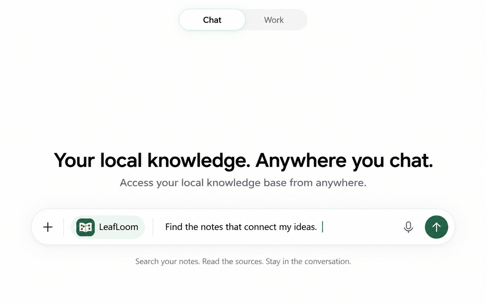
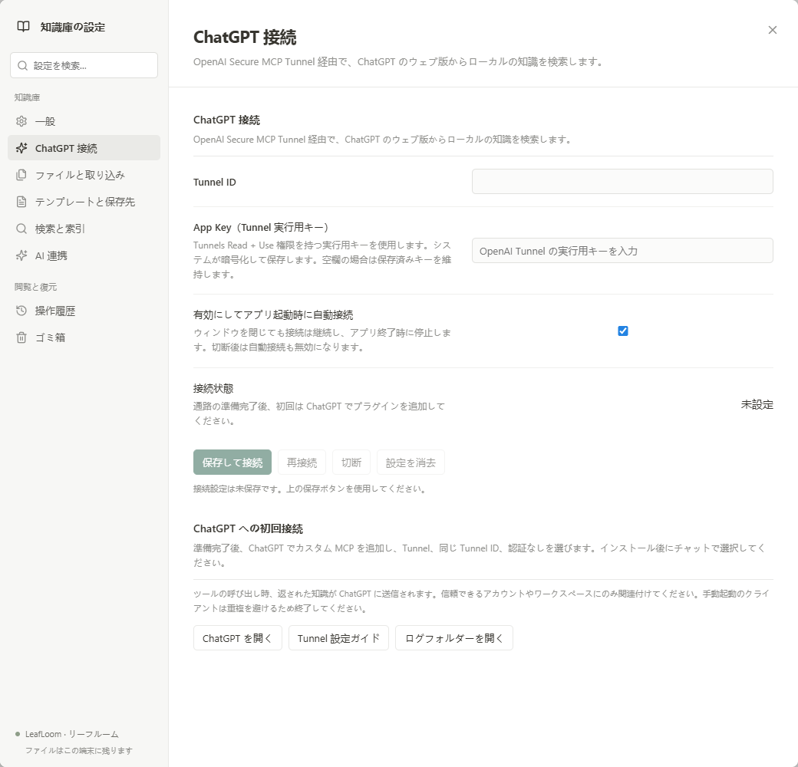
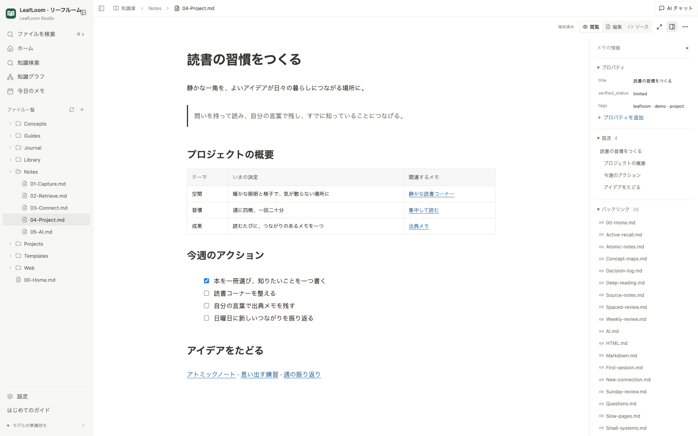
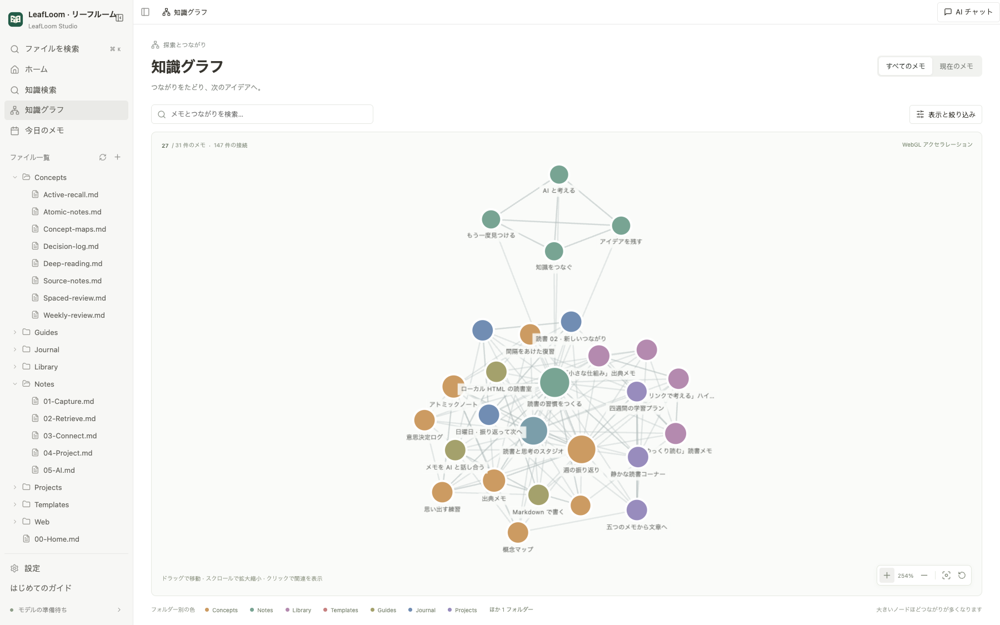
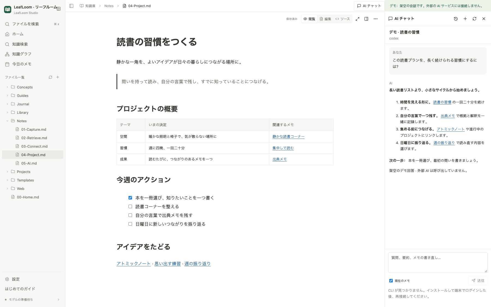
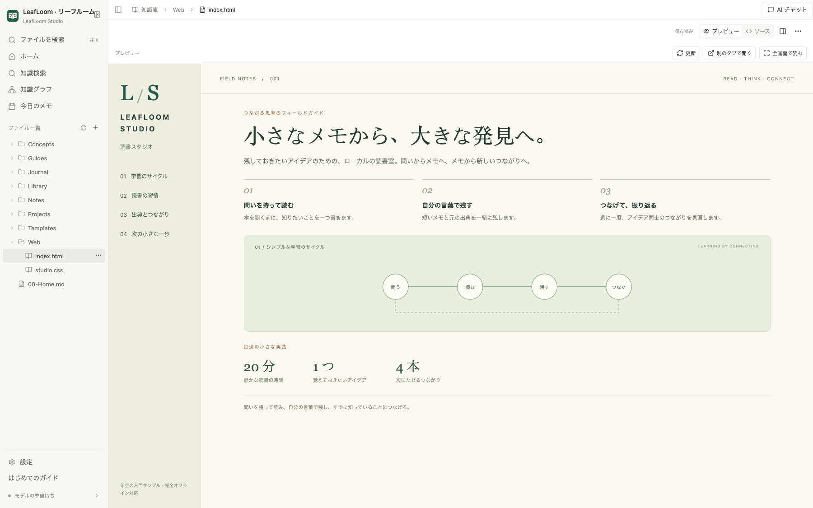
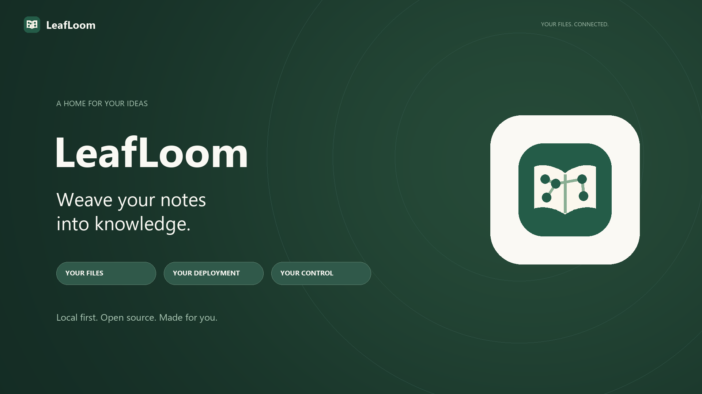

<p align="center"></p>

# LeafLoom · リーフルーム

**知識は手元に。いつもの AI と、もっと活かす。**

[English](../../README.md) · [中文](../../docs/zh-CN/README.md) · [日本語](../../docs/ja/README.md)

散らばったメモ、プロジェクト資料、保存したウェブページを、つながる知識ベースへ。**LeafLoom は、オープンソースでローカルファーストのナレッジ管理ツール・個人 Wiki** です。Markdown と HTML、出典をたどれる検索、知識グラフ、MCP、Skill、AI Chat、ChatGPT 連携を一つのワークスペースで使えます。

ファイルと検索インデックスは自分のパソコンに保存。読む、書く、探す作業はローカルで行い、必要なときに AI をつなげられます。

**[Windows 版をダウンロード](https://github.com/DJ-Huang/LeafLoom/releases/latest) · [Mac 版をダウンロード](https://github.com/DJ-Huang/LeafLoom/releases/latest)**

[使い始める](#使い始める) · [ChatGPT と接続](#chatgpt-でローカルの知識を活用) · [MCP・Skill・AI Chat](#ai-connections) · [利用ガイド](GUIDE.md) · [ドキュメント一覧](../README.md)

**LeafLoom の使い心地を動画で（英語）：**

https://github.com/user-attachments/assets/56f37418-23cc-4763-af3c-3253fb06f517

## 自分の知識が育つ場所

| やりたいこと | LeafLoom でできること |
| --- | --- |
| **使うほど育つ知識ベース** | 双方向リンク、バックリンク、テンプレート、知識グラフで、メモや調査資料、プロジェクト文書を個人 Wiki にまとめます。 |
| **自分で管理するプライバシー** | ファイルとインデックスは自分の端末に保存。検索対象も自分で選び、知識ベースをクラウドに預ける必要はありません。 |
| **Markdown + HTML** | 表やタスクを Markdown で記録し、スタイル・画像・対応するスクリプトを含むローカル HTML も同じ画面で開けます。 |
| **原文を確認できる検索** | キーワード検索、Wiki ナビゲーション、任意のローカル BGE-M3 意味検索を使い、結果から元のメモへ戻れます。 |
| **いつもの作業に AI を** | MCP クライアント、同梱の `wiki-search` Skill、メモに並べる AI Chat に対応。編集提案は確認してから保存します。 |
| **ChatGPT から自分の知識へ** | デスクトップ内蔵の Tunnel クライアントで接続し、ChatGPT の会話からローカルのメモを検索・閲覧できます。 |

研究資料の整理、プロジェクト Wiki、読書メモ、AI が根拠として参照できる資料集。自分のフォルダーから始められます。

## 知識はローカルに。共有は自分で選ぶ。

- **資料は自分のフォルダーに保存。** 閲覧、編集、グラフ、ローカル検索はメモをホスティングされた知識サービスへ送信しません。依存関係と必要なモデルの準備後は、オフラインで使えます。
- **検索範囲も自分で選択。** 初期状態では索引の対象は空です。サービスはループバックのみで待ち受け、ファイルへのアクセスは接続フォルダー内に制限します。
- **AI 連携は任意。** AI Chat は質問、選択した文章、有効にしたメモの文脈、検索した根拠を選択したサービスへ送ることがあります。ChatGPT 接続では、要求されたツールの結果が ChatGPT に渡ります。

[ローカル保存、アクセス境界、AI のプライバシーについて](../SECURITY.md)

## ChatGPT でローカルの知識を活用

**自分の知識を、ChatGPT との会話へ。** ChatGPT のウェブ版で LeafLoom を選ぶと、選択したフォルダーを検索し、メモを読み、出典をたどりながら会話できます。LeafLoom を実行するパソコンはオンラインで、アプリを起動しておく必要があります。現在の接続は検索と読み取りに対応し、メモの編集は LeafLoom で行います。

[ChatGPT を開く](https://chatgpt.com/) · [ChatGPT Plugins で接続を追加](https://chatgpt.com/plugins) · [公式 Tunnel 設定ガイド](https://developers.openai.com/api/docs/guides/secure-mcp-tunnels)



*上図は Chat の利用イメージです。下の設定画面は実際のデスクトップアプリから撮影しています。*

### 一度設定すれば、アプリと一緒に接続

1. LeafLoom デスクトップアプリで **設定 → ChatGPT 接続** を開き、既存の **Tunnel ID** と **Tunnels Read + Use** 権限を持つ **App Key** を入力して、**保存して接続** を選びます。クライアントは内蔵されているため、別途ダウンロード、設定ファイルの作成、ターミナル操作は不要です。
2. ChatGPT でカスタム MCP を追加し、接続方法に **Tunnel** を選び、同じ Tunnel ID を入力して、認証を **認証なし** に設定します。接続をインストールし、会話で **LeafLoom** を選びます。Tunnel を対象の ChatGPT ワークスペースに関連付け、そのワークスペースでカスタム MCP 接続が許可されている必要があります。[公式設定ガイド](https://developers.openai.com/api/docs/guides/secure-mcp-tunnels)もご覧ください。
3. 例えば「このテーマに関するメモを探し、出典を示して」と聞いてみましょう。先に LeafLoom で検索対象のフォルダーを選んでください。初期状態では索引の対象は空です。



App Key は OS によって暗号化して保存されます。接続はアプリと一緒に起動し、ウィンドウをトレイに閉じても続き、アプリの終了時に停止します。**切断** を選ぶと、再び有効にするまで自動接続を停止します。メモは自分のパソコンに保存され、ツールで取得した結果は ChatGPT に送信されます。

[デスクトップのインストールと接続の詳細](../DESKTOP.md#chatgpt-connection) · [プラットフォームごとの検証と現在の制限](../TUNNEL_VALIDATION.md)

<a id="ai-connections"></a>

## MCP・Skill・AI Chat

いつものツールから自分の知識を使い、必要なときに原文を確認できます。

| 接続方法 | 使い方 |
| --- | --- |
| **MCP** | Codex、Cursor、Claude Code などをローカル HTTP MCP の `http://127.0.0.1:18080/mcp`（既定のポート）に接続。選択した範囲で知識を検索し、原文や索引状態を確認できます。 |
| **Skill** | **設定 → AI 連携 → スキルをインストール** から同梱の [`wiki-search` Skill](../../wiki-search/SKILL.md) を追加。対応する AI アシスタントに検索、Wiki ナビゲーション、出典確認の手順を伝えます。MCP の接続設定は別途必要です。 |
| **AI Chat** | 対応するログイン済み CLI をつなぎ、メモや選択した文章について対話。引用から原文を開き、編集差分を確認して下書きに取り込み、準備ができたら保存します。 |

[AI Chat・MCP・Skill の設定](AI.md)

## つながる思考のワークスペース

初回起動時に「デモを試す」を選ぶと、内蔵の[読書と思考のスタジオ](../../vault_rag/examples/ja)を開けます。関連するメモ、ローカル HTML の読書室、プロジェクト・読書・意思決定のテンプレートを収録しています。編集内容はデモを開き直しても残ります。

### Markdown を読み、書く

整形された本文を直接編集し、`/` コマンド、ブロックのドラッグ、表の編集、画像の貼り付けや添付のドロップを使えます。本文と Markdown ソースで元に戻す履歴を共有し、未変更の原文とプロパティを保持します。通常は自動保存し、AI の下書きは手動で保存します。[Markdown 編集ガイド](GUIDE.md#コマンドで編集)。



### 知識グラフでつながりをたどる

バックリンクから判断の背景をたどり、グラフから忘れていたつながりを見つけます。デモでは、知識カード、プロジェクト、読書資料、学習ログの間にある実際のリンクを探索できます。



### AI Chat でメモを深める

原文と対話を並べて、回答中の参照から関連メモへ戻れます。この画面は架空のデモ対話で、外部 AI は呼び出していません。



### ローカル HTML をそのまま読む

ローカルの `.html`・`.htm` を開き、一度プロジェクトフォルダーを確認すると、関連するスタイル、スクリプト、リソースとともにサイトを実行できます。移動、ダウンロード、任意の SPA ルーティングに対応し、サイドバーの「プレビュー」から既存の HTTP/HTTPS サイトや開発サーバーも開けます。[HTML プロジェクトガイド](GUIDE.md#html-プロジェクトとウェブサイトを開く)。下の HTML 読書室はデモに含まれています。



## 使い始める

**[最新の Release](https://github.com/DJ-Huang/LeafLoom/releases/latest) のデスクトップアプリがおすすめです。** リポジトリのクローンや、Python・Node・Ollama の事前インストールは不要です。

| 対応環境 | ダウンロード | インストール |
| --- | --- | --- |
| Windows 10/11 x64 | [Windows 版](https://github.com/DJ-Huang/LeafLoom/releases/latest) · `.exe` | インストーラーを実行し、スタートメニューやデスクトップから LeafLoom を開きます。 |
| macOS 14 以降 · Apple Silicon | [Mac 版](https://github.com/DJ-Huang/LeafLoom/releases/latest) · `.dmg` | ディスクイメージを開き、LeafLoom を「アプリケーション」にドラッグして起動します。 |

言語を選び、同梱のデモを試すか自分のフォルダーを開いて、検索範囲を選びます。初期状態では索引の対象は空です。まずは閲覧し、意味検索が必要になったら設定でローカルモデルを準備できます。

[詳しいインストール要件とプラットフォームの検証状況](../DESKTOP.md)

<details>
<summary>ソースから起動（開発向け）</summary>

```sh
git clone https://github.com/DJ-Huang/LeafLoom.git
cd LeafLoom
```

1. リポジトリをダウンロードまたはクローンし、書き込み可能なフォルダーに展開します。
2. Windows 10/11 x64：`Start.cmd` をダブルクリック。 macOS 14 以降の Apple Silicon：リポジトリで `sh Start.sh` を実行。
3. 初回は専用の実行環境と依存関係を準備して画面を開きます。検索モデルは必要に応じて設定から準備します。Python、Node、Ollama の事前インストールは不要です。
4. 言語を選び、架空のデモを試すか自分のフォルダーを接続して、検索範囲を明示的に選びます。

</details>

[📖 はじめてのガイドと FAQ](GUIDE.md) · [✨ AI 連携](AI.md) · [▶ 英語の紹介動画](../../assets/promo/leafloom-en.mp4)

[](../../assets/promo/leafloom-en.mp4)

## 3 つの言語

使い慣れた **日本語、English、简体中文** で始められます。画面、初回ガイド、利用ガイド、機能スクリーンショットは 3 言語に対応。言語設定は索引の設定とは別に保存します。

**自分の知識を、自分で配置し、自分で管理する。** 対応する端末で実行し、ローカル限定のアクセス、非公開認証、フォルダー境界で管理できます。[配置と安全性](../SECURITY.md)。

## できること・制限

閲覧、編集、グラフ、キーワード検索にはモデルは不要です。ローカルの意味検索を使うときに、設定から BGE-M3 を準備します。外部 AI や ChatGPT には、それぞれのアカウント、権限、ネットワーク接続が必要です。

デスクトップの対応環境は上記のとおりです。クラウド同期、すべての Obsidian プラグイン、メディアの文字起こしは提供しません。

## 更新と参加

**デスクトップアプリ：** LeafLoom を終了し、[Releases](https://github.com/DJ-Huang/LeafLoom/releases/latest) から対応する最新版をインストールして、再び開きます。

**ソースからのインストール：** リポジトリの更新後に `Install.cmd` または `sh Install.sh` を実行してサービスを再起動します。ブラウザーの更新だけではサーバーは更新されません。

[Contributing](../../CONTRIBUTING.md) · [Changelog](../../CHANGELOG.md) · [Third-party notices](../../THIRD_PARTY_NOTICES.md) · [Media](../../docs/MEDIA.md)

MIT © 2026 DJ。依存関係とモデルはそれぞれのライセンスを保持します。 [License](../../LICENSE)

Technical compatibility: `vault-rag`, `VAULT_RAG_HOME`, `.vault-rag/`, HTTP MCP `/mcp`.
