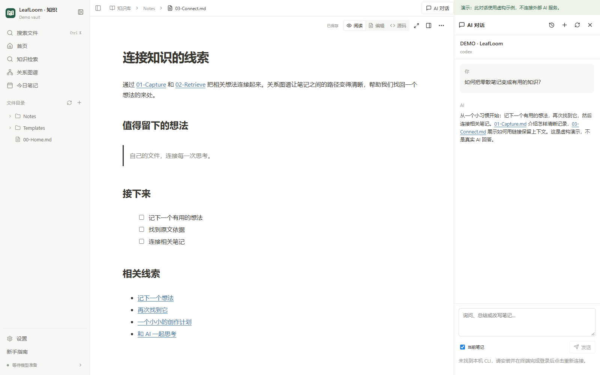

# 可选 AI 接入

[English](../en/AI.md) · [中文](AI.md) · [日本語](../ja/AI.md)

浏览、编辑、图谱和本地检索不需要外部 AI。助手使用本机已有、已登录的 Codex 或 Codely CLI，无需向 LeafLoom 网页输入 API Key。

## 网页助手

按 CLI 官方说明安装，在普通终端完成登录。打开 **AI 对话**，选择服务，必要时重新连接。选中文字后使用 **添加到 AI 对话**；发送前核对引用卡片和 **当前笔记** 开关。配置的模型服务可能收到问题、选文、当前笔记和检索依据。

对话按主题保存在私有配置目录。**停止** 保留已收到的回答。刷新或重启会恢复历史，不自动重发问题。请保留 CLI 自己的原生会话记录，以便恢复。

## 检查修改再保存

先检查差异预览。**接受到草稿** 更新编辑器，尚不写入原文件；AI 草稿及后续手动编辑暂停自动保存，使用 **保存草稿** 或 `Ctrl/⌘+S` 才写入。**丢弃草稿** 经确认恢复磁盘版本。创建新笔记需要确认，不覆盖同名文件。

原文、草稿或磁盘版本发生变化时，请重新生成或手动合并；应用保留冲突草稿。

## 用 AI 调整设计

在设计工作台选择元素，使用 **添加到 AI 对话** 附加项目、页面、稳定 ID 和当前版本，再描述布局、素材、组件、动画或脚本的修改。内置助手只能修改当前对话明确附加的设计项目。一批设计修改直接应用，并形成一个持久撤销步骤；版本冲突时保留较新的设计。脚本播放状态不会写入设计历史。脚本接口与导出见 [Design Studio](../DESIGN_STUDIO.md)。

## 通过 MCP 连接其他客户端

打开 **设置 → AI 连接 → MCP 访问权限**，启用本机 AI 读取并复制生成的连接配置。专用凭据仅显示一次。Codex 使用 `http_headers.Authorization`，Cursor 使用 `headers.Authorization`，Claude Code 使用 `type: http` 和 `headers.Authorization`。重新生成凭据或关闭全部资源权限后旧凭据立即失效，请勿共享配置。

需要直接保存时，另行开启 **允许本机 AI 修改笔记**。ChatGPT 沿用已有 Tunnel，分别开启它的“读取全部笔记”和“修改笔记”开关；权限变更后自动重连，请在客户端刷新工具列表。两种连接默认都关闭写入。

完整访问覆盖关联目录内全部 Markdown、TXT、HTML/HTM，包括归档和未勾选 RAG 的笔记。支持查找、分段读取、创建、精确修改、属性、移动、可恢复删除、历史、链接、模板与日记。RAG 仍只使用已选择且符合条件的 Markdown/TXT；HTML 按源码读写。旧的本机免鉴权连接及旧 bearer 凭据继续保留原有五项只读能力，旧 `auth-token` 不能开启完整访问。

所有修改校验知识库版本，已有笔记还需读取时的文件版本。移动、删除先返回影响预览；历史与回收区可先预览再恢复。MCP 读取磁盘版本，界面中冲突的未保存草稿继续保留，并明确区分保存成功与索引待更新。网页助手的笔记编辑仍使用原有提案流程。受管设计使用 `design_document`、`design_operations` 以及设计历史、素材、共享库和导出工具，沿用该连接的读写权限。

**设置 → AI 集成 → 安装技能** 安装 `wiki-search` 指令，不自动配置 MCP。详见[完整工具契约](../MCP.md)。

CLI 未被发现时，先确认终端可以运行它，再重启服务以获得最新 PATH。登录过期在 CLI 中重新登录。会话恢复失败时保留历史并处理 CLI 状态，不要删除知识笔记来修复对话。

