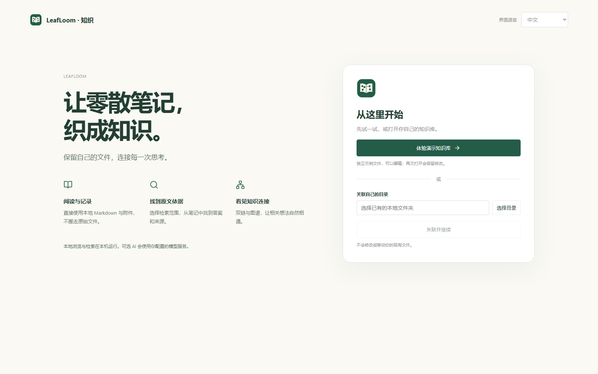
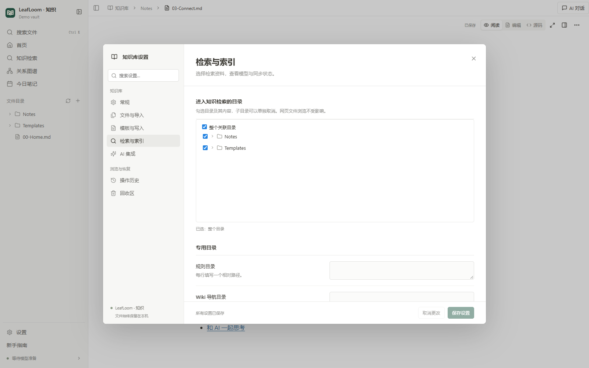
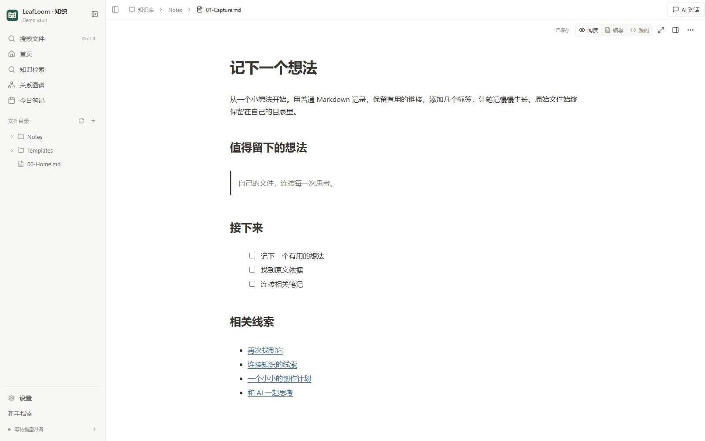
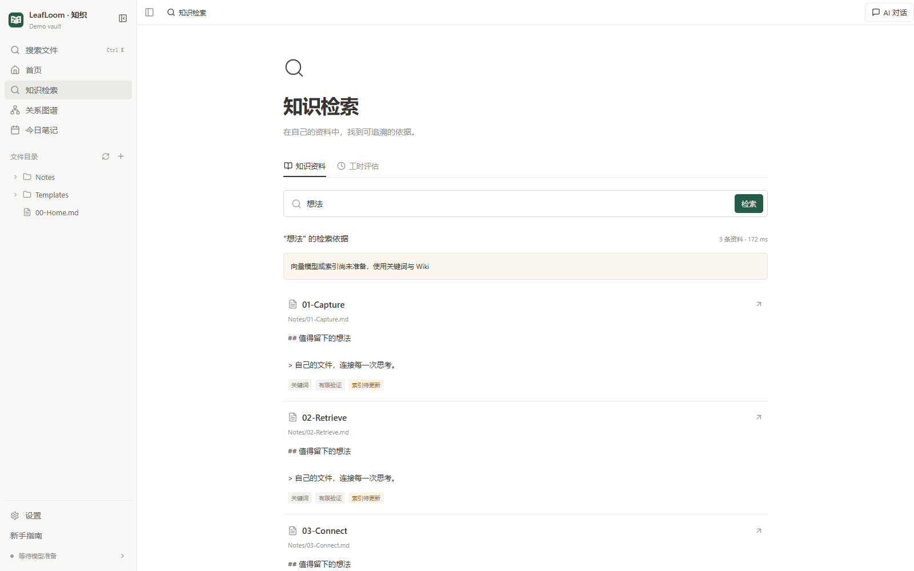
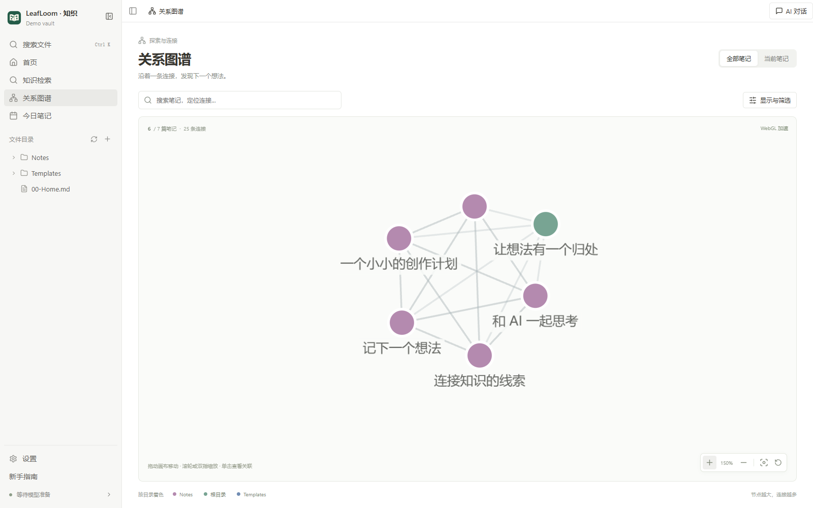

# 开始使用 LeafLoom · 知织

[0.1.8 更新内容与升级说明](RELEASE_NOTES_0.1.8.md)

在 **设置 → Skill** 安装或更新 **LeafLoom 技能**。在新的本机 Codex 聊天中使用 `$leafloom` 查知识库、管理项目任务或记录工作。设计请求会引导你打开 **设计工作台**。技能直接连接正在运行的 LeafLoom。请在 **设置 → AI 集成** 中开启本机 AI 读取，需要保存改动时再开启写入。

工作记录和汇报默认使用当前知识库的 `工作中枢/`。飞书和 GitLab 流程按需加载。详见[工作中枢](../WORK_HUB.md)。

**选择办公软件：** 打开 **设置 → Skill → 工作中枢配置**，勾选使用的软件，可同时选择飞书/Lark、Notion 等多个平台，每次修改即时保存。按来源自动选择、仅本地为独立互斥模式；取消全部软件后恢复自动选择。钉钉、企业微信和 Notion 当前仅保存偏好，标注尚未接入；登录与权限另行设置。也可说“同时用飞书和 Notion”“再加上 Notion”，与设置页共用 `工作中枢/配置.md`，兼容原单选配置。多选不扩大采集范围，也不将任务同时写入所有平台。对话修改后重新载入设置即可。中枢目录可在 **模板与写入 → 默认写入位置** 调整，旧资料不会自动移动。

周报和双周报优先参考 `工作中枢/模板/周报模板.md`（如存在）。

需要原样阅读工作记录时，可指定飞书页面并说“同步飞书工作记录”：按需单向同步页面及子页面到 `工作中枢/工作目录/`，图片、视频经校验后保存在附件服务器，支持超过 500 MB 的视频。本地修改和源页面移除后的副本会保留，失败可继续；需要本机 LeafLoom、Python 3.11+ 和已登录的 `lark-cli`。详见[工作中枢](../WORK_HUB.md)。

[English](../en/GUIDE.md) · [中文](GUIDE.md) · [日本語](../ja/GUIDE.md)

[全部文档](../README.md)

**开发者：** 在源码目录中，Windows 双击 `Dev.cmd`；macOS 14+ Apple 芯片双击 `Dev.command`，也可在终端运行 `sh Dev.sh`。若下载或复制后丢失执行权限，先运行一次 `chmod +x Dev.command Dev.sh`。两端也可运行 `node scripts/dev-desktop.cjs`。需要 Node 22+ 和 uv，首次启动自动安装依赖。桌面端直接运行源码，前端修改后自动更新，无需手动构建。Dev 与安装版完全共用用户配置、模型、凭据和桌面数据，后端沿用同一份配置中的端口（默认 18080）；只有开发依赖保存在 `.cache/desktop-dev/.venv`，Vite 使用 5173。切换前先退出当前应用；隔离验证时显式设置临时 `VAULT_RAG_HOME`。修改 Python/Electron 后，选择 **LeafLoom → 重启 LeafLoom** 或托盘中的 **重启 LeafLoom**。详见[源码开发](../DESKTOP.md#source-development)。

**可选浏览器开发：** 按[双终端启动步骤](../DESKTOP.md#optional-browser-development)先在 `http://127.0.0.1:5173` 启动 Vite，再运行 `uv run --locked python scripts/dev-browser.py --home /tmp/leafloom-browser-dev --port 36229 --loopback-ui`，用专用浏览器 profile 打开输出的 `http://localhost:36229/`。必填的 home 须为新建／空目录或由此启动器标记过的目录；标记固定端口与界面模式，更改时使用全新目录及 profile。省略 `--loopback-ui` 则保留 `app.<installation-id>.localhost` 管理界面。真实运行时与后台工作正常启用，不自动下载模型或调用外部 AI。受影响的受管浏览器仍可能无法预览独立来源的 HTML 项目，请勿绕过安全警告。这是浏览器开发入口，不代表支持 Linux 桌面安装。

旧 Dev 配置保留在 `.cache/desktop-dev/` 中供恢复，不覆盖安装版配置。共享数据目录尚无 `models/` 时会复制复用旧模型并保留原文件；已有模型目录保持不变。

旧仓库启动入口已移除。安装版通过自己的快捷方式和菜单管理；开发时使用 Dev，通过开发实例自己的托盘／菜单栏退出，或在启动终端按 Ctrl+C。

## 帮助中心

从应用侧栏选择 **帮助中心**，或打开[在线帮助中心](https://dj-huang.github.io/LeafLoom/docs/zh-CN/)。按任务浏览主题，使用 `Ctrl/⌘+K` 搜索完整文章。文章提供步骤、完成后的表现、问题排查、本页目录与前后篇导航；切换语言保留任务与标准章节。示例可复制、截图可放大；未启用 JavaScript 时仍可浏览主题和阅读文章。帮助搜索只检索公开文档，不读取你的知识库。

## 安装与打开

[LeafLoom 官网](https://dj-huang.github.io/LeafLoom/zh-CN/) 提供中英日三语介绍、产品截图和各平台最新可用正式版安装包直达下载。按平台选择 Windows 或 Mac，旁边可查看版本说明与 SHA-256 校验文件；若新 Release 缺少某平台安装包，官网继续提供该平台最新可用正式版，并显示对应版本、说明和校验文件；仅在所有正式发布都没有该平台安装包时显示暂不可用。

官网的 About（关于）页面提供作者 GitHub 与 X 个人主页链接，可从顶部导航或页脚进入；切换语言时仍停留在关于页面。

支持 Windows 10/11 x64，以及 macOS 14+ Apple 芯片。桌面安装器暂不支持 Linux、Intel Mac 和 Windows ARM。

**推荐从 [最新 Release](https://github.com/DJ-Huang/LeafLoom/releases/latest) 下载桌面安装包。** 无需克隆仓库，也无需预装 Python、Node 或 Ollama。

1. **Windows：** 下载 Windows x64 的 `.exe`，运行安装程序，再从开始菜单或桌面快捷方式打开 LeafLoom。
2. **Mac：** 下载 macOS Apple 芯片的 `.dmg`，打开后将 LeafLoom 拖入「应用程序」，再启动应用。
3. 选择语言，体验内置演示库或关联自己的目录。阅读、编辑、图谱和关键词检索无需下载语义检索模型；需要时再在检索设置中准备 BGE-M3。

关闭窗口后，LeafLoom 留在托盘／菜单栏；选择 **退出** 才会停止应用及本地服务。应用菜单 **LeafLoom → 重启 LeafLoom** 和托盘中的 **重启 LeafLoom** 会使用相同配置与数据目录重新打开应用。重启前准备笔记草稿并等待本地服务停止；若提示未保存内容，可选择返回取消重启。开发模式保留 Vite，并先同步锁定的 Python 依赖，再加载当前源码。首次从没有此菜单的版本更新时，仍需手动退出并启动 Dev 一次。新安装默认不开启登录启动，可在桌面设置或托盘中修改。更新时打开 **设置 → 常规 → 应用更新 → 检查更新**，查看当前与最新版本。有新版时选择 **下载并安装**，进度条显示百分比和已下载／总大小。SHA-256 校验通过后，应用正常退出（保留未保存草稿提示），再打开 Windows 安装向导或 Mac DMG；完成安装，Mac 将新版拖入“应用程序”，然后重新打开 LeafLoom。取消退出后可选择 **继续安装**；检查或下载失败可重试。Dev 仅检查版本，更新源码后重新运行 Dev。

服务仅监听本机 `127.0.0.1`，默认端口 `18080`。[桌面安装详情](../DESKTOP.md)包含安装要求与验证边界；开发者可查看[源码安装说明](../../README.md#get-started)。

macOS 通过 **Dev.command** 或 **Dev.sh** 启动开发模式时，Dock 同样显示 LeafLoom logo 和名称。更新桌面源码或品牌资源后，选择 **重启 LeafLoom** 即可重新加载。

维护者推送与项目版本一致的 `vX.Y.Z` 标签后，GitHub 会自动构建两个平台的安装包，并生成含 `SHA256SUMS.txt` 的 Release 草稿。检查 Actions 结果和草稿后手动发布；构建失败可重跑，已公开版本禁止覆盖。手动 **Run workflow** 只提供 Actions 附件下载。当前标签构建没有受信任发行签名（Mac 使用临时签名且未公证），系统仍可能提示或拦截。详见[构建、重试与发布步骤](../DESKTOP.md#automatic-release-drafts)。

## 选择语言与知识库

欢迎页默认跟随系统语言，不支持的语言回退英文。可选择中文、English 或日本語，之后在 **设置 → 常规 → 界面语言** 修改。切换语言保留文档、草稿与位置，不重建索引。

选择 **体验演示知识库**，先探索一套独立的虚构资料。可以编辑，重复打开保留修改；各语言的演示库互相独立。已有 Markdown/Obsidian 资料时，选择 **关联自己的目录**。原文件继续留在原处；这是文件编辑器，保存编辑会修改这些原文件。



## 明确选择检索范围

网页可浏览整个关联目录，知识检索只使用明确勾选的目录。可以选整个目录或指定子目录，也可以单独排除某个子目录。默认不勾选任何目录。**暂时只浏览** 表示知识检索暂时没有语料。

只索引 `.md` 和 `.txt`。图片、视频和附件可以浏览，但不会自动转写。隐藏或应用目录、`.ragignore` 排除项及已退出检索的笔记仍被排除。规则、主题导航和工时专用目录属于进阶设置，普通笔记无需配置。



## 阅读、记录、检索与连接

1. 从侧栏打开 Markdown 笔记即可直接编辑。正文保持阅读时的排版，**查看源码** 可切换到 Markdown 文本。普通编辑自动保存，发生冲突时保留草稿，核对后再合并。
2. 使用 **新建笔记** 记录想法。写下 `[[另一篇笔记]]` 建立连接。
3. `Ctrl/⌘+K` 按名称找文件；侧栏 **知识检索** 搜索笔记里的问题与关键词。
4. 点击检索结果打开原文，结合上下文和验证状态判断依据是否可靠。
5. 在 **关系图谱** 搜索笔记、筛选目录、沿连接探索。反向链接来自其他笔记对当前笔记的引用。
6. 首页清单可手动标记完成，也可关闭；侧栏 **新手指南** 可重新打开。

右键顶部路径栏中的任意目录或文件名（包括 **知识库**），可选择 **复制相对路径** 或 **复制绝对路径**。相对路径以当前知识库根目录为起点，根目录自身为 `.`；绝对路径使用运行服务的电脑上的路径及系统分隔符。路径获得焦点后按 **Shift+F10** 也能打开菜单，点击当前文件名／目录名同样可用。复制上级目录时，得到的是该级目录的路径。





## 用命令快速编辑

在正文行首或空格后输入 `/`，可插入标题、列表、待办、引用、表格、代码、图片、链接、公式和 Mermaid 图表。菜单显示图标、用途说明、分类和最近使用；支持中文名称及 `/h2`、`/todo` 等别名，方向键选择、Enter 确认，Esc 关闭并保留输入。代码、公式、属性和网址中不会弹出菜单。

选中文字后使用浮动格式栏，或用 `Ctrl/⌘+B`、`Ctrl/⌘+I`、`Ctrl/⌘+E` 切换加粗、斜体和行内代码。选中文字后粘贴网址即可生成链接，也可用 `Ctrl/⌘+Shift+K` 输入链接。输入 `[[` 和笔记名，可按完整路径选择目标笔记。

悬停在块旁使用 **＋** 插入内容，点击手柄可转换、创建副本、移动或删除，拖动手柄可调整段落、列表项或完整块的位置。文字可跨段落选择；点击表格单元格直接输入，Tab 换格，末格 Tab 新增行，表格工具栏可增删行列、设置表头和对齐。支持粘贴截图和拖入文件；附件以唯一名称保存在知识库统一的 `_attachments` 目录（或已配置的 `attachment_folder`），不覆盖已有文件。撤销链接不会删除附件，上传失败或取消后已完成的文件也会保留。

正文仍保存为普通 Markdown，未修改的块和文档属性保持原文；正文与源码共用撤销记录。公式和 Mermaid 默认显示渲染结果，通过各自面板修改。复杂或不支持直接编辑的内容保留展示，可定位到源码修改。切换界面语言保留当前编辑器及撤销历史。表格支持 Markdown 可表达的简单结构，不包含合并单元格和格内嵌套块。

**本页目录** 在正文左侧以无边框列表显示当前 Markdown 笔记的标题层级。点击左上角双箭头 **收起目录**，原位置保留列表图标，可点击 **展开目录**。含子标题的目录项可直接点击标题文字，折叠或展开整段子目录，同时跳转到该章节；左侧箭头只切换折叠，没有子标题的项目只跳转。编辑或隐藏整个目录时保留各级折叠状态；阅读已折叠的子章节时只高亮其折叠父标题，不会自动展开。当前阅读的章节以蓝色显示，随正文滚动更新；点击标题可在正文或源码模式中靠上定位。目录随编辑同步更新，支持下划线形式的标题，同名标题分别定位，代码块和文档属性不会混入目录。当前会话记住每篇笔记的开关。文档区域较窄时默认收起，展开后以浮层显示；点击父标题折叠时浮层保持打开，选择没有子标题的项目或按 Esc 后关闭。

## 行内标注与评论

Markdown 正文中选中文字后，浮动格式栏会出现五种颜色的 **高亮** 与 **评论** 图标。选择高亮色即可标记重要内容；选中已高亮文字后，点击颜色前带斜线的 **清除高亮** 按钮可恢复普通文字，右键菜单也提供此操作。仅清除选中的部分，保留两侧高亮和评论，一次清除可整体撤销／重做；点击评论或按 `Ctrl/⌘+Shift+M` 可针对选中文字发起讨论。文档顶部的 **评论** 按钮打开右侧面板；无需选中文字也可以发表 **页面评论**。支持回复、编辑评论、标记已解决/重新打开、筛选和删除。

评论中的引用可点击跳回正文。原文移动后尽量按文本和上下文重新定位；如果引用文字被删除或出现无法判定的重复引用，显示 **定位已失效**，可在正文中重新选择文字并点击 **关联到当前选区**。高亮和评论也可在 Markdown 源码模式中看到，不会写入 Markdown 源码。标注与正文、源码共用当前会话的撤销历史：使用顶部撤销／重做按钮，或 `Ctrl/⌘+Z` 撤销、`Ctrl/⌘+Shift+Z`（也支持 `Ctrl+Y`）重做。添加、删除（含回复）、编辑评论、解决／重新打开及重新关联都可与正文修改按顺序撤销。评论输入框保留自身文字撤销；若其他窗口或 MCP 已修改评论，撤销／重做会停止，不覆盖新内容。创建标注前会先保存普通未保存正文；AI 手动草稿则必须先显式保存。

标注、评论和回复属于**应备份的用户数据**，存放于每个知识库的 `.vault-rag/annotations.sqlite`，不要将其当作可删除的索引。经 LeafLoom 移动、重命名或移入回收区后再恢复笔记，评论与该笔记的身份关联仍保留。首期支持 Markdown 标注（底层也允许 TXT 页面评论）；HTML 项目和 Design Studio 尚不支持原位评论。详细技术边界见[标注系统说明](../ANNOTATIONS.md)。

## 打开 HTML 项目、网站与设计工作台

1. 从文件目录打开本地 `.html` 或 `.htm` 文件，确认 **项目文件夹** 后选择 **保存并打开**。文件夹应包含入口及全部配套资源；网页的 `/` 对应这个文件夹。留空表示使用关联知识库的根目录。
2. 在 **项目设置** 中修改目录，或为前端单页应用启用 **SPA 路由**。页面路由不存在时打开项目入口；缺失的脚本、图片和 JSON 仍会报错。
3. 网页工具栏提供后退、前进、刷新、全屏和 **独立标签页**。桌面应用在自身窗口内运行同一网站；浏览器与桌面应用的网站存储互相独立。
4. 侧栏选择 **网页 → 打开网址**，可打开已有 HTTP/HTTPS 网站或开发服务。LeafLoom 不安装依赖，也不启动网站后台；外部网站可能限制嵌入或要求登录。
5. 侧栏选择 **设计工作台**，或在目录右键选择 **在此新建设计项目**。新项目使用受管可视化文档；已有 `1.1.0` 项目保留原图层审阅能力，也可以转换为独立的可编辑副本。画布支持手游竖屏 `720×1560`、横屏 `1560×720`、桌面网页 `1440×900` 或自定义尺寸。

**源码** 可编辑 HTML 文本。普通编辑自动保存；仍有未保存草稿时，网页视图使用临时来源预览，不会因预览而保存文件。配套资源仍读取磁盘。HTML 的浏览不受检索勾选范围限制，也不会进入知识检索索引。

HTML 项目与设计工作台资源只保存在项目目录（如 `assets/`、`Design/Assets/`），不进入中央 `_attachments`，也不参与附件服务器迁移。若已注册的 HTML 项目仍在 `_attachments` 下，请先关闭 LeafLoom，再运行一次性脚本 `scripts/localize_html_attachments.py`（默认预览，加 `--apply` 才写入）：项目整树迁到 `Web/<名称>/`，项目外的中央依赖迁到各项目的 `assets/`，并改写静态 HTML/CSS 引用；脚本生成的引用会列为需人工处理的阻断项。

macOS 14/15 的 Safari 无法打开本机网页时，可在 **设置 → 常规 → Safari 本机网页兼容** 启用专属解析配置，系统会请求管理员授权。移除方式与平台边界见 [HTML 项目说明](../HTML_PROJECTS.md)。

旧的回环地址打开新版工作区地址时，会自动迁移本地草稿与视图状态。目标地址已有的值优先保留，发生冲突时可从横幅下载备份，原浏览器存储仍保留。这不是浏览器之间或浏览器与桌面应用之间的同步。

## 在设计工作台制作游戏画面

先在设置中启用飞书连接，并完成妙搭应用所需的授权。在设计工作台点击 **发布到**，然后选择 **妙搭**，选择页面并新建应用，或通过应用 ID 关联已有的 Design Studio 课件应用。关联时会检查课件身份和远端文件版本；发现未识别的修改会暂停，不能通过重新关联跳过检查。发布会用所选页面替换该应用当前课件，已有应用的访问范围保持不变。新应用先发布不含课件的空白外壳；飞书确认公司内访问范围后才上传并发布课件，因此可能需要两次审批。任务使用已保存版本，在后台上传素材并发布；对话框显示关联页面、动态引用、授权和审批提示。不确定操作中断后，先检查远端应用；素材阶段可核对后继续。

妙搭发布状态会跟随后台任务更新：首轮发布转入素材上传、完成或中断后，刷新会显示当前阶段，不再误报没有待检查的发布。临时读取失败会延迟重试。上传中断后，点击“核对素材并继续”按完整文件名检查远端：唯一结果直接复用，完整查询确认不存在时重新上传，结果不完整或存在歧义则保持暂停。

妙搭编辑器预览与正式发布是两个工作区。正式课件已上线、编辑器仍显示“页面待开发”时，应先检查云端代码差异，再保留现有修改并合入 `origin/sprint/default`；刷新预览本身不会拉取代码。以实际页面显示、翻页和交互作为验收，不能只看发布状态。正式课件使用平台的无扩展名正文入口，入口画面随应用打包后建立同源隔离画面，避免嵌入导航卡住；正文未就绪时不会启用翻页，等待超时会提供重试和单独打开入口。


- 项目首页提供搜索、最近打开、收藏、重命名、复制、移动、归档与可恢复回收站。工作区撤销/重做处理项目管理，项目历史处理跨页面、关闭重开后的设计修改。
- 在 **页面** 中新增、分组、排序或复制画面；右键页面列表中的画面可复制或删除，删除可撤销，最后一页不能删除。插入文字、图片、容器、按钮、形状、SVG、自定义 HTML、嵌入子页面，或 HUD、角色卡、图鉴、弹窗等游戏起步组件。点击图层、按住 Shift 多选，通过画布与属性面板调整位置、尺寸、角度、文字、外观及横排/竖排/网格布局。子页面和组件实例保留独立身份。
- 在 **素材** 中上传或粘贴图片，查看尺寸与透明信息，编辑名称、分类和标签，定位使用处，替换单张图片或全部引用。将组件、素材发布到个人共享库后可跨项目导入，更新版本需明确选择。依赖资源会复制到项目中，供离线使用；仍有引用的素材须先替换或移除使用处才能删除。
- **动画** 面板提供淡入、位移、缩放、弹跳、呼吸和旋转；**脚本与源码** 可为元素或页面编写 `mount(ctx)` JavaScript，并把参数暴露为属性控件。编辑时暂停脚本，可试播组件或整页交互，停止后恢复设计状态；日志可定位元素。代码和参数修改进入同一撤销历史。
- 点击 **导出** 可选择要分享的页面，生成已保存版本的交互式 HTML ZIP。至少选择一页；页面按原顺序排列，从第一个所选页面开始，仅打包相关素材与依赖。未选择的已知跳转或嵌入目标会列出供补选；跳转将不可用，嵌入处留空。脚本动态引用不一定能识别，外部网址不会打包；解压后请打开 `index.html` 检查交互。

- **添加到 AI 对话** 会携带元素稳定 ID 与当前版本。受管设计修改直接应用，一次 AI 批量指令对应一次撤销。`Ctrl/⌘+Z` 撤销，`Ctrl/⌘+Shift+Z` 重做，关闭重开仍有效。保存冲突保留待处理修改，请查看后再选择重新加载/重新应用。等待保存完成后导出，解压并连同配套文件打开 `index.html`。

- 在画布控件或左侧图层上右键，选择 **复制控件定位信息**，即可粘贴到外部 AI；属性面板也提供同名按钮。按住 Shift 多选后，可一次复制全部选中控件；右键已选控件会保留多选。精简 JSON 仅包含 `Design/studio/project.json` 的绝对路径 `file`、页面 `page_id`（主组件为 `component_id`）和控件 `node_id`（多选时为 `node_ids` 数组）。仅在适用时附加 `variant_id` 或 `has_pending_changes:true`。先等待保存，再让 AI 读取最新设计并通过带版本检查的操作修改，以保留撤销历史。桌面端使用系统剪贴板；更新原生复制支持后重启 LeafLoom。 画布或图层获得焦点时，按 **⌘+C**（Mac）或 **Ctrl+C**（Windows）复制非图片单选或多选的定位信息。单选图片时会复制源图片；需要图片的定位信息时请明确选择 **复制控件定位信息**。文字编辑、输入框、源码编辑器及普通文字选区仍正常复制文字；预览模式保持原有行为。

- HTML 转换保留文档根上下文、混合文本和响应式图片候选。无法读取的外部样式表会被省略并提示，原始源码不变。视口/rem 单位及媒体查询仍使用渲染器环境。原始文本节点只提供内容编辑，布局和文字样式应选择父级调整。使用前请与原页面对照检查。

- 使用**选择**（`V`）和**抓手**（`H`）浏览画布，也可按住空格拖动。缩放百分比、加减按钮、适应页面（`Shift+1`）及适应选区（`Shift+2`）控制视图；Ctrl/⌘+滚轮围绕指针缩放。编辑时保留画布位置。**图层**中的容器可折叠，底部选中路径可返回父级；**布局**、**外观**和**文字排版**分组便于修改属性。独立画布连接失败时可重试，管理界面仍可显示已保存的图层和属性。
- **转换副本** 保留原项目，导入原生 DOM/CSS、文字与素材，并适配可识别的导航、设置开关和上下文页面状态。原脚本留在副本源码中，其他旧事件处理与运行状态需要补写新脚本；转换提示会列明范围，使用前对照原画面。完整命令、脚本 API、迁移限制和性能验收目标见 [Design Studio 说明](../DESIGN_STUDIO.md)。

AI 导入视频等大素材时，优先使用 `design_import_asset` 的知识库内相对路径 `source_path`，或飞书 CLI 返回的 `source_file_id`，让文件在服务所在机器内复制，不再经 AI 连接进行 Base64 往返。设 `include_document:false` 可只返回简短回执。导入保留大小、内容校验、当前权限和撤销历史；不接受知识库外的路径。示例见 [MCP 说明](../MCP.md)。

MCP 笔记保存会在文件与历史记录写入后返回 `saved:true` 和已保存版本。目录、附件元数据与检索索引在后台更新；`index_pending` 表示索引待处理，不表示文件未保存。元数据准备期间仍可按准确路径读取并继续按版本编辑；全局查询可能短暂返回 `metadata_pending`，此时重试查询即可，不要重复已成功的保存。后端修复需重启 LeafLoom 才能生效；内置重启流程会处理本地草稿。

跨电脑同步设计时，先关闭发送端 LeafLoom，同步整个项目文件夹（含素材）及其 `.vault-rag/design-studio` 历史，等同步完成后再在接收端打开。项目在知识库内的相对路径应保持一致，Windows 与 Mac 的知识库根路径可以不同。两端都应使用修复后的版本，并且一次只在一台电脑编辑。打开项目不会改写历史归属；不同目录复用同一项目 ID、中断保存与外部内容冲突时仍会拦截。需要独立副本时，请使用项目首页的 **复制**。

**外部源码编辑。** 可以用文本编辑器或 AI 工具修改 `Design/studio/project.json`。下一次打开或重新加载时，完整且合法的文档会自动接入为一条「外部文件修改」历史，支持撤销和重做，原文件不会被重新写入。只有格式变化时不新增历史。旧窗口保存仍会触发版本冲突并保留待保存修改，应重新加载后核对合并。JSON 未写完或格式错误时，完成或修正外部编辑后重试。中断保存与外部内容冲突、历史不完整的情况仍保留保护。更新此功能后需重启 LeafLoom。

设计项目的 **回收站** 支持恢复、**永久删除项目** 和 **清空项目回收站**。永久操作会列出项目并要求确认；项目文件、设计历史及相关项目管理撤销记录将移除，其他项目和共享库不受影响。


如果项目首页提示后台尚未加载项目管理功能，请从托盘／菜单栏退出应用后重新启动；只刷新页面不会加载新的后台接口。管理状态读取成功前，删除、移动等按钮暂不可用，可用“重试”重新连接。

## 日常使用与恢复

外部修改会自动检测。**刷新数据** 更新页面内容；浏览器刷新不会升级后台服务。设置中可切换知识库。删除进入回收区，可在 **设置 → 回收区** 恢复；**操作历史** 查看保存版本与文件操作。永久清空回收区后无法恢复。

本地文件与历史记录不是云备份，请用自己的备份工具保护资料。LeafLoom 不提供云同步，也不兼容所有 Obsidian 插件。

## 可选 AI

参阅 [AI 接入](AI.md)。浏览和本地检索无需 AI 订阅或 CLI。配置的外部模型服务可能接收所选内容。笔记的 AI 修改先进入可检查的草稿，需要手动保存；受管设计项目的 AI 修改直接应用，可从项目历史撤销。

## 可选飞书接入

1. 自行安装、配置并登录[官方 lark-cli](https://github.com/larksuite/cli)，凭据由 CLI 管理。
2. 打开 **设置 → AI 连接 → 飞书**，启用接入，可选填写原生可执行文件路径和 CLI profile，保存后点击 **验证连接**。路径留空自动检测。
3. 在 **MCP 访问权限** 中分别开启本机 AI 和 Tunnel 的飞书读取、写入。首次启用本机访问时复制专用连接配置；更新后端后刷新客户端工具清单。

4. 让 AI 先读取已安装 CLI 的帮助及内置 Skill，再通过通用读写工具操作文档、多维表格及其他业务。块级编辑支持 XML 标题和富文本结构；文档更新仍需要读取所得版本号。账号验证通过不代表对每个资源都有权限。
5. 高风险命令和原始 API 调用还需开启本机或 Tunnel 的独立“高风险操作”开关（默认关闭），并逐次明确确认。关闭读取或写入时，高风险权限也会关闭。
6. 附件使用临时文件 ID 分块上传下载；导入已关联目录中的现有文件还需笔记读取权限。升级后刷新工具列表：原四个文档／多维表格工具已替换为 CLI 发现、通用读写和文件传输。

同一 Tunnel 的不同聊天共用该 Tunnel 的已配置权限。LeafLoom 独立校验运行时内部身份，不受聊天连接凭据影响，切换聊天无需刷新权限或重连；关闭资源权限仍会立即撤销访问。

Dev 与安装版共用 Tunnel 配置和生命周期：启用后随应用启动，退出时停止；已有安装版时 Dev 复用其运行文件。共享目录只允许一个受管实例，不要再为同一连接手动运行独立 tunnel-client。MCP 鉴权错误会标明 `leafloom_mcp`，无需重新授权飞书。读取多维表格时应使用表列表返回的真实 ID，不直接采用链接中未经确认的 table 参数。

状态会区分未安装／不兼容、未配置、未登录、登录失效和网络异常。在外部完成配置或重新授权后再次验证。云端操作需要联网，按请求向调用的 AI 返回内容，不会自动导入或索引到本地知识库。详见[能力与限制](../FEISHU.md)。

## 常见问题

**搜不到资料？** 检查选中目录、扩展名和排除设置，再查看索引进度。语义模型或索引未准备时，会明确显示关键词/Wiki 降级；这不代表语义索引已经完成。

**开始使用前必须下载模型吗？** 不需要。桌面安装包内置私有运行环境，阅读、编辑、图谱和关键词检索无需 BGE-M3；需要语义检索时再从设置下载模型。源码安装另需准备开发依赖。

设置 → 搜索与索引和首次引导会持续显示模型准备的连接、下载、校验阶段，以及文件数、接收量、速度和已用时间。30 秒无新进度时会显示等待提示；失败后保留诊断详情并可重试。关闭设置后仍会在后台准备，可继续阅读；退出应用会中断。重试会尽量复用已有下载。模型文件就绪后，后续建索引有独立进度。

模型区域还显示实际保存路径，点击「打开目录」可在系统文件管理器中查看；目录不存在时会先创建空目录，不会触发模型下载。

**数据在哪里？** 笔记在关联目录，索引、历史和回收区位于其中的 `.vault-rag/`。配置、模型、令牌和 AI 历史位于 Windows 的 `%LOCALAPPDATA%\VaultRag` 或 macOS 的 `~/Library/Application Support/VaultRag`。可用 `VAULT_RAG_HOME` 指定私有目录。

**可以离线使用吗？** 桌面应用安装后，本地阅读、编辑、图谱和关键词检索可以离线使用；语义检索还需先准备本地模型。外部 AI 的联网需求由服务商决定。

**白屏或更新没生效？** 完成网页构建与安装，重启服务，再刷新浏览器。检查日志和端口冲突。仅重新打开浏览器不会加载新服务器代码。

**支持网络目录吗？** 桌面端使用本机目录；拒绝 UNC 共享和符号链接/junction 访问，以保证操作留在关联目录内。

**如何卸载？** 先退出 LeafLoom，再通过 Windows 系统设置卸载，或在 Mac 的「应用程序」中移除应用。笔记、配置、索引和模型会保留。旧版源码服务可在对应环境运行 `vault-rag service uninstall`；不再需要的数据请自行确认后删除。

## 让 AI 访问完整笔记与设计项目

设计 MCP 现在默认返回精简分页摘要，每页默认 20 项。用 `page_id` 查看元素摘要，用 `section` 列出素材／组件／样式／脚本；需要源码时，以 `full=true` 加页面／元素或资源 ID 精确读取。沿 `next_offset` 翻页，并将返回的 `revision` 作为 `expected_revision`，避免混入不同版本。设计修改、撤销／重做与导入默认返回短回执，`include_document=true` 可恢复原完整返回；`design_get_project` 默认也不展开受管文档。无选择条件的 `design_document(full=true)` 仍可获取完整文档。更新后重启后端并刷新客户端工具；内置 AI 使用相同默认行为。详见 [MCP 读取选项](../MCP.md)。

同一套知识库读写权限现已覆盖附件。更新后重启后端，并刷新所用 AI 客户端的工具列表；使用 LeafLoom ChatGPT 插件时，再刷新该插件。`vault_files` 查询元数据、返回文件版本和 Markdown 引用、读取原始字节、准备 ZIP 下载并查看任务；`vault_files_update` 接收聊天文件或本机分块上传，准备移动／重命名、回收及统一整理方案。先读取方案，再携带当前任务版本明确执行、继续或撤销，后续编辑不会被强制覆盖。上传保存到配置的附件目录，同名自动保留两份，默认不修改笔记。聊天上传在后台执行，失败后先核对逐文件结果，再重试剩余文件。详见[文件工具契约](../MCP.md#general-file-tools)。

在 **设置 → AI 连接** 中，为本机 AI 或 ChatGPT 开启完整 MCP 读取，再分别开启写入开关，即可直接保存并保留历史、使用可恢复删除。可编辑关联目录内的 Markdown/TXT/HTML 与设计项目。受管项目使用 `design_document`、`design_operations`、`design_history` 及素材导入、共享库、导出工具；六个旧设计工具继续可用。RAG 仍只使用勾选范围，旧连接保持原有五项只读能力。详见 [AI 接入](AI.md)、[工具契约](../MCP.md)与[Design Studio 说明](../DESIGN_STUDIO.md)。

Dev 与安装版使用同一个 MCP 地址和权限配置（通常为 `http://127.0.0.1:18080/mcp`）。升级服务或更新专用凭据后，重新加载所用客户端的连接；使用 ChatGPT 时，再刷新其插件工具。旧会话可能仍缓存兼容凭据；除工具清单外，还应检查 `vault_index_status.capabilities` 是否为当前连接的完整读写权限。

## 附件管理

### 附件服务器与自动同步

目录扫描期间，顶部同步按钮直接显示已扫描与待扫描目录数，即使关闭同步状态弹窗也每两秒更新。失败后保留扫描计数；弹窗用可读说明区分建立连接超时、读取响应超时和读取中断，并显示失败时间及可用的下次连接重试时间。

资料同步短暂断线时显示自动重试提示，上次连接问题默认折叠。实际重试会显示 **正在重新连接…**，验证资料服务响应后显示 **连接已恢复，正在同步资料**，即使没有待上传任务也显示当前同步过程。重试过程中和成功后不再悬挂旧红字；认证、授权和无效响应等需要处理的错误继续显示。连接恢复会唤醒资料同步，不必等待整个附件目录扫描结束；重试保留最近成功同步的时间。

后台扫描通知会在列表读取期间合并，避免大目录尚未读完就被反复取消。读取超过 20 秒会显示可重试的错误，保留已有列表；首次读取失败不会一直转圈，也不表示附件已删除。

增量扫描提交批次时不再每次刷新整页附件列表：状态栏仍轮询进度，扫完或失败后再更新网格。来源选 **本地** 时只读本机目录，不等待远程扫描锁；**缓存到本地** 会把所选远程文件实体化进知识库附件缓存。

附件服务器可选。未配置时，笔记与附件管理上传保存在本机 `_attachments`；打开 **附件管理** 并初始化本机目录缓存即可浏览、预览和上传。需要 NAS 浏览或迁移时再添加服务器。

打开 **设置 → 附件服务器**，添加连接，填写地址、账号和密码，然后点击 **保存并连接**。WebDAV 使用 HTTP(S) 服务地址；SMB 使用 `smb://主机/共享目录/子目录`，也可粘贴 Windows 共享路径。不需要选择服务器品牌。SMB2/3 使用填写的账号密码，不依赖系统挂载或系统登录身份；不跟随 DFS 转发与重解析路径。公网 WebDAV 使用 HTTPS，数字形式的内网或本机 HTTP 地址继续可用。已有服务器配置、根目录、上传目录和资料库绑定保持原值。列表不依赖极空间 Sync 文件夹。测试连接会显示往返时延；优先 Tailscale 直连（非 DERP 中继），本机与 NAS 同网时改用局域网 WebDAV 地址。

多人使用同一 DUFS 服务器时，每人连接自己的账号目录地址。管理员可按[单容器多账号与 DJ 迁移指南](DUFS_MULTIUSER.md)配置，包含符号链接补丁、原密码保留及恢复步骤。

每张卡片可编辑连接、启用／停用或 **设为新附件默认位置**。新配置的第一台服务器默认用于上传；切换默认位置只影响后续上传，不移动原件，也不改变已绑定的资料库。笔记继续保存在本地知识库。新服务器默认上传到 `Incoming`，资料保存到 `Incoming/LeafLoomCatalog/v1`；已有缓存和上传队列容量保持原值，下载容量仍在下载设置中管理。

同一页的 **服务器上传与迁移任务** 可将本地附件迁到服务器：选择目标，可选粘贴知识库相对路径（每行一个；留空则预览整个附件目录），先预览再确认执行。已注册 HTML 项目整树及其受保护依赖会被排除——HTML 项目资源不参与服务器迁移。失败、中断或等待连接时，对**同一任务**点 **继续此迁移**，不要并行新开整库迁移。上传并校验后权威原件在服务器，本地 `_attachments` 同路径保留为版本匹配缓存（读优先命中；清理已下载缓存只删本机副本，不删 NAS）。若预览为 0 个待迁移文件且只有排除项，是本机规则（HTML／工程依赖、类型未启用或已在服务器），展开排除项查看原因，并非「服务器已有所以扫不到」。外出慢链路（如仅走 Tailscale DERP）时，服务器地址用 Tailscale `100.x`，每批约 50–200 个路径，电脑插电、禁止休眠并保持 LeafLoom 运行，断线后 resume。在家优先局域网地址（`192.168.x.x`），可较大批次或整目录。迁移进行中任务卡会显示「传输中」、已完成数／总数、已传字节、传输速度与当前文件；大文件在慢链路上速度可能很低，请保持本页打开。迁移进行中不要改服务器 URL、清 outbox 或并行多个迁移任务。

连接后可在 **同步状态 → 导入现有文件到目录库** 把成员固定为服务器目录库（`…/attachments/v1/members/`，只登记不下载原件），日常不再全树扫描；粘贴／上传上服务器后，笔记尺寸图片保留本机缓存便于插图，较大／非图片暂存删除、列表只显示预览，其他整文件需 **缓存到本地**。启动恢复凭据后沿用上次检查时间，到期任务在短暂启动缓冲后运行；断线恢复可提前检查。分组、封面、资料和附件引用在后台同步，原文件按需下载。失败或中断保留已有记录；认证失败暂停，修改凭据后恢复。完全退出应用后停止，下次启动补同步。桌面密码继续由系统加密保存；浏览器密码只保留在后台进程内存。已有官方客户端桥接配置继续沿用其连接行为，仍需保持官方客户端可用。

通过 WebDAV 上传资料时只检查目标目录自身，不必每次读取整个封面目录；上传内容仍需回读校验一致后才标记为已同步。

目录扫描现在按目录保存本机断点。连接中断或应用重启后，未完成的扫描复用已完成目录，继续剩余工作。后续自动检查复用两小时内的目录缓存，到期子目录独立核对，不因父目录仍有效就跳过；每台服务器最多同时读取两个目录。同步状态弹窗显示首次扫描、增量检查或续扫，以及复用的目录数量。**立即同步**沿用缓存；**完整核对**绕过缓存，立即重新查询全部目录以核对新增、修改与删除，不下载原附件。失败扫描不会判定文件缺失，删除仍需扫描完整成功并确认文件不存在。切换知识库、地址、账号、凭据版本或资料目录后，旧断点失效。从没有目录断点的旧版升级后，需要建立一次初始断点。

服务器没有提供 WebDAV 变更日志时，无法不查询目录就获知所有深层变化。这里采用定期核对，不使用父目录时间或 ETag 推断子目录没有变化。未变化的附件记录不重复写入，目录缓存不会覆盖打开或上传附件时取得的较新文件信息。

附件工具栏提供 **附件概览**、**同步状态** 和 **附件信息**。详细统计与同步明细按需打开。详情栏默认收起，记住展开偏好，关闭时保留文件选择。不支持直接预览的文件优先展示已有封面并支持放大，不下载原件；封面缺失或失败时显示文件图标和下载入口。后台更新保留筛选、选择、滚动和资料草稿；分页快照过期时，通过 **列表已更新，查看最新内容** 加载最新首页。

切换分组时，页面标题同步变为分组名称，只读取该分组的附件。主动切换分组、来源或搜索条件后，旧列表与数量会清空并显示加载状态；读取失败明确提示重试，不会把旧分组内容留在新标签下。后台同步继续保留当前列表和草稿，本地索引进度变化不会取消正在进行的分组读取。

文件目录操作菜单和侧栏的 **新建与导入** 使用当前目录，包含新建文件／目录、导入和模板创建；附件上传仍在附件管理页。本机目录整理入口仍隐藏；服务器迁移在 **设置 → 附件服务器**。上传、下载、重命名和回收保留；文件操作继续检查引用并要求相应确认。

扫描读取某个目录时若遇到连接或读取超时，会自动重试最多两次；持续超时仍会停止扫描并保留旧记录，请检查连接或服务器负载后重新刷新。

服务器根目录与各子目录可放置可见的 `leafloom.ignore`，支持 Gitignore 风格的路径、glob、`#` 注释及 `!` 重新纳入，子目录规则可覆盖祖先规则。扫描始终遍历子目录以读取其规则，不采用 Git 的“排除父目录后停止遍历”行为，因此子目录规则仍可重新纳入父层排除的文件。默认排除 `.md`、`.markdown`、`.base`、`.html`、`.htm` 和脚本／源码文件，默认项也可用 `!` 纳入；`.txt`、`.json` 与二进制／设计资源保留。请通过 NAS 自身的文件管理器编辑规则，LeafLoom 只读取得规则，不要求 Dufs 写权限。修改后再次刷新服务器目录；完整成功后，被排除项才从附件列表、附件检索和容量统计中隐藏。排除不会删除 NAS 原件，也不等于缺失：已收录的资产 ID、标签、旧引用及缓存保留，旧 ID／引用仍可读取原件。规则读取或解析失败不会按新规则部分隐藏旧记录，修正后可重新刷新。

请保存为 UTF-8（可带 BOM，支持 CRLF），第一行必须精确为 `# leafloom-ignore v1`，前面不可有空行；缺少或错误的声明会停止刷新，避免把认证／错误页当作规则。每个文件最多 64 KiB、2,048 行，每行最多 2,048 字符。可复制以下模板到根目录或子目录，再修改规则：

```text
# leafloom-ignore v1
# 排除此目录下的临时文件
*.tmp
# 将这个 Markdown 文件重新纳入附件
!reference.md
```

### 附件分组、来源资料与下载

附件管理默认显示 **全部附件**，不预设商店或文件格式专属入口。点击 **新增分组** 创建自己的 Tab，支持重命名、左右排序和删除。分组独立于附件分类；一个附件可属于多个分组，删除分组不会删除附件或资料。

分组可以纯手动管理，也可按存储来源、目录、格式、分类和标签收录。不同条件之间同时满足，同一条件的多个值满足任意一个；目录包含子目录，格式不区分大小写。选中附件后点 **分组**，可手动加入、排除或恢复规则。结果为「条件匹配＋手动加入－手动排除」，手动操作优先。来源、搜索、格式和排序筛选仍可叠加使用。

分组定义与成员身份保存在知识库，自动同步到已绑定资料服务器内独立的 `attachment-groups/events/`。新连接默认资料目录为 `Incoming/LeafLoomCatalog/v1`，已有绑定保持不变；资料目录不会进入附件扫描。离线变更重启后继续同步；同一分组被两台电脑同时修改时保留双方，在编辑分组中核对后解决。其他电脑无法访问的本地成员记录仍保留，不会绑定到同名文件。

已有来源资料及封面按原关联显示在各附件上，文件继续逐个展示，不自动按商品合并，也不把官方分类自动变成 Tab。个人分类、标签和简介独立保存；个人非空简介和分类优先，标签与来源关键词共同用于检索。来源刷新不覆盖个人整理，未取得的封面不会生成替代图。既有商品目录及旧 MCP 接口保留兼容；专门来源的批量采集脚本是可选适配，不是附件浏览的前置条件。

左侧 **下载** 页面集中显示服务器附件下载和本地附件 ZIP 任务。服务器附件点击 **下载附件** 后后台流式暂存并校验；**可保存到本机** 表示暂存完成，仍需点击 **保存到本机**。切换页面不停止任务，重启后可恢复任务记录。单个本地附件直接保存，不额外复制到暂存。旧 ZIP 任务保留原有一小时有效期，中断后重新发起。

**下载设置** 中的服务器下载暂存默认 **20 GiB**，与 **2 GiB** 预览缓存和上传队列分开，至少保留 **5 GiB** 磁盘余量。受控下载句柄有效期 24 小时，过期后重新准备；暂存按容量及最长七天策略清理，活动传输不淘汰。**清理暂存** 仅删除本机准备副本，不删除 NAS 原件。支持强版本校验的下载按既有规则续传，其余完整重试。

AI/MCP 的 `vault_files` 使用 `groups` 列出分组，`list` 支持 `group_id`，`stat` 返回附件及来源资料，`prepare_download`、`download_status` 管理服务器下载。`vault_files_update` 的 `group_update` 用于分组及成员操作，要求当前分组 revision 和写权限；只读连接只能查询。既有 `products`、`product`、`product_update` 保持兼容。完整附件通过下载页交付，不经 MCP Base64 搬运。

#### 脚本批量采集

部分官方商品页没有 JSON-LD 标记；采集仍可读取其官方结构化商品与发布者数据，但必须核对商品 ID 和发布者身份，不能仅凭标题或封面确认。

保持 LeafLoom 运行并配置好商品目录，在仓库中用[采集脚本](../../scripts/collect_unity_catalog.py)指定同一知识库：

```sh
python3 scripts/collect_unity_catalog.py --root /path/to/vault --group "Unity Asset" --dry-run --report /path/to/preview.json
python3 scripts/collect_unity_catalog.py --root /path/to/vault --group "Unity Asset" --start --wait --report /path/to/collection-report.json
python3 scripts/collect_unity_catalog.py --root /path/to/vault --start --wait --interval 10 --report /path/to/collection-report.json
python3 scripts/collect_unity_catalog.py --root /path/to/vault --status --report /path/to/status-report.json
python3 scripts/collect_unity_catalog.py --root /path/to/vault --apply-chinese /path/to/chinese.json --report /path/to/chinese-report.json
```

脚本控制本机后台，不操作浏览器、不使用商店账号 Cookie，也不下载资源包原件。中断续跑保留已完成的待核对判断，访问受阻和网络失败项仍重试。后台同步在已有核验检查点时先恢复待传，再检查远端，合并重复扫描；首次或主动同步仍先读取远端。采集沿用后台保存的进度，Ctrl-C 只停止监控，不取消后台任务。`succeeded` 表示官方资料取得成功，不代表中文整理完成，需另行检查中文简介与翻译状态。报告中的 `legacy_unresolved` 是旧断点缺少身份信息的未核实计数，不算成功；完整进度以资源包库存核对。中文输入只局部更新明确提供的官方翻译字段，保留个人标签和笔记。[输入格式与连接选项](../MCP.md#batch-script)见 MCP 文档。

使用新增批量选项前，请更新并重启 LeafLoom。`--dry-run` 只预览本地库存，不访问商店或提交资料改动。`--group` 接受分组 ID 或唯一名称；不指定则使用已配置商品目录，空分组不会扩大为全量。默认处理未关联包，以及已关联但缺封面、标签或介绍的商品；后者直接使用已记录的官方商品 ID。新关联必须标题与发布者精确吻合且结果唯一；只有标题线索时保存待核对提案。`--limit 100` 可限制试跑数量，`--refresh` 也刷新完整商品，`--delay 2` 在包之间等待两秒。同商品全部副本共享资料，包括所选分组以外的副本。仍缺封面、标签或介绍时报告 `needs_review` 与 `missing_fields`，下次运行会重试；限流或访问验证会暂停。没有个人介绍或中文摘要时，附件卡片显示已取得的来源摘要；个人整理保持原样。

临时网络错误或服务器不可用时会短暂等待并重试两次；遇到限流或访问验证则立即暂停。

中断后续跑时，可将 `--delay` 调整为 0.5～60 秒；选择的资产、分组和刷新选项不变时，已完成的结果会保留。本地修改只更新受影响的资料投影，远端核对和冲突检查继续执行。

采集最多并行读取三个官方页面或封面，查询完成后逐项串行写入资料。遇到限流或访问验证时停止发起新请求，已发出的请求可能完成；未处理的项目留在断点中，等待下次续跑。

### 文件操作恢复

本机目录整理仍留待后续；已有任务记录保留用于恢复。服务器附件迁移见上文 **设置 → 附件服务器**。重命名、移动和回收继续在确认前校验版本、访问边界与已发现引用。恢复材料位于 `.vault-rag/attachment-migrations/<job-id>/`：`manifest.json` 是任务记录，`originals/` 保存原附件，`notes/` 保存笔记备份。回收记录位于 `.vault-rag/trash/`。仍需恢复时请勿编辑或删除这些目录。


### 附件文件类型

在 **设置 → 附件服务器 → 附件文件类型** 中编辑允许的后缀并点击 **保存**。本地文件、全部已配置服务器、附件管理上传、编辑器附件插入与 MCP 附件上传共用此白名单。默认包含常用图片（含 SVG）、PDF／Office、音视频、压缩包、字体、电子书和 `.unitypackage`，默认排除网页、脚本及其他源码；这些文件仍可通过普通文件导入。

后缀可用逗号、空格或换行分隔，`PNG` 会规范为 `.png`，自动去重且匹配不区分大小写。支持 `.tar.gz` 等复合后缀，不接受路径或通配符。留空表示不识别任何附件；**恢复默认类型** 会填入默认列表，检查后保存。设置按知识库保存在当前设备，不自动跨设备同步。

移除后缀会立即更新已有索引对应的附件列表、分组、AI 素材查询及数量／容量统计。新增后缀后，已有本地索引立即生效，服务器文件在下一次扫描后纳入，可复用目录缓存。服务器 `leafloom.ignore` 排除规则仍有效，`!` 不能绕过白名单。原件、资料、ID 和已有链接保留。待提交附件上传会再次检查类型，被禁用时保留恢复字节。附件迁移仍保留既有项目依赖保护和支持格式限制。


### 后台检查与扫描范围

启动直接显示已有附件列表，目录断点跨重启保留，到期任务在短暂启动缓冲后运行。配置的上传目录、其子目录及上级目录约每 2 小时检查；其他目录持续无变化时，检查间隔从 2 小时逐次翻倍，最长一周。各层子目录独立到期，不依赖父目录修改时间。LeafLoom 上传后立即更新本机列表，只标记相关目录和上级目录需要复查。商品资料与分组拉取在空闲时从 2 小时逐步延长到最长 6 小时，本机编辑仍及时提交。扫描与同步失败后，重试间隔从 1 分钟逐步延长到最长 1 小时。进度、检查频率与重试时间均跨重启保留。

通过其他工具修改的内容，要等相关目录下次检查才会出现：稳定归档最长可能延迟一周，空闲资料／分组最长 6 小时。需要立即更新目录时使用 **完整核对**，需要立即拉取资料时手动执行资料同步。此方案不需要在 NAS 上增加服务，仍采用定期检查，未接入服务器变更日志。

在 **设置 → 附件服务器** 编辑服务器，填写 **服务器扫描目录**：每行一个相对于已配置服务器根目录的路径，留空表示整个根目录。请包含希望在列表中显示的上传目录。此范围只限制发现和列表，不撤销既有文件引用；缩小范围不会删除文件、别名或个人资料。上级目录中的 `leafloom.ignore` 规则仍生效。

同步状态会区分读取缓存、实际读取服务器目录、确认缺失文件、同步引用与资料，并显示当前目录和资料处理数量。**暂停目录检查** 会跨重启保留，已完成目录的断点仍在；**恢复目录检查** 后继续发现。已有附件、下载和待提交资料不受影响。**完整核对** 只绕过所选目录范围内的缓存。通过其他工具修改服务器文件后，列表可能要等下次检查才更新。

## 从 FORMA 模板开始

点击目录仅选择父目录或展开，不会创建项目。请确认已选父目录与完整生成路径，输入单个新文件夹名称并选择模板，再点击**创建并打开设计工作台**。在名称框按回车、取消或关闭弹窗都不会创建文件；创建过程中字段和重复创建均被禁用。已有项目请从项目列表打开，无需重新创建。

打开 **设计项目 → 新建设计项目**，选择 **FORMA · 编辑式工作室**，输入项目名称和新的文件夹名称。预览展示模板的编辑式布局；创建后直接打开包含四个桌面/手机画板、328 个原生图层的独立可编辑项目。文字、布局、颜色、交互和原创 CSS 图形均可正常编辑保存，素材随程序打包，无需外链下载。已有文件夹会被拒绝而不会覆盖，请换一个文件夹名称。每次创建都有独立的项目身份和历史，修改不会影响内置模板或其他副本。

### 日常可视编辑

在画布空白处拖动框选，按住 Shift 追加选择。方向键将自由定位图层微调 1 px，Shift 加方向键移动 10 px。拖动时显示附近的对齐参考线；用对齐和等距分布控件精确排列嵌套容器里的元素。多选缩放作用于整个选区；自动布局子项通过拖动在同一父容器内重新排序，不再写入自由定位偏移。

属性面板按对象组织常用项，多选不同值显示为混合值，修改共同字段应用到选区。宽高可分别选择固定、适应内容或填满父级。横排/竖排可设置换行、对齐、间距、四边内边距及最小/最大尺寸。填满需要父布局有可用空间；长文案卡片建议外层固定宽度、高度适应内容。导出前测试长文案和窄屏。

排版提供字重、行高和字距，外观提供描边、阴影、渐变；图片可选择完整显示/填充裁切并用滑块调整裁切位置。将颜色、文字、间距保存为命名样式，应用到多个图层，再统一更新关联定义；独立定制保留为局部覆盖，需要冻结外观时解除样式关联。FORMA 提供命名品牌样式和易辨认的内容图层，方便替换品牌。

组件实例可视编辑源图层的文案、颜色、图片和状态。覆盖只影响当前实例，未覆盖项继承主组件；重置覆盖后恢复继承。导入提示分别说明保留、转换和不支持内容，不会重建任意 JavaScript 事件监听器或运行状态。保存失败时保留待提交操作；连接问题重试原操作，版本冲突则先检查后明确选择在最新版本上重应用。确认已保存后再导出。


## 试玩 Motion Playground

在 **新建设计项目** 中选择 **Motion Playground**。模板完整演示两种可编辑方式：在 **动画** 面板调整错峰入场、悬停/聚焦反馈和点击弹跳；在 **脚本** 面板查看、修改指针倾斜和点击切换状态的 `mount(ctx)` 源码与参数。选中对应命名图层，修改后进入 **预览** 试玩；编辑模式暂停动画。说明画板介绍各示例，窄屏画板便于检查触屏布局。

模板无外部依赖，不自动无限播放。预设动画遵循系统“减弱动态效果”设置，预览中更改设置也会生效；悬停示例同时支持键盘聚焦和触屏。脚本提供点击替代，并通过运行时上下文及返回的清理函数释放资源。修改随项目保存，导出的 HTML ZIP 仍可运行。模板选择卡片是静态示意图，并非动画录像。

## 页面文件夹分组

相同 **页面分组** 的页面会合并显示在一个带页数的文件夹中，即使它们在文档中不相邻。点击文件夹行可展开或收起。在“页面”标题旁点击 **文件夹分组**，勾选页面后选择已有文件夹名称或输入新名称；留空则移回未分组。文件夹旁的整理按钮会选中该文件夹的全部页面，改名即可重命名或合并文件夹；页面右键菜单也有 **移动到文件夹**。文件夹至少包含一个页面，移空后不再显示。分组沿用项目保存和撤销历史，不改变演示顺序；切换页面时会自动展开其所在文件夹。

**复制源图片。** 在设计工作台单选图片，切到右侧 **设计** 页签，在 **图片来源** 卡片点击 **复制图片**。卡片显示缩略图、文件名及知识库相对路径，并解析当前绑定、变体和以图片为根的组件覆盖所使用的素材。复制保留源图片尺寸与透明背景，不包含画布裁剪、圆角或旋转。锁定图片和只读变体也可复制，无需先保存，不增加项目历史。画布或图层列表获得焦点时，**⌘C / Ctrl+C** 复制单张图片；其他元素和多选仍复制定位信息，图片菜单也保留 **复制控件定位信息**。输入框正常复制文字。PNG 可粘贴到其他软件或笔记，笔记沿用已有附件上传流程。SVG 转为静态图片，动图只复制首帧。仅支持项目内源图，外链需先导入；文件缺失、读取或解码失败会明确提示并支持重试，不会改成复制链接或文字。源文件及 PNG 不超过 32 MiB，图片不超过 6400 万像素。桌面端更新原生剪贴板支持后需重启 LeafLoom。

## 在编辑与预览之间切换

在编辑与预览旁选择 **对比**，左侧保留可编辑画布，右侧运行交互预览。修改保存后，以及左侧切换页面或变体时，右侧自动刷新并重新开始交互。右侧导航独立于编辑页面；点击右侧 **重播** 回到左侧当前页面。工作台较窄时，通过 **画布／图层／属性** 切换面板，两个画布仍左右并排。

在工作台顶部选择 **预览**，无需导出 ZIP，即可直接试玩当前页面的动画、脚本和导航。工作台会先提交当前文字输入并完成待保存操作；保存失败时保留修改、停留在编辑模式，并提供重试提示，避免预览旧内容。预览隐藏图层与属性面板、选框和手柄；使用 **预览页面** 切换已有画板（包括模板自带的桌面/手机布局），用 **重播** 重新开始当前页面。选择 **编辑** 或 **返回编辑** 会回到进入预览前的页面、选中图层和画布位置。

在 **预览** 中点击 **全屏演示**，隐藏应用侧栏与工具栏，将整个画板按比例适配屏幕。当前交互继续运行，不会重新播放。将鼠标移到底部可显示翻页、选页和 **退出全屏** 工具；按 **Esc** 返回普通预览，再按原方式返回编辑。系统不支持原生全屏时，演示仍会铺满应用窗口。

## 复用数据并发布页面变体

在设计工作台右侧打开“数据”，把文字、按钮或图片绑定到稳定数据键，创建语言或其他用途的变体并填写内容。图片复用已有素材 ID。源数据更新后，旧翻译会提示复核；变体布局覆盖可调整文本框和页面尺寸，不会替换源布局。修改沿用正常保存、撤销和冲突恢复。

打开“批量发布”，选择页面和变体，核对尺寸并检查所选输出，可生成 PNG 压缩包或一份多页 PDF。“检查当前画布”能定位溢出和字体、素材风险。优先修改内容或文本框；明确点击文字适配后才会按最小字号和最大缩小比例调整。缺字与回退字体检测并非完整字体审查。失败项可按同一已保存快照重试。桌面版使用内置渲染器；网页或无界面服务器需要可选发布依赖。原有交互预览和 HTML ZIP 导出继续可用。详见[发布说明](../DESIGN_STUDIO.md#bound-content-variants-and-static-publishing)。

数据绑定和变体属于各自项目。发布到共享库的组件会固定源内容并去掉原项目的绑定链接；导入后可重新绑定到目标项目的数据键。

### 编辑式品牌模板与清晰的发布工作区

新建项目时选择 **ATELIER**，可获得三个灯具营销画板、可编辑文字、原创雕塑感图形，以及完整的中英日变体。在“数据”中编辑绑定源文案或切换变体；空白、FORMA 和 Motion 模板继续适用于其他通用设计工作。

工作台将编辑工具与导出、发布分组。页面排序、复制、删除收纳在页面属性的“页面操作”中。批量发布的操作栏始终可见，选择页面、变体、格式后核对摘要，再检查所选输出并发布。已完成项目以可展开的紧凑行显示，失败项展开诊断；文字适配限制与检查说明可按需展开。静态检查不能代替字体与版式的目视复核。 左侧图层面板和右侧属性面板的顶部标签栏各有收起按钮。画布工具栏提供独立的 **展开／收起左侧面板** 和 **展开／收起右侧面板** 按钮，编辑与对比模式都可以单独收起任意一侧。展开后保留标签、选择和草稿。工作台较窄时，通过 **图层** 或 **属性** 重新打开面板，点击面板的收起按钮返回画布。

## 通过 MCP 上传图片与普通附件

知识库普通附件使用 `vault_files_update`，设置 `request.action="upload"`。ChatGPT 优先使用 `source="files"` 和宿主提供的顶层 `files` 数组。本地客户端也可用 `source="base64"`、`name`、`data_base64`、原始字节的 `sha256` 一次上传不超过 2 MiB 的文件；更大的文件使用 begin/chunk/commit。省略 `folder` 时使用配置的附件目录，也可指定知识库内相对目录，例如 `Comics/Project/assets`。

先从 `vault_index_status` 获取 `workspace_revision`，每次写入使用唯一 `operation_id`，相同请求重试时保留原 ID。上传结果返回实际路径、大小、SHA-256、版本及 `markdown_link`，图片另返回 `markdown_embed`。通过 `vault_files` 的 stat 和 `source_note` 获取相对文档的引用，再按当前文档版本写入 Markdown。同名原文件会保留。

如果客户端只显示 Design Studio 导入或飞书临时传输，检查服务端 `tools/list` 是否包含 `vault_files` 和 `vault_files_update`。更新后重启后端，并刷新／重新扫描客户端插件工具目录；仅重启 LeafLoom 不会刷新客户端缓存。另行检查知识库写入权限，无需为普通附件授权飞书。详见 [MCP 文件工具](../MCP.md#general-file-tools)。

Base64 一次上传需要包含此改动的源码版或后续版本。


### AI 素材检索与交付

检索前，先在所需附件分组的编辑窗口勾选 **用于 AI 素材检索**。全部分组默认关闭，只收录已选分组的成员并集；未选择时返回 `scope_not_configured`，不回退到全库。开关随分组资料同步到 NAS，有冲突的分组暂不收录，需明确解决。普通附件浏览和笔记引用不受影响。

在 **下载 → 下载设置** 配置素材交付目录，并按需启用已准备本地模型的素材语义索引。AI 使用 `vault_files` 的 `search_assets`、`asset_details`、`asset_preview` 查找已有本地／NAS 素材、核对版本及查看真实预览，再用 `vault_files_update` 的 `deliver_asset` 下载并轮询 `delivery_status`。只有完成后返回服务所在机器的完整路径；交付文件不随缓存清理，由 AI 自行接入工程。没有模型仍可关键词检索；本版不索引包内资源或图片外观相似度。

## 使用双屏演示者模式

在本机桌面版打开 **预览 → 演示者模式**，选择观众屏幕，可先 **识别屏幕**，再开始演示。只有一块屏幕时使用独立窗口预演。有页面分组时默认播放当前组，勾选 **播放全部页面** 可包含其他页面；演示中的 **交换屏幕** 会交换控制台与观众窗口。

控制台左侧为可点击的实时操作预览，右侧为私人讲稿，拖动中间分隔条可调整宽度。拖动 A/B 滑块、选案例、滚动、展开详情和操作视频都直接作用于观众窗口；只有观众窗口实际播放媒体和输出声音。**下一步**、空格、右方向键先推进页内讲解点，页末再翻页，左方向键反向推进。展开演示时先收起演示，再推进。页码按钮和目录直接跳页；未接入步骤契约的项目按整页翻页。

讲稿分为整页提纲和以稳定步骤／案例标识关联的段落，可阅读、编辑和调整字号。手动滚动或编辑会暂停自动定位，点击 **继续跟随** 恢复；参数档位变化只更新状态提示。讲稿沿用版本检查、自动保存和撤销历史；保存失败保留本机草稿。演示画面固定使用开始时的完整快照，保存讲稿不会重播视频或复位滑块。

**黑屏** 会暂停并静音媒体；**恢复画面** 后需主动 **继续播放**。显示器或控制连接断开时暂停并隐藏观众输出，可重新选择屏幕恢复。**结束演示** 关闭观众窗口并返回之前的编辑页面、选区和画布位置。工程复制及历史保留讲稿，观众文档、HTML ZIP 与静态发布均排除讲稿。首版优先在 macOS 验收，Windows 真机验证单独记录。

## 笔记数据库

在字段名菜单选择 **编辑字段**，无需离开详情页。单选／多选可以直接编辑选项名称，在底部新增，点击色板换色，或确认删除选项。**保存** 后在各视图共享；取消不改配置，失败保留输入。重命名只改变显示名称，存储值保持固定；已移除的选项在旧记录中作为历史值保留，多选中可继续保留或清除，新记录不能再选择已移除值。编辑任务状态时，在同一面板选择接替的初始／完成状态后一起保存。被看板、排期或任务映射使用的字段保留其类型。

在详情页点击或右键字段名称，或使用 **⋯**，可 **重命名、上移／下移、删除字段**。重命名直接编辑显示名称，Enter 保存、Escape 取消。拖动左侧手柄可分别调整主要属性及展开的 **更多属性** 的顺序；也支持 **Alt＋上下方向键**、**Shift+F10**。顺序保存在当前详情布局并与嵌入共享；重命名和删除在数据库内共享。删除会确认保留原笔记属性值及正文，并提示涉及的分组、筛选或排期配置。内置／只读字段保留重命名和删除保护，仍可排序。保存失败时恢复原顺序或保留待提交名称。

记录详情优先显示当前详情布局，**更多属性** 展开其他已配置字段。综合视图可复用等值分类条件与记录匹配的已配置布局；没有专用布局时，按视图显示字段、分组、封面和时间线日期展示。在属性列表底部点击 **＋ 添加字段**，填写名称、类型及单选／多选的选项，一次保存字段定义与详情显示布局。取消或失败时保留原配置及输入；移除字段定义后，原 Markdown 属性和正文仍保留。

拖动顶部视图标签可左右调整顺序，也可用 **⋯ → 向左移动／向右移动**。右键或 **Shift+F10** 打开相同菜单，聚焦标签后按 **Alt＋左右方向键** 可直接移动。窄屏保留菜单入口，标签栏内部横向滚动。顺序保存在 `.base` 中并与嵌入共享；当前视图、筛选、记录与固定视图链接保持有效。保存失败时恢复原顺序，版本冲突时重新加载后再操作。

在文件目录标题旁或目录菜单中选择 **新建数据库**。输入名称；记录目录留空会创建专属目录，也可填写知识库内已有目录。`.base` 保存配置，每条记录仍是该目录及子目录中的 Markdown 笔记。数据库浏览不会自动勾选 RAG 检索范围。

顶部标签切换 **表格、列表、画廊、时间线**。用 **添加记录** 新建笔记，点击标题打开可编辑的记录详情，并可进入 **完整页面**。**字段** 支持文本、数字、单选、多选、日期、勾选、链接、附件；属性键固定，显示名称可改，移除字段配置保留原笔记属性。**布局** 设置显示字段及顺序、画廊封面/卡片大小/裁切、时间线起止日期字段。拖动表格列边界可调整宽度，聚焦边界后也可使用左右方向键；点击搜索图标搜索记录。字段面板先显示属性列表，选择已有字段进行编辑，或用“添加字段”新建。**筛选、排序、分组** 与搜索作用于当前视图；配置的筛选条件需要全部满足。状态显示已加载/总数，用 **加载更多** 继续读取。

右键点击任意视图中的记录，或点击记录上的 **⋯**，可打开统一菜单：**在侧边预览中打开、打开为完整页面、重命名、创建副本、复制笔记链接、移到回收站**。聚焦记录标题后可用 **Shift+F10** 打开，方向键选择，Escape 关闭并返回焦点。重命名修改标题并保留文件路径；副本保留正文、属性和附件引用，已有笔记 ID 会更新。复制链接得到 `[[笔记路径]]`。回收需要确认，原笔记可从回收区恢复；正文有未保存修改时，先保存再重命名、复制或回收。看板菜单还保留跨列移动与上下排序。窄屏使用 **⋯**，菜单会保持在屏幕内。

新增记录自动填写当前视图中明确的**等于**筛选对应的可编辑属性。例如任务视图筛选 `record_type = task` 时，新记录自动归为任务；设计文案、设定集同理。看板列内新增、固定视图嵌入和 MCP 使用相同规则；所在列的值优先于视图默认值，显式填写的值优先级最高。搜索词、范围、表达式、冲突条件和只读属性不用于推断。“全部内容”“待分类”等没有类型等值条件的视图仍允许创建待分类记录。

新增记录在保存成功后直接显示。若尚未进入当前分页，会以“刚创建”暂时置顶并定位；切换视图或搜索条件后恢复正常分页。被筛选排除的记录会明确提示，不会强行插入。

记录保存、确认回收后会自动更新当前视图；预览或取消回收不会重新加载数据库，无关目录的变更不会打断当前视图。

画廊优先使用指定封面图片，其次使用第一个图片附件；不可用时显示占位。在记录属性里选择或上传附件，视频使用现有播放器打开，可另外上传图片作为封面。时间线使用两个日期字段，支持日/周/月尺度，通过箭头、定位记录或 **回到今天** 切换日期窗口。拖动横条同时移动起止日期，拖动两端调整时长；日期按自然日处理，单日期显示一天。没有日期的记录列在“未排期”中，错误日期范围通过属性修正。

编辑器插入菜单中的 **插入数据库** 可选择数据库及指定视图，对应 Markdown 为 `![[项目.base]]` 或 `![[项目.base#view=<稳定视图ID>]]`。阅读、编辑模式共用交互视图，操作数据库不会改写父笔记正文。记录正文有未保存草稿时，先保存或合并，再修改数据库属性。外部修改会拒绝旧版本写入并保留输入，重新加载后核对再提交。**移到回收站** 会将原笔记移入可恢复回收区；删除视图或 `.base` 定义不会删除记录。旧任务看板、日历文件保持可用。

数据库 MCP 覆盖五种视图的创建、记录属性、标题重命名、复制、回收、字段、筛选／排序／分组／布局、看板分组增改删、跨列移动／排序／撤销与时间线排期。先调用 `vault_database(action="capabilities")` 查看操作清单；工具发现会给出各命令的结构化参数。`action="record"` 分页读取正文，`vault_update_note` 修改正文，文件工具负责附件。数据库 `.base` 的移动、删除与恢复沿用带预览的文件操作，保留记录笔记。更新后重启后端并刷新客户端工具列表。

具有知识库访问权限的 AI 可用 `vault_database` 发现数据库、读取配置、查询记录，用 `vault_database_update` 创建数据库、配置字段/视图及编辑记录。写操作需要知识库写权限及读取时版本；升级后刷新客户端工具列表。见 [MCP 参考](../MCP.md#note-databases)。

## 统一的工作空间

侧栏将首页、知识检索和今日笔记放在日常入口，图谱、设计、网页、附件和下载归入“工作台”；文件目录、新建与导入、恢复和设置入口保持可用。首页提供快速操作、检索入口和最近打开的笔记卡片，点击卡片可继续原文件。

正文上方使用紧凑工具栏，保存状态、源码、撤销/重做、评论和文档信息仍在原有流程中；任务列表的勾选框与正文在同一行。搜索、普通表单弹窗、设置和 AI 面板使用同一套中性色面板、蓝色主操作、键盘焦点和间距。窄屏通过导航按钮打开侧栏，Escape 关闭后返回原焦点。取消表单或未保存设置提示不会保存相应修改。

附件管理、关系图谱与设计工作台共用页面标题、搜索框、菜单和弹窗样式。窄屏下，附件操作自动换行，文件预览占满浏览区域；设计工作台通过 **画布／图层／属性** 切换面板，为画布保留可用空间。切换面板保留选择和草稿。项目菜单选择操作后收起，可用 Escape 关闭菜单或弹窗；较长的附件和发布弹窗可在屏幕范围内滚动。

## 数据库看板与基础任务

新建数据库时，在模板中选择 **任务管理**，会默认打开看板，并保留表格、列表、看板、画廊和时间线。已有数据库通过 **＋视图 → 看板** 接入。任务预设会预览缺少的字段，并允许绑定兼容的状态、优先级和截止日期；优先复用已有 `due` 或时间线结束日期，不自动转换同名但不兼容的字段。自定义流程需要明确选择初始状态和完成状态。

默认状态为待开始、进行中、已完成，笔记中保存 `open`、`in-progress`、`done`。卡片属性与原 Markdown 笔记共用；跨列拖动更新分组属性，同列拖动只保存当前看板的手动顺序。启用自动排序后，列内按规则排列，仍可跨列移动；切回手动排序恢复之前的安排。优先级排序遵循选项顺序。列头计数包含全部匹配记录，各列独立加载。

列内 **＋新建任务** 自动填写所在列属性；Enter 创建，Escape 取消标题输入。任务被当前筛选排除时会明确提示。点击卡片打开属性与完整正文，也可转为完整页面。未完成任务的逾期截止日期会突出显示。卡片菜单提供移动到、上移和下移；触屏长按拖动手柄，窄屏可在看板区域横向滚动。

列头 **⋯ → 删除分组** 会先显示整个数据库中受影响的记录数，包含当前视图筛选隐藏和未加载的记录。可选择将记录移到 **未分类** 或其他现有分组，再确认删除共享的字段选项；笔记正文保留，其他视图同步更新。初始或唯一完成状态须明确指定接替状态；未分类不能删除。取消、版本冲突、未保存正文和保存失败均保留待处理内容，失败的事务安全恢复。

分组菜单可编辑跨视图共享的显示名称、颜色，保留原选项值；也可移动列、隐藏和折叠分组。布局配置卡片字段、大小及可选封面，默认不显示封面。分组设置可隐藏空列、配置任务字段。未分类记录与历史选项值保持可见；隐藏或移除列、视图保留笔记。应用内重命名笔记会同步顺序引用，无法识别的外部重命名按新路径放到末尾。

拖动成功后可撤销。版本过期、正文有未保存草稿或保存失败时，不会覆盖其他内容，卡片恢复到已保存的位置。跨列属性和顺序通过可恢复事务共同保存；恢复发现外部修改时保留文件与恢复资料，可在文件历史中检查。全屏与 `![[路径.base#view=<id>]]` 稳定视图嵌入共享修改；嵌入内的操作和撤销不会修改父笔记正文。浏览任务不扩大检索范围。首版不包含子任务、重复任务、提醒、账号、泳道和依赖排程。

## 日历备忘录

从侧栏打开 **日历备忘录**。月历用于浏览日期；选中一天可查看当天安排并编辑当天笔记。**议程列表**展示所选日期起的 30 天安排和逾期未完成待办，勾选“显示已完成”查看完成记录。

当天笔记与“今日笔记”使用同一个 Markdown 文件、草稿和撤销记录。浏览日期不创建文件，点击“开始写当天笔记”才按已有每日笔记模板创建；原有笔记不会被覆盖。

选择 **新建安排**，填写标题、说明和日期，选择“待办”或“日程”。可使用全天安排，或指定当天起止时间；有开始时间时默认提前 10 分钟提醒，可改为到点、提前 30 分钟、1 小时、1 天或关闭。全天事项只进入每日汇总。安排可删除并从“已删除安排”恢复。

重复支持每天、每周、每月和周一至周五，可指定结束日期。每月不存在的日期跳过，工作日不包含节假日调休。编辑或删除重复安排可选“仅本次”或“本次及以后”；后者保留此前记录。

### 关联数据库任务

在安排编辑框选择数据库，再搜索和选择任务。数据库须先配置任务状态映射。单次待办与原任务同步完成状态：勾选写入首个完成状态，取消勾选恢复初始状态。任务有未保存草稿时先处理草稿，再修改状态。重复待办每次独立完成，关联任务仅作引用。

安排日期不会修改任务截止日。日历设置中可选择要展示截止日期的任务数据库，默认不选择；截止日以独立标记展示，参与每日汇总，不生成待办或单项提醒。应用内移动或重命名会维护关联；外部移动仅凭已有且唯一的稳定 ID 恢复。无法确认时会提示重新关联。

### 开启提醒

打开 **日历设置**，启用日程提醒。每日汇总默认 09:00，可修改时间或关闭汇总；没有待提醒内容时不发送。首次打开日历时记录设备的 IANA 时区，也可在设置中修改，如 `Asia/Shanghai`。

桌面端运行或驻留托盘时发送系统通知，点击可打开对应日期。浏览器版在“提醒列表”查看。完全退出、电脑休眠时不发送；恢复后将错过的通知合并提示，补查最近 30 天的单项提醒，历史已生成提醒仍保留在列表。通知失败不会删除应用内记录；操作系统通知权限或勿扰设置可能影响显示。

只提醒当前关联知识库，切换后停止旧库调度。全天日期不转换时区；重复安排按设置时区计算，夏令时不存在的时间向后顺延，重复时间仅提醒一次。安排、重复例外和完成记录保存在知识库的 `Calendar/LeafLoom/changes/`；每日笔记仍是原目录中的 Markdown。

### 两台电脑同步（Resilio）

1. 两台电脑都升级到支持日历同步的版本。先在已有日历数据的电脑启动新版，打开日历的 **同步与冲突**。
2. 让 Resilio 同步整个知识库中的 `Calendar/LeafLoom/`，确认该目录没有被忽略且两端均已下载。继续排除 `.vault-rag`，无需放开整个隐藏目录，也不要同步正在使用的 SQLite 文件。
3. 等待 Resilio 完成传输，再在第二台电脑打开日历。应用显示本机已读取的变更数量；另一端是否收到文件须在 Resilio 中确认。
4. 提醒开关、每日汇总时间、已读和已发送记录按设备保存，新设备默认关闭提醒。需要提醒的电脑各自开启；两台都开启时，两台都会提醒。日历时区和截止日来源则会同步。

每次修改生成一个独立变更文件。不同事项可自动合并；离线同时修改同一事项时，**同步与冲突** 保留双方版本，选择后再继续编辑或提醒。选择针对整个重复系列及其后续分段，未选版本仍保留在变更文件中。删除也作为变更保存；不要手动删除、改名或编辑 `changes/` 文件，否则会暂停日历修改和提醒，待同步完成或从另一台电脑／备份恢复缺失文件后刷新。两个设备同时调整共享设置也需要选择版本。

首次升级时，应用先将原 `.vault-rag/calendar.sqlite3` 备份到 `.vault-rag/calendar-backups/`，校验内容后导出安排、重复例外、完成及删除记录。迁移可中断后重试；成功后原库保留，但旧版本应用会拒绝继续写入，避免两套数据分叉。备份位置显示在“同步与冲突”中；本机提醒偏好和投递历史转存至 `.vault-rag/calendar-local.sqlite3`。

备份日历内容须包含整个 `Calendar/LeafLoom/`；若还需保留本机提醒历史和设置，一并备份本机 `.vault-rag/calendar-local.sqlite3` 与迁移备份。关联数据库定义、任务 Markdown 和每日笔记仍按原方式同步；日历同步不会解决这些笔记自身的同时编辑冲突，也不会自动扩大知识检索范围。
