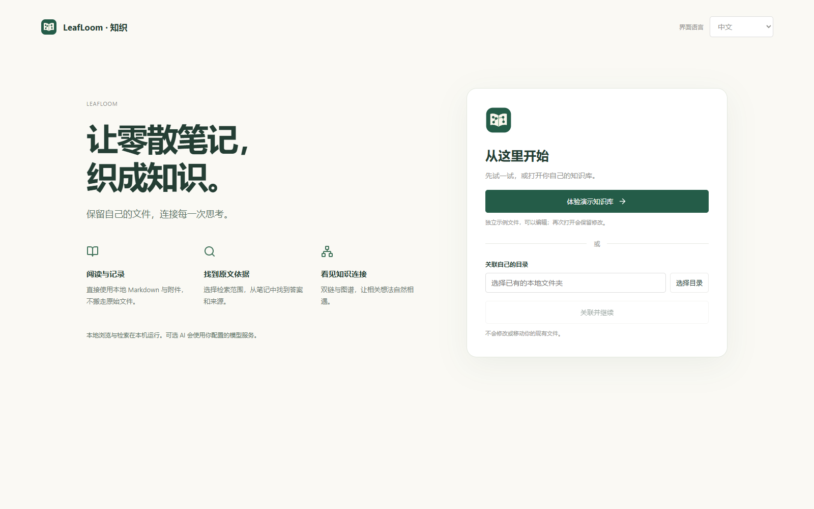
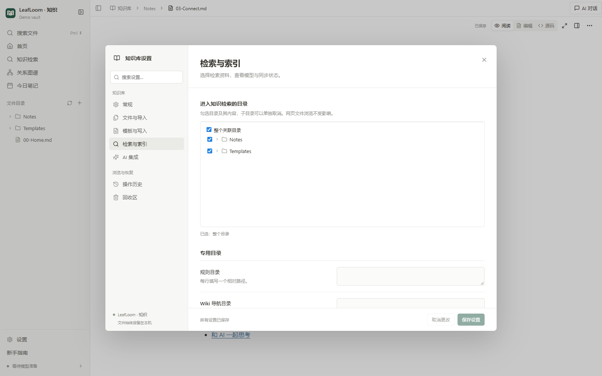
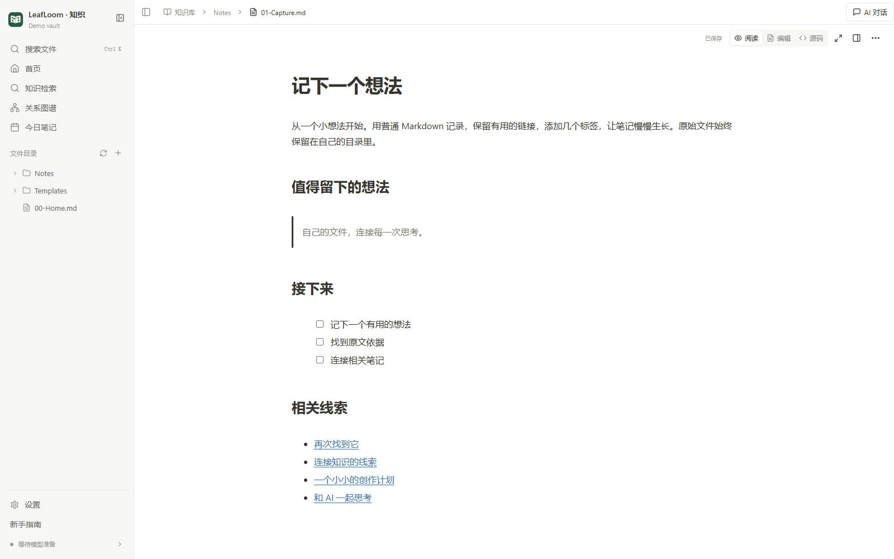
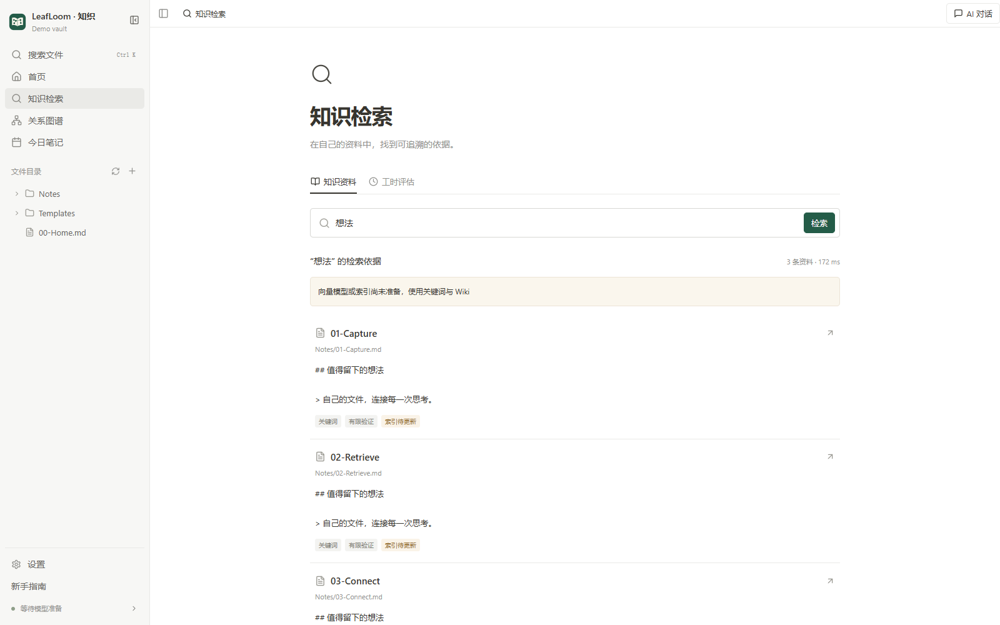
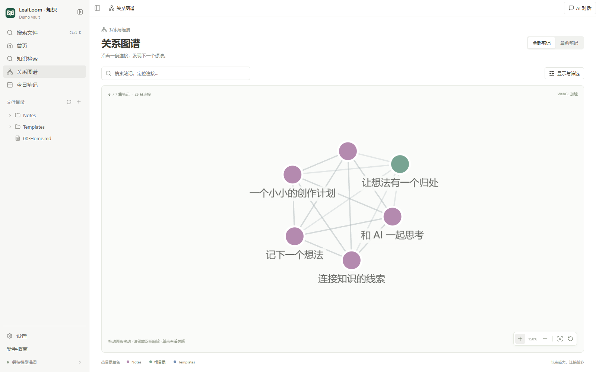

# 开始使用 LeafLoom · 知织

在 **设置 → Skill** 中安装或更新内置的 `wiki-search` 技能。

[English](../en/GUIDE.md) · [中文](GUIDE.md) · [日本語](../ja/GUIDE.md)

[全部文档](../README.md)

**开发者：** 在源码目录中，Windows 双击 `Dev.cmd`；macOS 14+ Apple 芯片双击 `Dev.command`，也可在终端运行 `sh Dev.sh`。若下载或复制后丢失执行权限，先运行一次 `chmod +x Dev.command Dev.sh`。两端也可运行 `node scripts/dev-desktop.cjs`。需要 Node 22+ 和 uv，首次启动自动安装依赖。桌面端直接运行源码，前端修改后自动更新，无需手动构建。Dev 与安装版完全共用用户配置、模型、凭据和桌面数据，后端沿用同一份配置中的端口（默认 18080）；只有开发依赖保存在 `.cache/desktop-dev/.venv`，Vite 使用 5173。切换前先退出当前应用；隔离验证时显式设置临时 `VAULT_RAG_HOME`。修改 Python/Electron 后从托盘退出并重新启动。详见[源码开发](../DESKTOP.md#source-development)。

**可选浏览器开发：** 按[双终端启动步骤](../DESKTOP.md#optional-browser-development)先在 `http://127.0.0.1:5173` 启动 Vite，再运行 `uv run --locked python scripts/dev-browser.py --home /tmp/leafloom-browser-dev --port 36229 --loopback-ui`，用专用浏览器 profile 打开输出的 `http://localhost:36229/`。必填的 home 须为新建／空目录或由此启动器标记过的目录；标记固定端口与界面模式，更改时使用全新目录及 profile。省略 `--loopback-ui` 则保留 `app.<installation-id>.localhost` 管理界面。真实运行时与后台工作正常启用，不自动下载模型或调用外部 AI。受影响的受管浏览器仍可能无法预览独立来源的 HTML 项目，请勿绕过安全警告。这是浏览器开发入口，不代表支持 Linux 桌面安装。

旧 Dev 配置保留在 `.cache/desktop-dev/` 中供恢复，不覆盖安装版配置。共享数据目录尚无 `models/` 时会复制复用旧模型并保留原文件；已有模型目录保持不变。

旧仓库启动入口已移除。安装版通过自己的快捷方式和菜单管理；开发时使用 Dev，通过开发实例自己的托盘／菜单栏退出，或在启动终端按 Ctrl+C。

## 安装与打开

[LeafLoom 官网](https://dj-huang.github.io/LeafLoom/zh-CN/) 提供中英日三语介绍、产品截图和各平台最新可用正式版安装包直达下载。按平台选择 Windows 或 Mac，旁边可查看版本说明与 SHA-256 校验文件；若新 Release 缺少某平台安装包，官网继续提供该平台最新可用正式版，并显示对应版本、说明和校验文件；仅在所有正式发布都没有该平台安装包时显示暂不可用。

官网的 About（关于）页面提供作者 GitHub 与 X 个人主页链接，可从顶部导航或页脚进入；切换语言时仍停留在关于页面。

支持 Windows 10/11 x64，以及 macOS 14+ Apple 芯片。桌面安装器暂不支持 Linux、Intel Mac 和 Windows ARM。

**推荐从 [最新 Release](https://github.com/DJ-Huang/LeafLoom/releases/latest) 下载桌面安装包。** 无需克隆仓库，也无需预装 Python、Node 或 Ollama。

1. **Windows：** 下载 Windows x64 的 `.exe`，运行安装程序，再从开始菜单或桌面快捷方式打开 LeafLoom。
2. **Mac：** 下载 macOS Apple 芯片的 `.dmg`，打开后将 LeafLoom 拖入「应用程序」，再启动应用。
3. 选择语言，体验内置演示库或关联自己的目录。阅读、编辑、图谱和关键词检索无需下载语义检索模型；需要时再在检索设置中准备 BGE-M3。

关闭窗口后，LeafLoom 留在托盘／菜单栏；选择 **退出** 才会停止应用及本地服务。新安装默认不开启登录启动，可在桌面设置或托盘中修改。更新时打开 **设置 → 常规 → 应用更新 → 检查更新**，查看当前与最新版本。有新版时选择 **下载并安装**，进度条显示百分比和已下载／总大小。SHA-256 校验通过后，应用正常退出（保留未保存草稿提示），再打开 Windows 安装向导或 Mac DMG；完成安装，Mac 将新版拖入“应用程序”，然后重新打开 LeafLoom。取消退出后可选择 **继续安装**；检查或下载失败可重试。Dev 仅检查版本，更新源码后重新运行 Dev。

服务仅监听本机 `127.0.0.1`，默认端口 `18080`。[桌面安装详情](../DESKTOP.md)包含安装要求与验证边界；开发者可查看[源码安装说明](../../README.md#get-started)。

维护者推送与项目版本一致的 `vX.Y.Z` 标签后，GitHub 会自动构建两个平台的安装包，并生成含 `SHA256SUMS.txt` 的 Release 草稿。检查 Actions 结果和草稿后手动发布；构建失败可重跑，已公开版本禁止覆盖。手动 **Run workflow** 只提供 Actions 附件下载。当前标签构建没有受信任发行签名（Mac 使用临时签名且未公证），系统仍可能提示或拦截。详见[构建、重试与发布步骤](../DESKTOP.md#automatic-release-drafts)。

## 选择语言与知识库

欢迎页默认跟随系统语言，不支持的语言回退英文。可选择中文、English 或日本語，之后在 **设置 → 常规 → 界面语言** 修改。切换语言保留文档、草稿与位置，不重建索引。

选择 **体验演示知识库**，先探索一套独立的虚构资料。可以编辑，重复打开保留修改；各语言的演示库互相独立。已有 Markdown/Obsidian 资料时，选择 **关联自己的目录**。原文件继续留在原处；这是文件编辑器，保存编辑会修改这些原文件。

## 明确选择检索范围

网页可浏览整个关联目录，知识检索只使用明确勾选的目录。可以选整个目录或指定子目录，也可以单独排除某个子目录。默认不勾选任何目录。**暂时只浏览** 表示知识检索暂时没有语料。

只索引 `.md` 和 `.txt`。图片、视频和附件可以浏览，但不会自动转写。隐藏或应用目录、`.ragignore` 排除项及已退出检索的笔记仍被排除。规则、主题导航和工时专用目录属于进阶设置，普通笔记无需配置。

## 阅读、记录、检索与连接

1. 从侧栏打开 Markdown 笔记即可直接编辑。正文保持阅读时的排版，**查看源码** 可切换到 Markdown 文本。普通编辑自动保存，发生冲突时保留草稿，核对后再合并。
2. 使用 **新建笔记** 记录想法。写下 `[[另一篇笔记]]` 建立连接。
3. `Ctrl/⌘+K` 按名称找文件；侧栏 **知识检索** 搜索笔记里的问题与关键词。
4. 点击检索结果打开原文，结合上下文和验证状态判断依据是否可靠。
5. 在 **关系图谱** 搜索笔记、筛选目录、沿连接探索。反向链接来自其他笔记对当前笔记的引用。
6. 首页清单可手动标记完成，也可关闭；侧栏 **新手指南** 可重新打开。

## 用命令快速编辑

在正文行首或空格后输入 `/`，可插入标题、列表、待办、引用、表格、代码、图片、链接、公式和 Mermaid 图表。菜单显示图标、用途说明、分类和最近使用；支持中文名称及 `/h2`、`/todo` 等别名，方向键选择、Enter 确认，Esc 关闭并保留输入。代码、公式、属性和网址中不会弹出菜单。

选中文字后使用浮动格式栏，或用 `Ctrl/⌘+B`、`Ctrl/⌘+I`、`Ctrl/⌘+E` 切换加粗、斜体和行内代码。选中文字后粘贴网址即可生成链接，也可用 `Ctrl/⌘+Shift+K` 输入链接。输入 `[[` 和笔记名，可按完整路径选择目标笔记。

悬停在块旁使用 **＋** 插入内容，点击手柄可转换、创建副本、移动或删除，拖动手柄可调整段落、列表项或完整块的位置。文字可跨段落选择；点击表格单元格直接输入，Tab 换格，末格 Tab 新增行，表格工具栏可增删行列、设置表头和对齐。支持粘贴截图和拖入文件；附件以唯一名称保存在笔记旁的 `attachments` 子目录，不覆盖已有文件。撤销链接不会删除附件，上传失败或取消后已完成的文件也会保留。

正文仍保存为普通 Markdown，未修改的块和文档属性保持原文；正文与源码共用撤销记录。公式和 Mermaid 默认显示渲染结果，通过各自面板修改。复杂或不支持直接编辑的内容保留展示，可定位到源码修改。切换界面语言保留当前编辑器及撤销历史。表格支持 Markdown 可表达的简单结构，不包含合并单元格和格内嵌套块。

## 打开 HTML 项目、网站与设计工作台

1. 从文件目录打开本地 `.html` 或 `.htm` 文件，确认 **项目文件夹** 后选择 **保存并打开**。文件夹应包含入口及全部配套资源；网页的 `/` 对应这个文件夹。留空表示使用关联知识库的根目录。
2. 在 **项目设置** 中修改目录，或为前端单页应用启用 **SPA 路由**。页面路由不存在时打开项目入口；缺失的脚本、图片和 JSON 仍会报错。
3. 网页工具栏提供后退、前进、刷新、全屏和 **独立标签页**。桌面应用在自身窗口内运行同一网站；浏览器与桌面应用的网站存储互相独立。
4. 侧栏选择 **网页 → 打开网址**，可打开已有 HTTP/HTTPS 网站或开发服务。LeafLoom 不安装依赖，也不启动网站后台；外部网站可能限制嵌入或要求登录。
5. 侧栏选择 **设计工作台**，或在目录右键选择 **在此新建设计项目**。新项目使用受管可视化文档；已有 `1.1.0` 项目保留原图层审阅能力，也可以转换为独立的可编辑副本。画布支持手游竖屏 `720×1560`、横屏 `1560×720`、桌面网页 `1440×900` 或自定义尺寸。

**源码** 可编辑 HTML 文本。普通编辑自动保存；仍有未保存草稿时，网页视图使用临时来源预览，不会因预览而保存文件。配套资源仍读取磁盘。HTML 的浏览不受检索勾选范围限制，也不会进入知识检索索引。

macOS 14/15 的 Safari 无法打开本机网页时，可在 **设置 → 常规 → Safari 本机网页兼容** 启用专属解析配置，系统会请求管理员授权。移除方式与平台边界见 [HTML 项目说明](../HTML_PROJECTS.md)。

旧的回环地址打开新版工作区地址时，会自动迁移本地草稿与视图状态。目标地址已有的值优先保留，发生冲突时可从横幅下载备份，原浏览器存储仍保留。这不是浏览器之间或浏览器与桌面应用之间的同步。

## 在设计工作台制作游戏画面

- 项目首页提供搜索、最近打开、收藏、重命名、复制、移动、归档与可恢复回收站。工作区撤销/重做处理项目管理，项目历史处理跨页面、关闭重开后的设计修改。
- 在 **页面** 中新增、分组、排序或复制画面；插入文字、图片、容器、按钮、形状、SVG、自定义 HTML、嵌入子页面，或 HUD、角色卡、图鉴、弹窗等游戏起步组件。点击图层、按住 Shift 多选，通过画布与属性面板调整位置、尺寸、角度、文字、外观及横排/竖排/网格布局。子页面和组件实例保留独立身份。
- 在 **素材** 中上传或粘贴图片，查看尺寸与透明信息，编辑名称、分类和标签，定位使用处，替换单张图片或全部引用。将组件、素材发布到个人共享库后可跨项目导入，更新版本需明确选择。依赖资源会复制到项目中，供离线使用；仍有引用的素材须先替换或移除使用处才能删除。
- **动画** 面板提供淡入、位移、缩放、弹跳、呼吸和旋转；**脚本与源码** 可为元素或页面编写 `mount(ctx)` JavaScript，并把参数暴露为属性控件。编辑时暂停脚本，可试播组件或整页交互，停止后恢复设计状态；日志可定位元素。代码和参数修改进入同一撤销历史。
- **添加到 AI 对话** 会携带元素稳定 ID 与当前版本。受管设计修改直接应用，一次 AI 批量指令对应一次撤销。`Ctrl/⌘+Z` 撤销，`Ctrl/⌘+Shift+Z` 重做，关闭重开仍有效。保存冲突保留待处理修改，请查看后再选择重新加载/重新应用。等待保存完成后导出，解压并连同配套文件打开 `index.html`。

- HTML 转换保留文档根上下文、混合文本和响应式图片候选。无法读取的外部样式表会被省略并提示，原始源码不变。视口/rem 单位及媒体查询仍使用渲染器环境。原始文本节点只提供内容编辑，布局和文字样式应选择父级调整。使用前请与原页面对照检查。

- 使用**选择**（`V`）和**抓手**（`H`）浏览画布，也可按住空格拖动。缩放百分比、加减按钮、适应页面（`Shift+1`）及适应选区（`Shift+2`）控制视图；Ctrl/⌘+滚轮围绕指针缩放。编辑时保留画布位置。**图层**中的容器可折叠，底部选中路径可返回父级；**布局**、**外观**和**文字排版**分组便于修改属性。独立画布连接失败时可重试，管理界面仍可显示已保存的图层和属性。
- **转换副本** 保留原项目，导入原生 DOM/CSS、文字与素材，并适配可识别的导航、设置开关和上下文页面状态。原脚本留在副本源码中，其他旧事件处理与运行状态需要补写新脚本；转换提示会列明范围，使用前对照原画面。完整命令、脚本 API、迁移限制和性能验收目标见 [Design Studio 说明](../DESIGN_STUDIO.md)。

设计项目的 **回收站** 支持恢复、**永久删除项目** 和 **清空项目回收站**。永久操作会列出项目并要求确认；项目文件、设计历史及相关项目管理撤销记录将移除，其他项目和共享库不受影响。

如果项目首页提示后台尚未加载项目管理功能，请从托盘／菜单栏退出应用后重新启动；只刷新页面不会加载新的后台接口。管理状态读取成功前，删除、移动等按钮暂不可用，可用“重试”重新连接。

## 日常使用与恢复

外部修改会自动检测。**刷新数据** 更新页面内容；浏览器刷新不会升级后台服务。设置中可切换知识库。删除进入回收区，可在 **设置 → 回收区** 恢复；**操作历史** 查看保存版本与文件操作。永久清空回收区后无法恢复。

本地文件与历史记录不是云备份，请用自己的备份工具保护资料。LeafLoom 不提供云同步，也不兼容所有 Obsidian 插件。

## 可选 AI

参阅 [AI 接入](AI.md)。浏览和本地检索无需 AI 订阅或 CLI。配置的外部模型服务可能接收所选内容。笔记的 AI 修改先进入可检查的草稿，需要手动保存；受管设计项目的 AI 修改直接应用，可从项目历史撤销。

## 可选飞书接入

1. 自行安装、配置并登录[官方 lark-cli](https://github.com/larksuite/cli)，凭据由 CLI 管理。
2. 打开 **设置 → AI 连接 → 飞书**，启用接入，可选填写原生可执行文件路径和 CLI profile，保存后点击 **验证连接**。路径留空自动检测。
3. 在 **MCP 访问权限** 中分别开启本机 AI 和 Tunnel 的飞书读取、写入。首次启用本机访问时复制专用连接配置；更新后端后刷新客户端工具清单。

4. 让 AI 先读取已安装 CLI 的帮助及内置 Skill，再通过通用读写工具操作文档、多维表格及其他业务。块级编辑支持 XML 标题和富文本结构；文档更新仍需要读取所得版本号。账号验证通过不代表对每个资源都有权限。
5. 高风险命令和原始 API 调用还需开启本机或 Tunnel 的独立“高风险操作”开关（默认关闭），并逐次明确确认。关闭读取或写入时，高风险权限也会关闭。
6. 附件使用临时文件 ID 分块上传下载；导入已关联目录中的现有文件还需笔记读取权限。升级后刷新工具列表：原四个文档／多维表格工具已替换为 CLI 发现、通用读写和文件传输。

同一 Tunnel 的不同聊天共用该 Tunnel 的已配置权限。LeafLoom 独立校验运行时内部身份，不受聊天连接凭据影响，切换聊天无需刷新权限或重连；关闭资源权限仍会立即撤销访问。

Dev 与安装版共用 Tunnel 配置和生命周期：启用后随应用启动，退出时停止；已有安装版时 Dev 复用其运行文件。共享目录只允许一个受管实例，不要再为同一连接手动运行独立 tunnel-client。MCP 鉴权错误会标明 `leafloom_mcp`，无需重新授权飞书。读取多维表格时应使用表列表返回的真实 ID，不直接采用链接中未经确认的 table 参数。

状态会区分未安装／不兼容、未配置、未登录、登录失效和网络异常。在外部完成配置或重新授权后再次验证。云端操作需要联网，按请求向调用的 AI 返回内容，不会自动导入或索引到本地知识库。详见[能力与限制](../FEISHU.md)。

## 常见问题

**搜不到资料？** 检查选中目录、扩展名和排除设置，再查看索引进度。语义模型或索引未准备时，会明确显示关键词/Wiki 降级；这不代表语义索引已经完成。

**开始使用前必须下载模型吗？** 不需要。桌面安装包内置私有运行环境，阅读、编辑、图谱和关键词检索无需 BGE-M3；需要语义检索时再从设置下载模型。源码安装另需准备开发依赖。

设置 → 搜索与索引和首次引导会持续显示模型准备的连接、下载、校验阶段，以及文件数、接收量、速度和已用时间。30 秒无新进度时会显示等待提示；失败后保留诊断详情并可重试。关闭设置后仍会在后台准备，可继续阅读；退出应用会中断。重试会尽量复用已有下载。模型文件就绪后，后续建索引有独立进度。

模型区域还显示实际保存路径，点击「打开目录」可在系统文件管理器中查看；目录不存在时会先创建空目录，不会触发模型下载。

**数据在哪里？** 笔记在关联目录，索引、历史和回收区位于其中的 `.vault-rag/`。配置、模型、令牌和 AI 历史位于 Windows 的 `%LOCALAPPDATA%\VaultRag` 或 macOS 的 `~/Library/Application Support/VaultRag`。可用 `VAULT_RAG_HOME` 指定私有目录。

**可以离线使用吗？** 桌面应用安装后，本地阅读、编辑、图谱和关键词检索可以离线使用；语义检索还需先准备本地模型。外部 AI 的联网需求由服务商决定。

**白屏或更新没生效？** 完成网页构建与安装，重启服务，再刷新浏览器。检查日志和端口冲突。仅重新打开浏览器不会加载新服务器代码。

**支持网络目录吗？** 桌面端使用本机目录；拒绝 UNC 共享和符号链接/junction 访问，以保证操作留在关联目录内。

**如何卸载？** 先退出 LeafLoom，再通过 Windows 系统设置卸载，或在 Mac 的「应用程序」中移除应用。笔记、配置、索引和模型会保留。旧版源码服务可在对应环境运行 `vault-rag service uninstall`；不再需要的数据请自行确认后删除。

## 让 AI 访问完整笔记与设计项目

在 **设置 → AI 连接** 中，为本机 AI 或 ChatGPT 开启完整 MCP 读取，再分别开启写入开关，即可直接保存并保留历史、使用可恢复删除。可编辑关联目录内的 Markdown/TXT/HTML 与设计项目。受管项目使用 `design_document`、`design_operations`、`design_history` 及素材导入、共享库、导出工具；六个旧设计工具继续可用。RAG 仍只使用勾选范围，旧连接保持原有五项只读能力。详见 [AI 接入](AI.md)、[工具契约](../MCP.md)与[Design Studio 说明](../DESIGN_STUDIO.md)。

Dev 与安装版使用同一个 MCP 地址和权限配置（通常为 `http://127.0.0.1:18080/mcp`）。升级服务或更新专用凭据后，重新加载本地客户端连接，并刷新 ChatGPT 插件工具。旧会话可能仍缓存兼容凭据；除工具清单外，还应检查 `vault_index_status.capabilities` 是否为当前连接的完整读写权限。

## 从 FORMA 模板开始

打开 **设计项目 → 新建设计项目**，选择 **FORMA · 编辑式工作室**，输入项目名称和新的文件夹名称。预览展示模板的编辑式布局；创建后直接打开包含四个桌面/手机画板、328 个原生图层的独立可编辑项目。文字、布局、颜色、交互和原创 CSS 图形均可正常编辑保存，素材随程序打包，无需外链下载。已有文件夹会被拒绝而不会覆盖，请换一个文件夹名称。每次创建都有独立的项目身份和历史，修改不会影响内置模板或其他副本。
