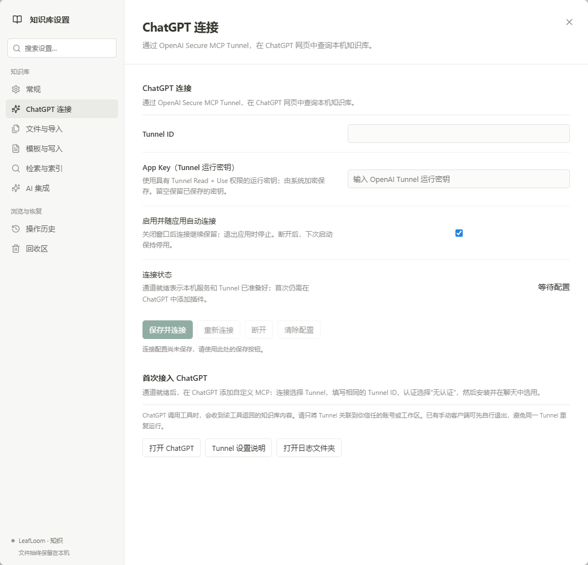
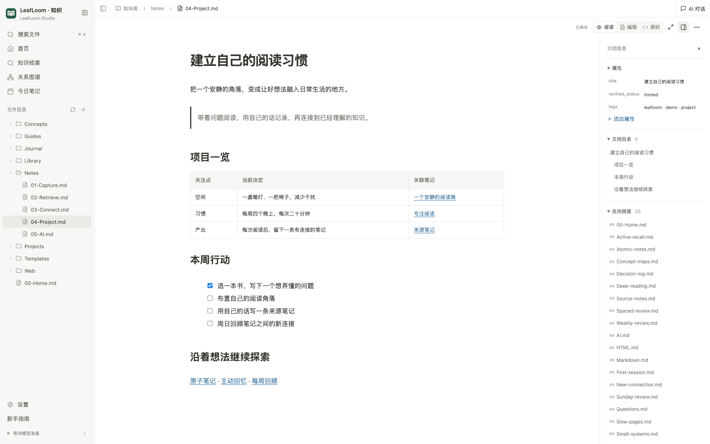
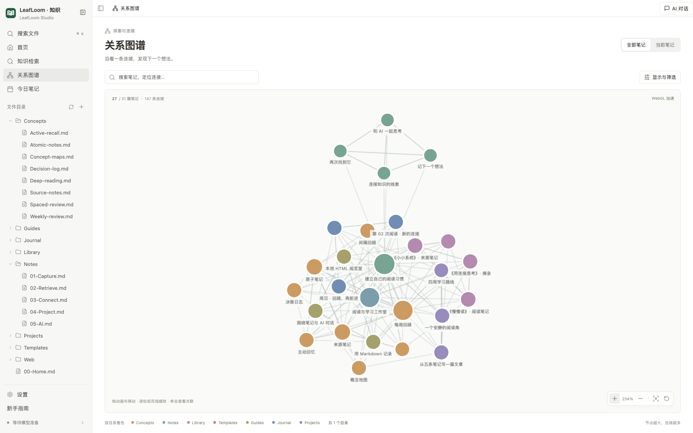
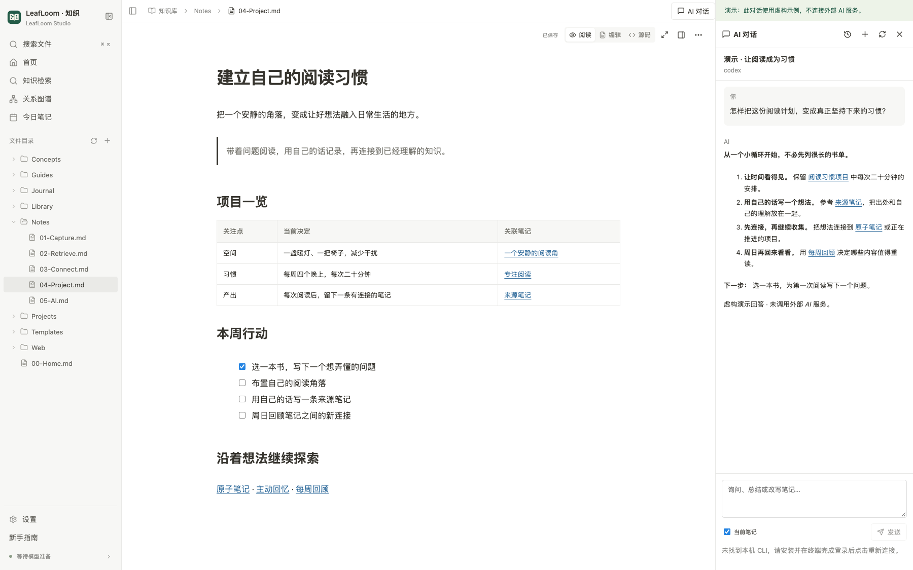
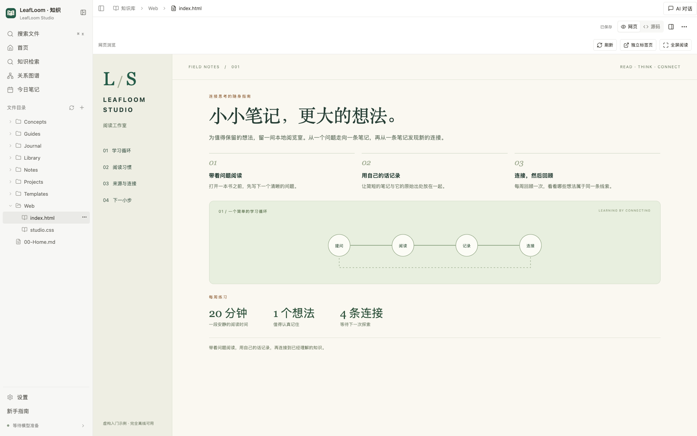

<p align="center"></p>

# LeafLoom · 知织

**让知识留在本地，让 AI 用上你的知识。**

[English](../../README.md) · [中文](../../docs/zh-CN/README.md) · [日本語](../../docs/ja/README.md)

让零散笔记、项目文档和收藏网页，成为查得到、连得起、用得上的知识。**LeafLoom 是开源、本地优先的知识库管理工具与个人 Wiki**，支持 Markdown 与 HTML，集成来源可追溯的检索、知识图谱、MCP、Skill、AI Chat 和 ChatGPT 连接。

文件和检索索引保存在自己的电脑上。日常阅读、记录与检索在本地完成；需要 AI 时，再把知识带进对话。

**[下载 Windows 安装包](https://github.com/DJ-Huang/LeafLoom/releases/latest) · [下载 Mac 安装包](https://github.com/DJ-Huang/LeafLoom/releases/latest)**

[开始使用](#开始使用) · [连接 ChatGPT](#在-chatgpt-中使用本地知识库) · [MCP、Skill 与 AI Chat](#ai-connections) · [新手指南](GUIDE.md) · [文档目录](../README.md)


## 给你的知识，一个自己的家

| 你需要的 | LeafLoom 带来的 |
| --- | --- |
| **越用越有价值的知识库** | 用双链、反向链接、模板与知识图谱，把笔记、研究资料和项目文档组织成个人 Wiki。 |
| **自己掌控的隐私** | 文件与索引留在本机，检索目录由你选择，无需把知识库托管到云端。 |
| **Markdown + HTML** | 用 Markdown 记录表格、任务和想法；在同一工作区打开带有样式、图片和受支持脚本的本地 HTML 网页。 |
| **找得到，也追得回原文** | 结合关键词检索、Wiki 导航与可选的本地 BGE-M3 语义检索，从结果直接回到原始笔记。 |
| **完整的 AI 工作流** | 接入 MCP 客户端，安装内置 `wiki-search` Skill，或在笔记旁打开 AI Chat；内置对话先审阅，授权后的 MCP 可直接保存并保留历史。 |
| **ChatGPT 也能用你的知识** | 桌面端内置 Tunnel 客户端，在 ChatGPT 对话中检索、读取本地笔记。 |

整理个人资料、搭建项目 Wiki、积累阅读笔记，或给 AI 助手一份有据可查的知识来源，都可以从自己的文件夹开始。

## 知识留在本地，分享由你决定

- **资料就在自己的文件夹里。** 浏览、编辑、图谱和本地检索不向托管知识库上传笔记。完成依赖和所需模型的初次准备后，这些功能可以离线使用。
- **检索范围由你选择。** 默认不索引任何目录；本地服务仅监听本机，文件访问限制在关联目录内。
- **AI 按需连接。** AI Chat 可能向所选服务发送问题、选文、已启用的笔记上下文和检索依据；使用 ChatGPT 连接时，请求的工具结果会发送给 ChatGPT。

[了解本地存储、访问边界与 AI 隐私](../SECURITY.md)

## 在 ChatGPT 中使用本地知识库

**让 ChatGPT 带着你的知识回答。** 在 ChatGPT 网页对话中选择 LeafLoom，即可检索已选择的目录、读取笔记，并沿着来源继续交流。运行 LeafLoom 的电脑需要保持联网、应用保持运行。在设置中启用完整笔记访问及独立写入开关后，可让 ChatGPT 创建、编辑、整理和恢复笔记；RAG 继续使用原有勾选范围。

[打开 ChatGPT](https://chatgpt.com/) · [前往 ChatGPT 插件页添加连接](https://chatgpt.com/plugins) · [官方 Tunnel 接入指南](https://developers.openai.com/api/docs/guides/secure-mcp-tunnels)


*上图为 Chat 使用场景示意；下方设置页来自实际桌面应用。*

### 配置一次，随应用自动连接

1. 在 LeafLoom 桌面应用中打开 **设置 → ChatGPT 连接**，填写已有的 **Tunnel ID** 和具有 **Tunnels Read + Use** 权限的 **App Key**，点击 **保存并连接**。客户端已内置，无需另外下载、编写配置文件或打开终端。
2. 在 ChatGPT 中添加自定义 MCP，连接方式选择 **Tunnel**，填写同一 Tunnel ID，认证选择 **无认证**。安装连接后，在对话中选择 **LeafLoom**。Tunnel 需要关联到目标 ChatGPT 工作区，该工作区需允许自定义 MCP 连接；详见[官方接入指南](https://developers.openai.com/api/docs/guides/secure-mcp-tunnels)。
3. 试着问：“找到与这个主题有关的笔记，并列出来源。”先在 LeafLoom 中选择检索目录；默认不索引任何目录。



App Key 由操作系统加密保存。连接随应用启动，关闭窗口留在托盘时继续运行，退出应用时停止。点击 **断开** 会停用自动连接，直到再次启用。笔记保存在自己的电脑上；调用工具时，请求的结果会发送给 ChatGPT。

[桌面安装与连接详情](../DESKTOP.md#chatgpt-connection) · [平台验证与当前限制](../TUNNEL_VALIDATION.md)

<a id="ai-connections"></a>

## MCP、Skill 与 AI Chat

在熟悉的工具里使用自己的知识，并随时核对原文依据。

| 连接方式 | 可以怎么用 |
| --- | --- |
| **MCP** | 将 Codex、Cursor、Claude Code 等客户端接入本地 HTTP MCP：`http://127.0.0.1:18080/mcp`（默认端口）。启用完整访问后可查找、创建、编辑、整理和恢复关联笔记；RAG 保持勾选范围，写入默认关闭。 |
| **Skill** | 在 **设置 → AI 集成 → 安装技能** 中安装内置的 [`wiki-search` Skill](../../wiki-search/SKILL.md)，引导兼容的 AI 助手完成检索、Wiki 导航与来源核对；MCP 连接需另行配置。 |
| **AI Chat** | 连接受支持、已登录的 CLI，围绕当前笔记或选文对话，打开回答中的引用。先预览修改差异，接受到草稿后再决定何时保存。 |

[配置 AI Chat、MCP 与 Skill](AI.md)

## 看见知识工作台

首次启动时点击「体验演示知识库」，即可打开内置的[阅读与学习工作室](../../vault_rag/examples/zh-CN)。示例包含相互连接的笔记、本地 HTML 阅览室，以及项目、阅读和决策模板。可以直接修改，再次打开会保留已有编辑。

### Markdown 文档：从阅读到记录

直接在排版后的正文中编辑，用 `/` 命令插入内容、拖动块、修改表格、粘贴截图或拖入附件。正文与 Markdown 源码共用撤销历史，未修改原文和属性保持不变；普通编辑自动保存，AI 草稿手动保存。参阅 [Markdown 编辑指南](GUIDE.md#用命令快速编辑)。



### 知识图谱：沿着连接发现线索

沿着反向链接，找回一个决策背后的想法；打开图谱，发现曾经忽略的关联。示例展示知识卡片、项目、阅读资料和学习日志之间的真实链接。



### AI Chat：围绕当前笔记展开思考

把原文与对话放在一起，从回答中的引用回到关联笔记。图中对话明确标注为虚构演示，未调用外部 AI。



### HTML 预览：把本地网页也放进知识库

打开本地 `.html`、`.htm` 文件，确认一次项目文件夹，即可运行带有配套样式、脚本和资源的网站。支持网页导航、下载与可选 SPA 路由，也可从侧栏「网页」打开已有 HTTP/HTTPS 网站或开发服务。参阅 [HTML 项目指南](GUIDE.md#打开-html-项目与网站)。下图的 HTML 阅览室已包含在演示库中。



## 开始使用

**推荐直接安装 [最新 Release](https://github.com/DJ-Huang/LeafLoom/releases/latest) 中的桌面应用。** 无需克隆仓库，也无需预装 Python、Node 或 Ollama。

| 系统 | 下载 | 安装方式 |
| --- | --- | --- |
| Windows 10/11 x64 | [Windows 安装包](https://github.com/DJ-Huang/LeafLoom/releases/latest) · `.exe` | 运行安装程序，完成后从开始菜单或桌面快捷方式打开 LeafLoom。 |
| macOS 14+ · Apple 芯片 | [Mac 安装包](https://github.com/DJ-Huang/LeafLoom/releases/latest) · `.dmg` | 打开磁盘映像，将 LeafLoom 拖入「应用程序」，再启动应用。 |

选择语言，体验内置演示库或打开自己的目录，再选择检索范围。默认不索引任何目录；可以先浏览，需要语义检索时再在设置中准备本地模型。

[详细安装要求与平台验证说明](../DESKTOP.md)

<details>
<summary>从源码启动（供开发使用）</summary>

```sh
git clone https://github.com/DJ-Huang/LeafLoom.git
cd LeafLoom
```

1. 下载或克隆仓库到可写的本机目录，完整解压。
2. Windows 10/11 x64：双击 `Start.cmd`。 macOS 14+ Apple 芯片：在仓库目录运行 `sh Start.sh`。
3. 首次准备私有运行环境和依赖后打开工作区；检索模型在设置中按需准备，无需预装 Python、Node 或 Ollama。
4. 选择语言，体验虚构演示库或关联自己的目录，再明确选择检索范围。

</details>

[📖 新手指南与常见问题](GUIDE.md) · [✨ AI 接入](AI.md)

## 三种语言

用熟悉的 **中文、English 或日本語** 开始。界面、新手引导、使用指南和功能截图覆盖三种语言；语言偏好独立保存，不改变索引设置。

**自己的知识，自己部署，自己掌控。** 在受支持的电脑上自主运行，使用仅本机访问、私有身份校验与目录边界保护。[部署与安全](../SECURITY.md)。

## 能力与边界

阅读、编辑、图谱和关键词检索无需模型；需要本地语义检索时，再在设置中准备 BGE-M3。外部 AI 和 ChatGPT 需要各自的账号、权限与网络连接。

桌面安装器支持上方平台；不提供云同步、通用 Obsidian 插件兼容或媒体转写。

## 更新与参与

**桌面应用：** 退出 LeafLoom，从 [Releases](https://github.com/DJ-Huang/LeafLoom/releases/latest) 下载对应系统的新版安装包，安装后重新打开。

**源码安装：** 更新仓库后运行 `Install.cmd` 或 `sh Install.sh` 并重启服务。仅刷新浏览器不会更新服务器代码。

[Contributing](../../CONTRIBUTING.md) · [Changelog](../../CHANGELOG.md) · [Third-party notices](../../THIRD_PARTY_NOTICES.md) · [Media](../../docs/MEDIA.md)

MIT © 2026 DJ。依赖和模型保留各自许可。 [License](../../LICENSE)

Technical compatibility: `vault-rag`, `VAULT_RAG_HOME`, `.vault-rag/`, HTTP MCP `/mcp`.
